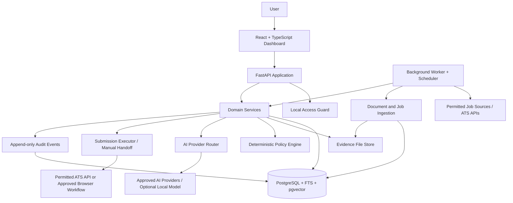
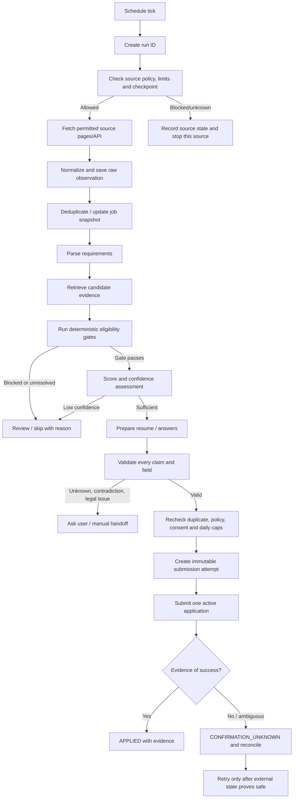

# JobPilot — System Architecture

**Status:** Overall architecture remains proposed. Foundation 1 implements and locally tests only the compensation-preference backend slice; PostgreSQL and broader product behavior remain unverified.

## 1. Design goals

1. Correct, traceable workflows before volume.
2. Local-first operation and explicit user control over personal data.
3. Simple deployment now, with clear seams for later worker and storage separation.
4. Separate deterministic policy code from probabilistic AI interpretation.
5. Never let model output perform a consequential action directly.
6. Every job, candidate fact, decision, document version, provider call and external attempt has an identity and history.
7. Avoid infrastructure that has no measured need.

## 2. Architectural style

Use a **modular monolith**: one FastAPI application organized into domain modules, a single PostgreSQL database, a frontend application, and a dedicated background worker process that runs the same codebase. Docker Compose launches these services locally. The worker is a separate process for failure isolation and long tasks, not a separate microservice with a separate domain API.

Start with a database-backed job/task table or a small supported scheduler mechanism. Do not introduce Redis/Celery solely because they are familiar. Add a queue broker only when measured throughput, retry semantics, concurrent workers, or workload isolation require one. Keep the scheduling interface and task contracts broker-neutral.

## 3. High-level architecture



### Core boundary

The policy engine is deterministic and authoritative. AI may extract, classify, summarize, compare evidence, or draft content. It cannot authorize itself to bypass a gate, alter rules, fill secrets, accept legal commitments, or claim that submission succeeded.

## 4. Runtime components

### 4.1 Web frontend

React + TypeScript + Vite. Views: overview, job inbox, job detail/match explanation, candidate evidence, application editor, application timeline, run/source health, settings, model usage, questions needing user input, export/import, system diagnostics.

The frontend communicates only with the local API. It must not hold provider API keys or perform direct provider calls. It renders server-provided statuses and structured gate reasons; it does not compute final eligibility itself.

### 4.2 API application

FastAPI endpoints for configuration, profile/evidence, jobs, match assessments, application preparation, approval, user answers, run status, provider telemetry, and export/import. Use Pydantic schemas at all boundary points. Domain logic belongs in services/policies rather than route handlers.

### 4.3 Scheduler and worker

The scheduler is timezone-aware and records each run. Default local schedule: 10:00, 17:00 and 22:00 Asia/Kolkata. At most one active run per source/checkpoint and one active external submission. The worker:

- scans candidate document directories;
- performs permitted source discovery;
- normalizes/deduplicates jobs;
- parses changed evidence and job descriptions;
- runs matching and preparation jobs;
- sends notifications or explicitly approved application emails;
- reconciles interrupted/uncertain application attempts;
- records checkpoints only after the source run has completed successfully to a defined completeness level.

Use bounded concurrency, source-specific rate limiters, job leases/locking, deadlines and cancellation. A task must be safe to resume. If the worker dies, tasks move to recoverable states instead of being silently retried as external side effects.

### 4.4 Persistence

PostgreSQL holds canonical application state, user settings, job records, source observations, application attempts, audit events, provider usage and structured facts. Enable PostgreSQL full-text search for lexical retrieval. Use `pgvector` only for embedding retrieval after selecting a compatible model and validating the desired vector dimension; tag every embedding with model and dimension metadata.

Original files live on a controlled local filesystem volume with content hashes and version metadata. The database stores metadata and references, not arbitrary unlimited binary blobs. A future object storage adapter may replace the local store without rewriting domain services.

### 4.5 AI provider router

A provider-neutral interface supports task-specific model candidates, structured-output requirements, privacy classification, per-provider rate limits, quota tracking, timeout budgets, bounded retries, fallbacks, cost controls, and telemetry. Provider adapters must normalize responses and errors; no domain code should depend on a provider-specific SDK directly.

Provider selection must consider both task quality and data permissions. A lower-cost or free provider is not automatically suitable for private candidate documents. Paid fallback is off until the user explicitly configures and approves a budget.

### 4.6 Submission executor

A narrow tool interface accepts only a previously approved, immutable `SubmissionPlan` containing a job identity, target method, exact documents/answers, validated field map, policy evaluation ID and consent record. The executor must not accept arbitrary model-generated URLs, JavaScript, shell commands, headers, or instructions.

Source adapters are separate from generic browser automation. Prefer a documented, permitted source API where appropriate. If browser automation is permitted and necessary, use a documented Playwright workflow, site-specific selectors, visible state checks, bounded retries, and confirmation evidence. A click is an attempted action, not success evidence.

## 5. Job lifecycle flow



## 6. Candidate document flow

1. Detect file state (path, size, mtime, hash); do not trust mtime alone.
2. Register a new immutable file version and preserve original bytes.
3. Determine content type using extension plus file signature where practical.
4. Extract text/structure with a format-specific adapter; OCR is a separately measured path.
5. Produce raw parser output and structured candidate facts with provenance and confidence.
6. Validate fact types and dates; detect conflicts with existing accepted facts.
7. Store extracted candidates without overwriting verified facts automatically.
8. On user verification, record accepted fact and verification history.
9. Chunk and embed eligible text if embeddings are enabled; record model/version/dimension.
10. Invalidate only the dependent caches and retrieval representations.

A file removal from the watched directory does not automatically erase historical evidence already used in applications. Mark it as removed from the active set; retain historical versions according to retention settings unless the user explicitly requests deletion and legal/backup constraints are considered.

## 7. Matching and retrieval flow

1. Normalize a job into structured requirements: mandatory, preferred, responsibilities, location, work type, compensation, sponsorship and declarations.
2. Retrieve candidate evidence using lexical search and semantic search when configured. Use exact skill coverage as an additional independent signal.
3. Fuse rankings using Reciprocal Rank Fusion (RRF) rather than directly adding incomparable raw BM25 and cosine scores. RRF constant and candidate pool size are configuration/versioned decisions; `k=60` is a conventional starting proposal, not a proven optimum.
4. Evaluate every mandatory qualification in deterministic policy code using evidence-backed states.
5. Compute match score and confidence separately. Similarity is not proof that a qualification is met.
6. Produce explanations linking each positive/negative claim to a candidate fact or job requirement.
7. Run calibration and regression tests before modifying weights/prompts/models.

## 8. Proposed folder and file structure

The current code is intentionally smaller than this future structure: root `pyproject.toml`/`uv.lock`; `backend/app/{api,db,domain,services}`; `backend/migrations/`; and `backend/tests/{unit,integration}`. `frontend/` remains empty. ADR-0008 records the concrete schema and local request guard for this first slice.

```text
jobpilot/
├── README.md
├── pyproject.toml
├── uv.lock                         # or the selected single lockfile; do not keep multiple conflicting locks
├── .env.example                    # variable names only; no real secrets
├── .gitignore
├── compose.yaml
├── compose.override.yaml           # optional local-only overrides
├── compose.production.yaml          # only if a remote host is later supported
├── docs/
│   ├── project-requirements-document.md
│   ├── architecture.md
│   ├── rules.md
│   ├── phases.md
│   ├── design.md
│   ├── memory.md
│   ├── data-model.md
│   ├── ai-spec.md
│   ├── application-safety-policy.md
│   ├── job-discovery-sources.md
│   ├── api-spec.md
│   ├── security-privacy.md
│   ├── testing-evaluation.md
│   ├── operations-deployment.md
│   ├── export-import.md
│   ├── observability-and-cost.md
│   └── decisions/
├── backend/
│   ├── alembic.ini                 # package dependencies and uv.lock are owned at root
│   ├── migrations/
│   │   ├── env.py
│   │   └── versions/
│   └── app/
│       ├── main.py                 # app factory and ASGI entry point
│       ├── core/
│       │   ├── config.py
│       │   ├── logging.py
│       │   ├── errors.py
│       │   ├── security.py
│       │   ├── clock.py
│       │   └── ids.py
│       ├── api/
│       │   ├── deps.py
│       │   ├── schemas/
│       │   └── routes/
│       ├── db/
│       │   ├── base.py
│       │   ├── session.py
│       │   └── models/
│       ├── domain/
│       │   ├── candidates/
│       │   ├── evidence/
│       │   ├── jobs/
│       │   ├── matching/
│       │   ├── applications/
│       │   ├── answers/
│       │   ├── sources/
│       │   ├── providers/
│       │   ├── exports/
│       │   └── audit/
│       ├── services/
│       │   ├── orchestration.py
│       │   ├── document_sync.py
│       │   ├── matching_service.py
│       │   └── application_service.py
│       ├── adapters/
│       │   ├── ats/
│       │   ├── browser/
│       │   ├── documents/
│       │   ├── email/
│       │   ├── llm/
│       │   └── storage/
│       ├── policies/
│       │   ├── eligibility.py
│       │   ├── compensation.py
│       │   ├── deduplication.py
│       │   ├── consent.py
│       │   ├── legal_declarations.py
│       │   └── submission.py
│       ├── tasks/
│       │   ├── scheduler.py
│       │   ├── worker.py
│       │   └── registry.py
│       └── prompts/                # versioned prompt templates; no secrets or user data
├── frontend/
│   ├── package.json
│   ├── vite.config.ts
│   ├── tsconfig.json
│   └── src/
│       ├── app/
│       ├── components/
│       ├── features/
│       │   ├── dashboard/
│       │   ├── jobs/
│       │   ├── evidence/
│       │   ├── applications/
│       │   ├── settings/
│       │   ├── usage/
│       │   └── history/
│       ├── api/
│       ├── hooks/
│       ├── styles/
│       └── types/
├── data/                            # runtime-mounted only; do not commit
├── scripts/
│   ├── doctor.py
│   ├── backup.py
│   ├── restore.py
│   └── validate_export.py
└── tests/
    ├── unit/
    ├── integration/
    ├── contract/
    ├── browser/
    ├── evaluation/
    ├── fixtures/
    └── security/
```

Keep one canonical dependency/lock strategy and avoid duplicating dependency manifests unless repository packaging requires a workspace. `data/`, user documents, local databases, exports, credentials and logs must be excluded from version control.

## 9. Proposed stack and rationale

| Layer | Proposed choice | Reason | Trade-off / scaling path |
|---|---|---|---|
| Language | Python 3.12+ (pin exact supported version in project) | Strong AI/document integration and typing | Validate every critical dependency against chosen Python version |
| API | FastAPI + Pydantic | Typed request boundaries, generated API schema | Avoid domain logic in routes |
| DB access | SQLAlchemy 2.x + Alembic | Mature relational modeling and migrations | Use one DB session per unit of work/task; do not share async sessions concurrently |
| Database | PostgreSQL | Transactional state, durable job history, FTS | External managed PostgreSQL is a future deployment choice |
| Vector search | pgvector, if evaluation supports it | One database and transactional provenance | Start exact search; add HNSW only after recall/latency benchmark |
| Frontend | React + TypeScript + Vite | Fast local dashboard development and type-safe contracts | Keep server state in a query/cache layer only where needed |
| Browser | Playwright | Browser automation with explicit visibility and state checks | Restrict domains/actions; browser automation remains source-policy-dependent |
| Scheduling | Small scheduler + DB-backed run/lease records | Adequate for one user and three daily runs | Move to broker/queue after evidence of need |
| Containers | Docker Compose | Reproducible local deployment | One-host deployment first; remote setup needs hardened config/auth/TLS |
| Tests | pytest, frontend test stack, Playwright tests | Unit, integration, and browser coverage | Separate deterministic correctness from LLM evaluation |

### Database vector dimension

Never hard-code a presumed embedding model dimension before selecting and probing the actual model. Store model ID, provider, dimension, content hash and version. Different dimensions/model spaces must not be compared. Use migrations or a separate embedding table keyed by model when multiple vector spaces are needed.

## 10. Scaling strategy

### Stage 1 — local single-user

- One frontend, one API, one worker/scheduler, one PostgreSQL container, local evidence volume.
- Conservative rate limits, one active application submission.
- No Redis, no Kubernetes, no multi-tenant abstractions.

### Stage 2 — more sources and larger evidence corpus

- Source-specific worker concurrency and leases.
- Add partial indexes, query-plan review, bounded pagination, efficient incremental embedding.
- Use pgvector approximate indexing only if exact retrieval fails a measured latency/scale target; benchmark recall and filtered queries.
- Separate large files into a storage abstraction; consider object storage for remote deployment.

### Stage 3 — always-on host

- Compose production overlay, reverse proxy/TLS, authentication, restricted network, secret manager, monitored backups, non-root containers, resource limits, and deployment rollback.
- Never expose unauthenticated local control endpoints to the internet.
- Consider managed PostgreSQL and encrypted object storage.

### Stage 4 — multi-user / high throughput (not currently scoped)

- Explicit tenancy/isolation model, per-user data keys and quotas, worker broker, deployment orchestration, stronger audit/administrative boundaries, and privacy/legal review.
- Reassess architecture before undertaking this; do not assume one-user design safely becomes a SaaS by simply exposing the port.

## 11. Key technical risks and spikes

Before production automation, run focused spikes for: source terms/capabilities, ATS form stability, PDF/DOCX extraction quality, local secret storage, pgvector model selection and retrieval performance, submission reconciliation, and backup restore. Record results in ADRs and `memory.md`.

## 12. External technical references

- PostgreSQL full-text search: https://www.postgresql.org/docs/current/textsearch.html
- pgvector indexing and vector types: https://github.com/pgvector/pgvector
- SQLAlchemy ORM: https://docs.sqlalchemy.org/en/20/orm/
- SQLAlchemy asyncio safety considerations: https://docs.sqlalchemy.org/en/20/orm/extensions/asyncio.html
- Docker Compose production guidance: https://docs.docker.com/compose/how-tos/production/
- Greenhouse Job Board API: https://docs.greenhouse.io/job-board.html
- Lever Postings API: https://github.com/lever/postings-api
- Ashby Job Postings API: https://developers.ashbyhq.com/docs/public-job-posting-api
- Playwright: https://playwright.dev/docs/intro

Verify live docs, terms, versions and permissions at implementation time.
