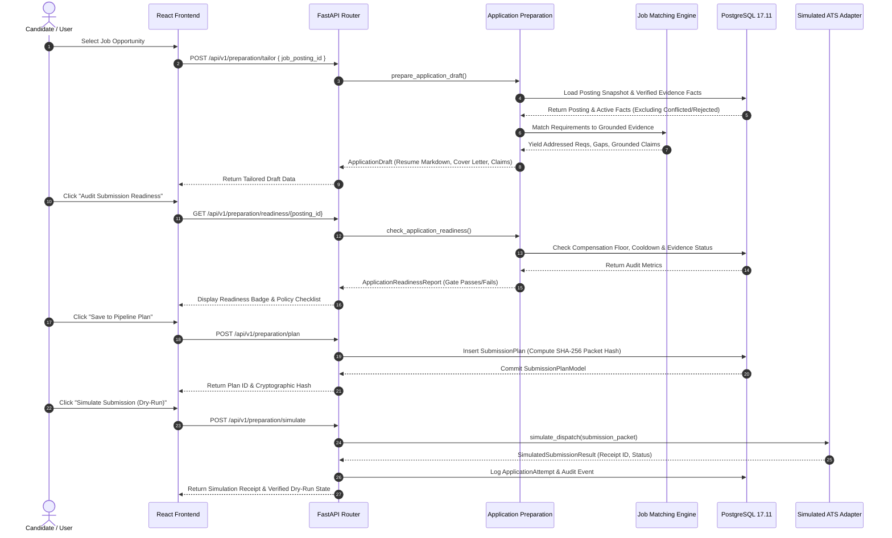

# Hire-Steward — Data Flow Architecture

**Product:** Hire-Steward / JobPilot  
**Scope:** End-to-End Data Transformation, Persistence Lifecycle, and Invariant Verification  

---

## 1. End-to-End Discovery to Application Flow

---

## 2. Ingestion & Evidence Grounding Data Flow

1. **Document Ingestion:**
   - Candidate uploads file (PDF, DOCX, TXT, CSV, XLSX) via UI.
   - Server computes SHA-256 hash of binary content (`CandidateDocumentBlob`).
   - Content-addressed deduplication ensures identical files are stored only once.
2. **Text Parsing & Fact Extraction:**
   - Text is parsed into clean Unicode NFC normalized strings.
   - Candidate facts (`CandidateFact`) are linked to source documents via `CandidateFactEvidence` storing exact `byte_start` and `byte_end` offsets.
3. **Verification State Lifecycle:**
   - Facts start in `UNREVIEWED` or `DOCUMENT_SUPPORTED` state.
   - User reviews and confirms facts to transition them to `USER_VERIFIED`.
   - Conflicted facts are flagged as `CONFLICTED` and strictly excluded from positive claims in tailored resumes.
   - Rejected or superseded facts are permanently excluded from application materials.

---

## 3. Policy Gating & Safety Data Flows

- **Hard Compensation Floor Gate (R-01):**
  - If a job's salary range is below the candidate's configured floor, or if compensation assessment outcome is `BLOCKED`, submission is barred.
- **Employer Cooldown Gate (R-06):**
  - Query existing active applications (`SUBMITTED`, `INTERVIEWING`, `ACCEPTED`) for the same employer subscription.
  - If an active application exists within the cooldown window, submission is blocked.
- **Evidence Verification Gate (R-03, R-04):**
  - Application readiness check ensures zero conflicted facts and alerts candidate on unreviewed claims prior to submission.
