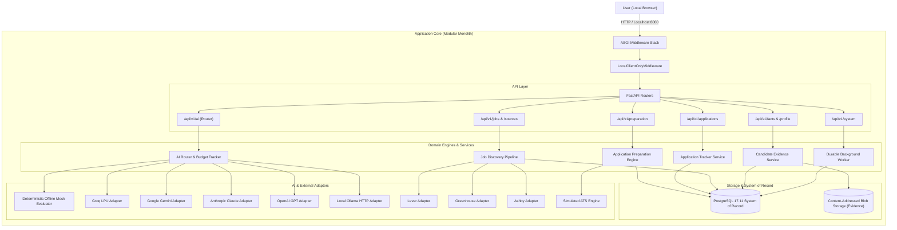

# Hire-Steward — System Architecture Specification

**Product:** Hire-Steward / JobPilot  
**Architecture Style:** Typed Modular Monolith with Local-First Single Page Application  
**Runtime:** Python 3.12+ (FastAPI, SQLAlchemy, Alembic, Pydantic v2) + Node.js (React 18, TypeScript Strict, Vite)  
**Database:** PostgreSQL 17.11 (Production `jobpilot_workspace`, Test `jobpilot_test`)  

---

## 1. System Context & Overview

Hire-Steward is an autonomous, private, user-controlled job discovery and application preparation workbench. It is engineered with strict local-first privacy guarantees: zero automatic external data transmission, deterministic policy gates, and local verification before any submission action.

---

## 2. Core Architectural Principles

1. **Modular Monolith:** Single, highly cohesive codebase with strictly typed boundaries and clear separation of concerns (Domain, Service, Adapter, Route).
2. **PostgreSQL as Source of Truth:** Relational schema with strict foreign keys, check constraints, and declarative migrations via Alembic.
3. **Loopback-Only Security Boundary:** Requests are strictly restricted to local loopback addresses (`127.0.0.1`, `::1`). Public network listeners or remote CORS origins are blocked pre-routing.
4. **Deterministic Policy Gates:** Crucial candidate policies (such as minimum compensation floors, cooldown intervals, and evidence truthfulness) are hard-coded deterministic invariants. No probabilistic LLM or third-party estimate is ever permitted to authorize submission.
5. **Double-Blind Evaluation:** Multi-model assessment engine with PII masking, provenance audit logging, and attempt fencing to prevent late response contamination.

---

## 3. Subsystem Breakdown

### 3.1 Frontend (React 18 + TypeScript Strict + Vite)
- **Design System:** Bespoke JobPilot Design System (Navy `#0f172a`, Slate `#475569`, Emerald `#059669`, Amber `#d97706`).
- **Layout Architecture:** Dedicated `.main-content` single-container vertical scrolling. Eliminates nested overflow traps and functions cleanly at 100% browser zoom across viewports.
- **State Management:** Reactive component hooks with typed API client (`frontend/src/api/client.ts`).
- **Static Asset Serving:** Compiled production distribution served by FastAPI with `Cache-Control: no-cache, must-revalidate, max-age=0` to prevent stale asset issues.

### 3.2 Backend Service Layer
- **Candidate Profile & Evidence:** Manages candidate identity, skills, experiences, and document versions with byte-span provenance mapping.
- **Job Discovery:** Polls and normalizes postings from Lever, Greenhouse, Ashby, and manual intake. Deduplicates using SHA-256 payload hashes.
- **Job Matching:** Multi-category deterministic requirement evaluation (Mandatory, Core, Preferred) with keyword and semantic scoring.
- **Application Preparation:** Synthesizes tailored resumes, cover letters, and recruiter outreach notes citing only verified candidate facts.
- **Submission Plans:** Generates immutable application packets with cryptographic SHA-256 signatures before simulated or manual handoff.
- **Durable Background Task Worker:** Relational queue tracking tasks, worker heartbeats, and run execution records with zero external queue dependencies (Celery/Redis not required).

### 3.3 Provider Abstraction & Security
- **Credential Storage:** Keys loaded from environment (`HIRE_STEWARD_*_API_KEY`) wrapped in Pydantic `SecretStr` to prevent leakage in stack traces or logs.
- **Budget Tracking:** Pre-dispatch liability reservation enforcing a hard $5.00 spend ceiling.
- **Pluggable Transports:** Adapters support custom `httpx.BaseTransport` for 100% offline unit and integration testing without external network egress.
