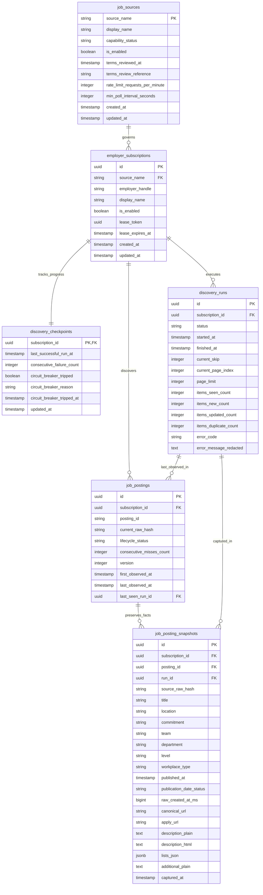

# Hire-steward — Job Discovery Data Model Specification

- **Status:** Proposed Design (Revised with Final Integrity & Lease Fencing Corrections; No Implementation)
- **Date:** 2026-10-28
- **Scope:** Defines the persistent relational data model to evolve the offline job-discovery vertical slice into a reliable, crash-safe, local-first discovery workflow.

---

## 1. Architectural Principles and Invariants

Hire-steward operates as a personal, local-first assistant on behalf of an individual job seeker. The persistence design reflects the following foundational principles:

1. **PostgreSQL as System of Record:** Relational integrity, check constraints, composite foreign keys, and atomic transactions enforce all invariants at the database level.
2. **Separation of Concerns:**
   - *Source Registry:* Global source capability, authorization, and rate-limiting policy.
   - *User Configuration:* User-managed employer boards and enabled/disabled status.
   - *Execution State & Checkpoints:* Ephemeral run logs, pagination cursors, and circuit breakers.
   - *Canonical Job Entity:* High-level vacancy identity, lifecycle status, and observation counters.
   - *Immutable Content Snapshots:* Change-triggered snapshots preserving the exact facts used for matching and assessment decisions.
3. **Historical Assessment Integrity:** Every field that may influence matching, compensation/eligibility evaluation, or application preparation is captured inside an immutable snapshot (`job_posting_snapshots`). Subsequent assessments link directly to the immutable snapshot ID, ensuring historical evaluations permanently retain their exact underlying facts even if an employer later alters the vacancy.
4. **Strict Relational Acyclicity (No Circular Foreign Keys):** The schema forms a strict directed acyclic graph (DAG). There are zero circular foreign keys:
   - `employer_subscriptions` does *not* reference `discovery_runs`.
   - `job_postings` does *not* reference `job_posting_snapshots`.
   - `discovery_checkpoints` does *not* reference `discovery_runs`.
   The current snapshot is resolved deterministically via the cryptographic content hash (`current_raw_hash`).
5. **Cross-Subscription Referential Integrity (Composite Foreign Keys):** To prevent cross-subscription data corruption at the database level:
   - `job_postings` references `discovery_runs` via composite key `(last_seen_run_id, subscription_id)`.
   - `job_posting_snapshots` references `job_postings` via composite key `(posting_id, subscription_id)` and `discovery_runs` via `(run_id, subscription_id)`.
   This mathematically prevents a posting or snapshot from referencing a discovery run belonging to a different employer subscription.
6. **Lease Ownership, Fencing, and Wall-Clock Time:** Concurrency is governed by an optimistic lease on `employer_subscriptions`. Every page-write transaction acquires an explicit row-level lock (`FOR UPDATE`) and validates lease ownership and expiry using wall-clock time (`clock_timestamp()`). Transaction-start timestamps (`NOW()`) are strictly insufficient because `NOW()` does not advance during lock acquisition waits. A runner that loses its lease is strictly fenced and cannot commit data.
7. **User-Configuration Timestamp Preservation:** Lease renewals and heartbeats update `lease_expires_at` exclusively; they do not touch `employer_subscriptions.updated_at`, preserving the semantic integrity of candidate-initiated configuration changes.
8. **Multi-Layer Source Activation Gate:** The schema check constraint (`is_enabled = TRUE` requires approved status) acts solely as defense-in-depth. Programmatic polling is strictly governed by a runtime authorization service that verifies persistent capability approval, global enablement, terms review references, and local subscription state before issuing requests. Sources in `NEEDS_REVIEW` (such as Lever) remain hard-blocked.
9. **Conservative Lifecycle Reopening:** Disappearance from a public listing feed never proves vacancy closure. Postings transition to `REMOVED` only after multiple consecutive successful runs omit them. Ordinary rediscovery reactivates `REMOVED` and `STALE` postings, but **never** silently reactivates a `CLOSED_CONFIRMED` posting.
10. **Restrictive Deletion & Immutability:** Deletion semantics use `ON DELETE RESTRICT`. Historical snapshots cannot be deleted via cascading posting deletes. Application-level immutability is enforced by insert-only repository patterns and database-level trigger guards. Automatic pruning remains deferred.

---

## 2. Entity-Relationship Model (Acyclic DAG with Composite Keys)



---

## 3. Table and Field Definitions

### 3.1 `job_sources`
- **Purpose & Ownership:** System-managed reference registry of all supported job board sources, tracking capability states, terms reviews, and global rate limits.
- **Classification:** Authoritative system configuration.

| Column | Type | Nullable | Constraints & Defaults | Description |
| :--- | :--- | :--- | :--- | :--- |
| `source_name` | `VARCHAR(32)` | NO | Primary Key | Machine-safe source identifier (e.g. `'lever'`, `'greenhouse'`, `'ashby'`). |
| `display_name` | `VARCHAR(64)` | NO | None | Human-readable source label (e.g. "Lever Postings API"). |
| `capability_status` | `VARCHAR(24)` | NO | Default `'NEEDS_REVIEW'` | Review status: `'NEEDS_REVIEW'`, `'VERIFIED_READ_ONLY'`, `'MANUAL_ONLY'`, `'BLOCKED'`, `'DISABLED_BY_USER'`. |
| `is_enabled` | `BOOLEAN` | NO | Default `FALSE` | Global toggle. Enforced by check constraint: cannot be `TRUE` unless `capability_status = 'VERIFIED_READ_ONLY'`. |
| `terms_reviewed_at` | `TIMESTAMPTZ` | YES | None | Timestamp of last legal/terms review. |
| `terms_review_reference`| `VARCHAR(256)` | YES | None | Reference or link to documentation/ADR justifying review state. |
| `rate_limit_requests_per_minute` | `INTEGER` | NO | Default `10` | Conservative global rate ceiling for this source. |
| `min_poll_interval_seconds` | `INTEGER` | NO | Default `43200` | Minimum interval between polls per employer (12 hours per ADR-0012). |
| `created_at` | `TIMESTAMPTZ` | NO | Server default `NOW()` | Record creation timestamp. |
| `updated_at` | `TIMESTAMPTZ` | NO | Server default `NOW()` | Record modification timestamp. |

**Table Constraints & Indexes:**
- `pk_job_sources`: `PRIMARY KEY (source_name)`
- `ck_job_sources_status`: `CHECK (capability_status IN ('NEEDS_REVIEW', 'VERIFIED_READ_ONLY', 'MANUAL_ONLY', 'BLOCKED', 'DISABLED_BY_USER'))`
- `ck_job_sources_active_gate`: `CHECK ((is_enabled = TRUE AND capability_status = 'VERIFIED_READ_ONLY') OR (is_enabled = FALSE))`
- `ck_job_sources_rate_positive`: `CHECK (rate_limit_requests_per_minute > 0 AND min_poll_interval_seconds >= 60)`

#### 3.1.1 Source Terms-Review Freshness Policy (365-Day Ceiling)
- **Freshness Rule & Rationale:** Hire-Steward enforces a maximum 365-day internal validity ceiling on `terms_reviewed_at`. If `(wall_clock - terms_reviewed_at) > 365 days`, discovery is immediately blocked with `SourceTermsReviewStaleError`. This freshness limit is an internal project safety policy to force regular human reassessment of third-party platform terms, robots.txt directives, and API constraints; it is **not** a claim that any law or external authority requires annual review.
- **Future Timestamps Rejected:** Any timestamp where `terms_reviewed_at > wall_clock` is rejected as invalid/corrupted review evidence (`SourceTermsReviewStaleError`).
- **Fail-Closed on Missing/Stale Evidence:** Discovery cannot proceed if `terms_reviewed_at` is null, if `terms_review_reference` is missing, or if the review is older than 365 days.
- **Independent Authorization Gate:** A valid review timestamp is a necessary prerequisite, but **does not by itself authorize discovery or establish permission**. Live requests additionally require `capability_status = 'VERIFIED_READ_ONLY'`, `is_enabled = TRUE`, and active candidate subscription consent.
- **Earlier Review Triggers:** Material changes to employer board structures, vendor terms modifications, or robots.txt restrictions mandate immediate review prior to the 365-day expiry.
- **Zero Live Access Authorization:** This policy does not grant live access to Lever or any other platform. Lever remains `NEEDS_REVIEW` and globally disabled (`is_enabled = FALSE`).

---

### 3.2 `employer_subscriptions`
- **Purpose & Ownership:** Candidate-managed employer job boards to monitor. Represents the user-configured boundary (no global crawler).
- **Classification:** Authoritative candidate settings.

| Column | Type | Nullable | Constraints & Defaults | Description |
| :--- | :--- | :--- | :--- | :--- |
| `id` | `VARCHAR(36)` | NO | Primary Key (UUIDv4) | Unique subscription identifier. |
| `source_name` | `VARCHAR(32)` | NO | FK to `job_sources.source_name` | Associated job board source. |
| `employer_handle` | `VARCHAR(128)` | NO | Validated handle pattern | Employer identifier (e.g. `'example-corp'`). |
| `display_name` | `VARCHAR(128)` | YES | None | Candidate-assigned friendly company name. |
| `is_enabled` | `BOOLEAN` | NO | Default `TRUE` | User-controlled active toggle. |
| `lease_token` | `VARCHAR(36)` | YES | UUIDv4 | Concurrency lock token held by an active runner. |
| `lease_expires_at` | `TIMESTAMPTZ` | YES | None | Expiration timestamp for runner lease (default 10 min). |
| `created_at` | `TIMESTAMPTZ` | NO | Server default `NOW()` | Subscription creation timestamp. |
| `updated_at` | `TIMESTAMPTZ` | NO | Server default `NOW()` | Records user-initiated configuration changes. **Not mutated by lease heartbeats.** |

**Table Constraints & Indexes:**
- `pk_employer_subscriptions`: `PRIMARY KEY (id)`
- `fk_subscriptions_source`: `FOREIGN KEY (source_name) REFERENCES job_sources(source_name) ON DELETE RESTRICT`
- `uq_employer_subscriptions_identity`: `UNIQUE (source_name, employer_handle)`
- `ck_subscriptions_handle_format`: `CHECK (employer_handle ~ '^[a-z0-9][a-z0-9_-]{0,127}$' AND employer_handle NOT IN ('.', '..'))`
- `ck_subscriptions_lease_pair`: `CHECK ((lease_token IS NULL AND lease_expires_at IS NULL) OR (lease_token IS NOT NULL AND lease_expires_at IS NOT NULL))`
- `ix_subscriptions_pollable`: `INDEX (is_enabled, source_name)`

*(Note: `current_run_id` is removed to eliminate circular references with `discovery_runs`).*

---

### 3.3 `discovery_checkpoints`
- **Purpose & Ownership:** Durable progress and circuit breaker state for each employer subscription. 1:1 relationship with `employer_subscriptions`.
- **Classification:** Derived execution metadata.

| Column | Type | Nullable | Constraints & Defaults | Description |
| :--- | :--- | :--- | :--- | :--- |
| `subscription_id` | `VARCHAR(36)` | NO | Primary Key, FK | Subscription identifier. |
| `last_successful_run_at` | `TIMESTAMPTZ` | YES | None | Completion time of last run that ended with `status = 'SUCCEEDED'`. |
| `consecutive_failure_count`| `INTEGER` | NO | Default `0` | Consecutive failed runs counter for circuit breaker. |
| `circuit_breaker_tripped` | `BOOLEAN` | NO | Default `FALSE` | Set to `TRUE` after 3 consecutive failures. |
| `circuit_breaker_reason` | `VARCHAR(64)` | YES | None | Reason code (e.g. `'RATE_LIMIT_429'`, `'AUTH_BLOCKED_403'`). |
| `circuit_breaker_tripped_at`| `TIMESTAMPTZ` | YES | None | Timestamp when circuit breaker tripped. |
| `updated_at` | `TIMESTAMPTZ` | NO | Server default `NOW()` | Checkpoint modification timestamp. |

**Table Constraints & Indexes:**
- `pk_discovery_checkpoints`: `PRIMARY KEY (subscription_id)`
- `fk_checkpoints_subscription`: `FOREIGN KEY (subscription_id) REFERENCES employer_subscriptions(id) ON DELETE CASCADE`
- `ck_checkpoints_failures_nonneg`: `CHECK (consecutive_failure_count >= 0)`
- `ck_checkpoints_cb_consistency`: `CHECK ((circuit_breaker_tripped = FALSE AND circuit_breaker_reason IS NULL AND circuit_breaker_tripped_at IS NULL) OR (circuit_breaker_tripped = TRUE AND circuit_breaker_reason IS NOT NULL AND circuit_breaker_tripped_at IS NOT NULL))`

---

### 3.4 `discovery_runs`
- **Purpose & Ownership:** Immutable audit log and ephemeral pagination cursor of every polling attempt for an employer subscription.
- **Classification:** Observed execution event history.

| Column | Type | Nullable | Constraints & Defaults | Description |
| :--- | :--- | :--- | :--- | :--- |
| `id` | `VARCHAR(36)` | NO | Primary Key (UUIDv4) | Unique run execution identifier. |
| `subscription_id` | `VARCHAR(36)` | NO | FK to `employer_subscriptions.id` | Target employer subscription. |
| `status` | `VARCHAR(28)` | NO | Default `'PENDING'` | Lifecycle: `'PENDING'`, `'RUNNING'`, `'SUCCEEDED'`, `'FAILED'`, `'INTERRUPTED'`, `'SKIPPED_CONCURRENT_LEASE'`. |
| `started_at` | `TIMESTAMPTZ` | NO | Server default `NOW()` | Execution start timestamp. |
| `finished_at` | `TIMESTAMPTZ` | YES | None | Execution termination timestamp. |
| `current_skip` | `INTEGER` | NO | Default `0` | Pagination offset reached (`skip`). |
| `current_page_index` | `INTEGER` | NO | Default `0` | Page index reached (0, 1, 2...). |
| `page_limit` | `INTEGER` | NO | Default `100` | Requested page limit (bounded `1 <= page_limit <= 100`). |
| `items_seen_count` | `INTEGER` | NO | Default `0` | Total posting instances received. |
| `items_new_count` | `INTEGER` | NO | Default `0` | New unique postings discovered. |
| `items_updated_count` | `INTEGER` | NO | Default `0` | Postings with modified content hash. |
| `items_duplicate_count` | `INTEGER` | NO | Default `0` | Postings with unchanged content hash. |
| `error_code` | `VARCHAR(64)` | YES | None | Error classification code on failure or skip. |
| `error_message_redacted`| `TEXT` | YES | None | Redacted error description (free of credentials/tokens). |

**Table Constraints & Indexes:**
- `pk_discovery_runs`: `PRIMARY KEY (id)`
- `fk_discovery_runs_subscription`: `FOREIGN KEY (subscription_id) REFERENCES employer_subscriptions(id) ON DELETE RESTRICT`
- `uq_discovery_runs_id_subscription`: `UNIQUE (id, subscription_id)` *(Required target for composite FKs)*
- `ck_discovery_runs_status`: `CHECK (status IN ('PENDING', 'RUNNING', 'SUCCEEDED', 'FAILED', 'INTERRUPTED', 'SKIPPED_CONCURRENT_LEASE'))`
- `ck_discovery_runs_page_limit`: `CHECK (page_limit >= 1 AND page_limit <= 100)`
- `ck_discovery_runs_skip_nonneg`: `CHECK (current_skip >= 0 AND current_page_index >= 0)`
- `ck_discovery_runs_counts_nonneg`: `CHECK (items_seen_count >= 0 AND items_new_count >= 0 AND items_updated_count >= 0 AND items_duplicate_count >= 0)`
- `ck_discovery_runs_termination`: `CHECK ((status IN ('SUCCEEDED', 'FAILED', 'INTERRUPTED', 'SKIPPED_CONCURRENT_LEASE') AND finished_at IS NOT NULL) OR (status IN ('PENDING', 'RUNNING') AND finished_at IS NULL))`
- `ix_discovery_runs_sub_started`: `INDEX (subscription_id, started_at DESC)`

---

### 3.5 `job_postings`
- **Purpose & Ownership:** Canonical local identity and current lifecycle state of a discovered job posting.
- **Classification:** Authoritative canonical vacancy state.

| Column | Type | Nullable | Constraints & Defaults | Description |
| :--- | :--- | :--- | :--- | :--- |
| `id` | `VARCHAR(36)` | NO | Primary Key (UUIDv4) | Unique internal posting identifier. |
| `subscription_id` | `VARCHAR(36)` | NO | FK to `employer_subscriptions.id` | Origin subscription. Identifies source and employer without redundant fields. |
| `posting_id` | `VARCHAR(128)` | NO | Validated posting ID | Source-provided posting identifier. |
| `current_raw_hash` | `CHAR(64)` | NO | Lowercase hex SHA-256 | Hash of latest parsed payload. Resolves the active snapshot. |
| `lifecycle_status` | `VARCHAR(24)` | NO | Default `'ACTIVE'` | State: `'ACTIVE'`, `'REMOVED'`, `'STALE'`, `'UNKNOWN'`, `'CLOSED_CONFIRMED'`. |
| `consecutive_misses_count`| `INTEGER` | NO | Default `0` | Number of consecutive successful runs omitting this posting. |
| `version` | `INTEGER` | NO | Default `1` | Incremented on each content change. |
| `first_observed_at` | `TIMESTAMPTZ` | NO | Server default `NOW()` | When this posting was first seen. |
| `last_observed_at` | `TIMESTAMPTZ` | NO | Server default `NOW()` | Most recent time seen in an active feed. |
| `last_seen_run_id` | `VARCHAR(36)` | NO | Composite FK to `discovery_runs` | Run in which it was most recently observed. |

**Table Constraints & Indexes:**
- `pk_job_postings`: `PRIMARY KEY (id)`
- `fk_job_postings_subscription`: `FOREIGN KEY (subscription_id) REFERENCES employer_subscriptions(id) ON DELETE RESTRICT`
- `uq_job_postings_identity`: `UNIQUE (subscription_id, posting_id)`
- `uq_job_postings_id_subscription`: `UNIQUE (id, subscription_id)` *(Required target for composite FKs)*
- `fk_job_postings_run_composite`: `FOREIGN KEY (last_seen_run_id, subscription_id) REFERENCES discovery_runs(id, subscription_id) ON DELETE RESTRICT`
- `ck_job_postings_posting_id`: `CHECK (posting_id ~ '^[A-Za-z0-9][A-Za-z0-9._-]{0,127}$')`
- `ck_job_postings_hash_format`: `CHECK (current_raw_hash ~ '^[0-9a-f]{64}$')`
- `ck_job_postings_lifecycle`: `CHECK (lifecycle_status IN ('ACTIVE', 'REMOVED', 'STALE', 'UNKNOWN', 'CLOSED_CONFIRMED'))`
- `ck_job_postings_misses_nonneg`: `CHECK (consecutive_misses_count >= 0)`
- `ck_job_postings_version_positive`: `CHECK (version >= 1)`
- `ix_job_postings_sub_status`: `INDEX (subscription_id, lifecycle_status)`
- `ix_job_postings_last_observed`: `INDEX (last_observed_at DESC)`

---

### 3.6 `job_posting_snapshots` (Immutable Assessment Baseline)
- **Purpose & Ownership:** Content-addressed, immutable versions of job posting bodies and decision-relevant metadata. A new row is written **only** when a posting is first discovered or when its content hash changes.
- **Classification:** Observed immutable source evidence.

| Column | Type | Nullable | Constraints & Defaults | Description |
| :--- | :--- | :--- | :--- | :--- |
| `id` | `VARCHAR(36)` | NO | Primary Key (UUIDv4) | Unique snapshot identifier. Referenced by assessments. |
| `subscription_id` | `VARCHAR(36)` | NO | Composite FK to `employer_subscriptions` | Subscription identifier enforcing cross-entity isolation. |
| `posting_id` | `VARCHAR(36)` | NO | Composite FK to `job_postings` | Target canonical posting (`ON DELETE RESTRICT`). |
| `run_id` | `VARCHAR(36)` | NO | Composite FK to `discovery_runs` | Run capturing this version (`ON DELETE RESTRICT`). |
| `source_raw_hash` | `CHAR(64)` | NO | Lowercase hex SHA-256 | Content hash of the posting payload. |
| `title` | `VARCHAR(500)` | NO | None | Snapshot job title. |
| `location` | `VARCHAR(256)` | YES | None | Location text at time of observation. |
| `commitment` | `VARCHAR(64)` | YES | None | Commitment (e.g. "Full-time"). |
| `team` | `VARCHAR(128)` | YES | None | Team identifier. |
| `department` | `VARCHAR(128)` | YES | None | Department identifier. |
| `level` | `VARCHAR(64)` | YES | None | Seniority/level string. |
| `workplace_type` | `VARCHAR(64)` | YES | None | Work arrangement (e.g. "remote"). |
| `published_at` | `TIMESTAMPTZ` | YES | None | Publication timestamp (required non-null if `EXACT`, null otherwise). |
| `publication_date_status`| `VARCHAR(16)` | NO | Default `'UNKNOWN'` | Status: `'EXACT'`, `'UNKNOWN'`, `'INVALID'`. |
| `raw_created_at_ms` | `BIGINT` | YES | None | Preserved millisecond epoch from source. |
| `canonical_url` | `VARCHAR(2048)` | YES | Safe HTTPS URL | Canonical job posting URL. |
| `apply_url` | `VARCHAR(2048)` | YES | Safe HTTPS URL | Direct application handoff URL. |
| `description_plain` | `TEXT` | NO | None | Clean plain text derived for search/matching. |
| `description_html` | `TEXT` | YES | Untrusted source data | Raw source HTML (untrusted, strictly sanitized before browser display). |
| `lists_json` | `JSONB` | NO | Default `'[]'::jsonb` | Structured bullet list sections (`PostingListSection`). |
| `additional_plain` | `TEXT` | YES | None | Additional closing plain text. |
| `captured_at` | `TIMESTAMPTZ` | NO | Server default `NOW()` | Timestamp when this snapshot was created. |

**Table Constraints & Indexes:**
- `pk_job_posting_snapshots`: `PRIMARY KEY (id)`
- `fk_snapshots_posting_composite`: `FOREIGN KEY (posting_id, subscription_id) REFERENCES job_postings(id, subscription_id) ON DELETE RESTRICT`
- `fk_snapshots_run_composite`: `FOREIGN KEY (run_id, subscription_id) REFERENCES discovery_runs(id, subscription_id) ON DELETE RESTRICT`
- `uq_snapshots_posting_hash`: `UNIQUE (posting_id, source_raw_hash)`
- `ck_snapshots_title_nonempty`: `CHECK (length(trim(title)) > 0)`
- `ck_snapshots_hash_format`: `CHECK (source_raw_hash ~ '^[0-9a-f]{64}$')`
- `ck_snapshots_pub_status`: `CHECK (publication_date_status IN ('EXACT', 'UNKNOWN', 'INVALID'))`
- `ck_snapshots_pub_exact`: `CHECK ((publication_date_status = 'EXACT' AND published_at IS NOT NULL) OR (publication_date_status IN ('UNKNOWN', 'INVALID') AND published_at IS NULL))`
- `ix_snapshots_posting_captured`: `INDEX (posting_id, captured_at DESC)`

---

## 4. Lease Ownership, Fencing, and Concurrency Lifecycle

```mermaid
sequenceDiagram
    autonumber
    participant Runner as Discovery Worker
    participant Sub as employer_subscriptions
    participant Run as discovery_runs
    participant Post as job_postings
    participant Snap as job_posting_snapshots
    participant Chk as discovery_checkpoints

    Runner->>Run: Create audit record (status='PENDING', page_limit=100)
    Runner->>Sub: Atomic Lease Acquisition (UPDATE ... WHERE unclaimed OR expired)
    alt Lease Acquisition Fails (Rowcount == 0)
        Runner->>Run: UPDATE status='SKIPPED_CONCURRENT_LEASE', finished_at=NOW(), error_code='LEASE_ACTIVE'
        Note over Runner: Persists terminal audit record; performs NO network requests, NO posting/snapshot mutations, NO checkpoint advancement
    else Lease Acquired (Rowcount == 1)
        Runner->>Run: UPDATE status='RUNNING'

        loop Bounded Page Loop
            Runner->>Runner: Fetch & Parse Page from ATS Source
            rect rgb(240, 248, 255)
                Note over Sub,Snap: Fenced Page Transaction
                Runner->>Sub: Lock Row: SELECT lease_token, lease_expires_at ... FOR UPDATE
                alt Lock Acquired & (token != runner_token OR lease_expires_at <= clock_timestamp())
                    Note over Runner: Fencing validation fails! ROLLBACK transaction; raise LeaseFencingError; halt runner immediately
                else Fencing Validated
                    Runner->>Snap: INSERT INTO job_posting_snapshots (if new hash)
                    Runner->>Post: Upsert job_postings (current_raw_hash, last_seen_run_id)
                    Runner->>Run: UPDATE current_skip, item counts
                    Note over Sub,Snap: COMMIT Page Transaction (releases row lock)
                end
            end
            Runner->>Sub: Lease Renewal: UPDATE lease_expires_at = clock_timestamp() + 10m WHERE lease_token=:token
        end

        alt Run Complete & Verified
            rect rgb(235, 255, 235)
                Note over Chk,Sub: Completion Transaction
                Runner->>Sub: Lock Row: SELECT ... FOR UPDATE & validate lease
                Runner->>Post: Absence Check: increment consecutive_misses_count for omitted ACTIVE postings
                Runner->>Run: UPDATE status='SUCCEEDED', finished_at=NOW()
                Runner->>Chk: UPDATE last_successful_run_at=NOW(), consecutive_failure_count=0
                Runner->>Sub: Release Lease (lease_token=NULL, lease_expires_at=NULL)
            end
        else Fatal Feed Error Encountered
            rect rgb(255, 235, 235)
                Note over Chk,Sub: Fail-Closed Transaction
                Runner->>Run: UPDATE status='FAILED', error_code, finished_at=NOW()
                Runner->>Chk: Increment consecutive_failure_count (trip CB if >= 3)
                Runner->>Sub: Release Lease
            end
        end
    end
```

### 4.1 Wall-Clock Time vs. Transaction-Start Timestamps in PostgreSQL
In PostgreSQL, `NOW()` (and `CURRENT_TIMESTAMP`, `transaction_timestamp()`) returns the start timestamp of the current transaction. It remains frozen and **does not advance during statement execution or while waiting to acquire a row lock** (see [PostgreSQL Date/Time Functions](https://www.postgresql.org/docs/17/functions-datetime.html)).

If a transaction begins and waits 15 seconds to acquire a row lock held by another process:
- `NOW()` still evaluates to the timestamp before the wait began.
- If the runner's lease expired during that 15-second wait, checking `lease_expires_at >= NOW()` could falsely evaluate to `TRUE`.
- Therefore, post-lock expiry validation **must use `clock_timestamp()`**, which returns true wall-clock time advancing in real time.

### 4.2 Atomic Initial Lease Acquisition
Newly created subscriptions have `lease_token IS NULL AND lease_expires_at IS NULL`. When acquiring a lease, the runner must atomically handle both unclaimed and expired subscriptions without overwriting an active unexpired lease held by another runner:

```sql
UPDATE employer_subscriptions
SET lease_token = :new_token,
    lease_expires_at = clock_timestamp() + INTERVAL '10 minutes'
WHERE id = :subscription_id
  AND (
    (lease_token IS NULL AND lease_expires_at IS NULL)
    OR lease_expires_at <= clock_timestamp()
  );
```
- **Atomicity:** Returns `rowcount = 1` if acquired, `0` if an unexpired lease is held.
- **Check Constraint Safety:** Satisfies `ck_subscriptions_lease_pair` (both assigned non-null simultaneously).
- **Configuration Protection:** Does **not** touch `employer_subscriptions.updated_at`, keeping user configuration timestamps semantically clean.

### 4.3 Page-Write Transaction Fencing Protocol
Every page-write and checkpoint transaction executes the following fencing protocol:
1. **Begin Transaction & Lock Row:**
   ```sql
   SELECT id, lease_token, lease_expires_at
   FROM employer_subscriptions
   WHERE id = :subscription_id
   FOR UPDATE;
   ```
2. **Validate Ownership & Wall-Clock Expiry:** After acquiring the lock, the application asserts:
   ```python
   if stored_lease_token != runner_lease_token or stored_lease_expires_at <= clock_timestamp():
       raise LeaseFencingError("Lease ownership lost or expired while awaiting lock")
   ```
3. **Execute Mutations:** Within the same transaction holding the row lock, execute page mutations (`job_posting_snapshots`, `job_postings`, `discovery_runs` progress).
4. **Commit:** Commit the transaction, persisting the page and releasing the row lock.
5. **Rollback on Fencing Failure:** If validation fails, `ROLLBACK` is executed immediately. A runner that lost its lease is strictly prevented from committing stale writes.

### 4.4 Heartbeat Lease Renewal
Between page requests, the runner extends its lease without modifying user configuration:
```sql
UPDATE employer_subscriptions
SET lease_expires_at = clock_timestamp() + INTERVAL '10 minutes'
WHERE id = :subscription_id
  AND lease_token = :runner_lease_token
  AND lease_expires_at > clock_timestamp();
```
If `rowcount == 0`, ownership was lost and the runner halts immediately.

### 4.5 Concurrent-Run Outcome (`SKIPPED_CONCURRENT_LEASE`)
If initial lease acquisition returns `rowcount = 0`:
- The runner terminates its pending run record with status `'SKIPPED_CONCURRENT_LEASE'`, `finished_at = NOW()`, and `error_code = 'LEASE_ACTIVE'`.
- The rejected attempt persists this terminal audit record to document the attempted run and its overlap, but performs:
  1. **No network requests** (no HTTP calls to external ATS endpoints).
  2. **No posting or snapshot mutations** (`job_postings` and `job_posting_snapshots` are untouched).
  3. **No checkpoint advancement** (`discovery_checkpoints` is untouched).

---

## 5. Current Snapshot Resolution and Transactional Contract

Because `job_postings.current_raw_hash` avoids a circular foreign key to `job_posting_snapshots`, relational consistency is enforced by an explicit **transactional invariant**:

1. **The Invariant:** For every row in `job_postings`, there must exist a corresponding row in `job_posting_snapshots` where:
   ```sql
   job_posting_snapshots.posting_id = job_postings.id
   AND job_posting_snapshots.source_raw_hash = job_postings.current_raw_hash
   ```
2. **Atomic Ingestion Step:** When a posting is first discovered or when its content changes:
   - Within a single database transaction, the runner inserts the new row into `job_posting_snapshots` and updates `job_postings.current_raw_hash = :new_hash`, `version = version + 1`.
   - If either write fails, the entire transaction rolls back.
3. **Integration Test Verification:** A required PostgreSQL integration test must simulate a failure during snapshot insertion and assert that the transaction rollbacks completely, leaving zero dangling hashes on `job_postings`.

---

## 6. Safe Absence Detection and Lifecycle Reopening

### Conservative Absence Threshold:
1. **Scope:** Evaluated **only** upon completion of a `SUCCEEDED` run. Failed, interrupted, or skipped runs make zero lifecycle modifications.
2. **Consecutive Miss Counter:**
   - Postings seen in the run reset `consecutive_misses_count = 0` and set `lifecycle_status = 'ACTIVE'`.
   - Postings belonging to the subscription that were `ACTIVE` but omitted from the run increment `consecutive_misses_count = consecutive_misses_count + 1`.
3. **Threshold for `REMOVED`:**
   - If `consecutive_misses_count < 2`, the posting remains `ACTIVE` (absorbing offset shifts and feed jitter).
   - If `consecutive_misses_count >= 2`, the posting transitions to `REMOVED`.
   - If unobserved for >30 days, it transitions to `STALE`.

### Reopening and Conflicting Observations:
- **`REMOVED` and `STALE`:** Ordinary rediscovery automatically transitions the posting back to `ACTIVE` and resets `consecutive_misses_count = 0`.
- **`CLOSED_CONFIRMED`:** Ordinary rediscovery **MUST NOT silently revert** `CLOSED_CONFIRMED` to `ACTIVE`.
  - Reappearance of a confirmed-closed vacancy indicates a potential recycled ID, zombie feed item, or distinct new requisition.
  - The posting remains `CLOSED_CONFIRMED`.
  - A conflict record is logged (`PostingConflict(CONFIRMED_CLOSED_REAPPEARED)`), and a candidate review alert is surfaced.
  - Reopening requires explicit candidate confirmation.

---

## 7. Migration Ordering and Downgrade Hazards

### Strict Topological Migration Order (Alembic Revision `0004`):
1. `job_sources`
2. `employer_subscriptions` (FK to `job_sources`)
3. `discovery_checkpoints` (FK to `employer_subscriptions`)
4. `discovery_runs` (FK to `employer_subscriptions`; composite target `uq_discovery_runs_id_subscription`)
5. `job_postings` (FK to `employer_subscriptions`; composite target `uq_job_postings_id_subscription`; composite FK to `discovery_runs`)
6. `job_posting_snapshots` (composite FKs to `job_postings` and `discovery_runs` with `ON DELETE RESTRICT`)

### Downgrade Hazard and Data Loss Warning:
- Executing `alembic downgrade 0003_candidate_evidence` drops the six discovery tables in reverse topological order.
- **Permanent Destruction:** Downgrading permanently deletes all subscriptions, run histories, discovered vacancies, and immutable posting snapshots.
- **Pre-Downgrade Safeguard:** On non-disposable environments, downgrades must not be executed without an explicit database backup or export.
- **Foundation Isolation:** Downgrading `0004` has zero impact on `0001`/`0002` (compensation preferences and audits) or `0003` (candidate document blobs, storage reservations, and fact provenance).

---

## 8. Summary of Service-Level vs Database-Level Invariants

| Invariant | Enforced At | Mechanism / Verification Point |
| :--- | :--- | :--- |
| **No activation of unapproved sources** | Database & Service | DB check constraint `ck_job_sources_active_gate` + 5-tier runtime authorization gate. |
| **No cross-subscription run/posting linkage** | Database | Composite foreign keys `(last_seen_run_id, subscription_id)` and `(posting_id, subscription_id)`. |
| **No orphan snapshots or dangling hashes** | Database & Service | Atomic transactional write + PostgreSQL rollback integration test. |
| **Runner cannot write after lease loss** | Database & Service | Transactional `FOR UPDATE` row lock + `clock_timestamp()` wall-clock expiry validation. |
| **Lease heartbeats preserve user timestamps** | Database & Service | Lease updates modify `lease_expires_at` without updating `employer_subscriptions.updated_at`. |
| **Atomic acquisition for unclaimed or expired leases** | Database | Atomic `UPDATE ... WHERE (lease_token IS NULL ...) OR lease_expires_at <= clock_timestamp()`. |
| **Skipped overlapping runs audit integrity** | Database & Service | Persists `SKIPPED_CONCURRENT_LEASE` with zero network, posting, or checkpoint mutations. |
| **Page limit strictly bounded (1..100)** | Database | DB check constraint `ck_discovery_runs_page_limit`. |
| **Exact publication date consistency** | Database | DB check constraint `ck_snapshots_pub_exact` (`EXACT` requires non-null; others require null). |
| **No cascading deletion of snapshots** | Database | `ON DELETE RESTRICT` on `fk_snapshots_posting_composite`. |
| **Snapshot immutability** | Database & Service | Insert-only ORM patterns + trigger-based update/delete prevention. |
| **No silent reactivation of closed jobs** | Service | Domain state machine records `PostingConflict(CONFIRMED_CLOSED_REAPPEARED)`. |
| **Absence does not equal closure** | Service | 2-miss threshold before `REMOVED`; `CLOSED_CONFIRMED` requires 404/candidate proof. |
