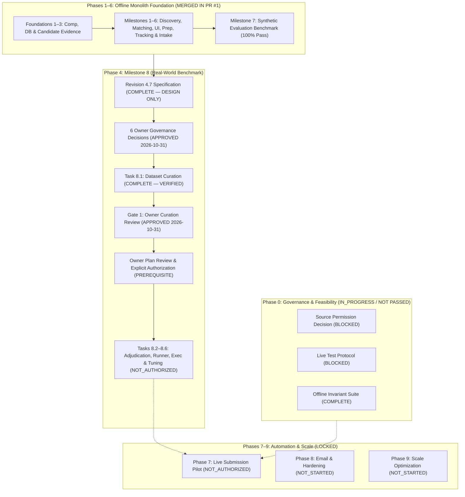
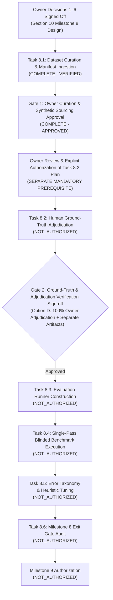

# Hire-Steward — Master Implementation Roadmap & Release Gates

**Current Product Name:** Hire-Steward (Machine-safe metadata: `hire-steward`)
**Specification Type:** Master Program Roadmap, Release Gates & Execution Tracking Matrix
**Current Architecture Status:** Offline-Complete Foundations (Milestones 1–7 Merged); Milestone 8 Task 8.1 Complete (Dataset Curation & Schema Manifest Verified); Decisions 1–6 Formally Resolved
**Repository Working Baseline:** Branch `main` synchronized with `origin/main` at commit `a517dd4f9dd0e3add7d1b6adbf5797af0dbf4b3e` (`a517dd4`)
**Fast-Check Health:** 617 total automated tests (577 fast unit/integration tests passing locally, 40 PostgreSQL integration tests passing against jobpilot_test); React Vite production build clean; frontend tests passing (3/3 Vitest); TypeScript strict check clean (0 errors); lockfile clean (uv lock --check); bytecode compilation clean (compileall); Chrome CDP 13-screen and 26-step master E2E journey 100% verified.

---

## 1. Executive Program Overview & Current State

This executive overview provides an immediate, authoritative briefing on the technical and operational status of Hire-Steward:

### 1. What is the current overall project state?
Hire-Steward has completed and verified its entire local-first, offline job search, matching, and application preparation foundation across **Foundations 1–3 and Milestones 1–7**. All corresponding feature branches were integrated into `main` through **Integration Pull Request #1** (commit `483a729`), verified by hosted GitHub Actions CI run `40916692872` (**349 passed, 0 failed, 3 warnings**, including all 24 PostgreSQL integration tests with isolated per-test schemas) validating commit `483a729`. Commit `a517dd4` is a later documentation-only commit; neither `a517dd4` nor the uncommitted Task 8.1 changes were validated by CI run `40916692872`. Milestone 8 (Real-World Job-Quality Evaluation Benchmark) has completed its architecture and statistical design specification at **Revision 4.7** (`docs/real-world-job-quality-evaluation-design.md`). The application runtime operates strictly local-first and under user control with zero live external ATS requests.

### 2. What has been completed?
- **Foundation 1:** Configurable annual compensation preference (default INR 100,000/year; zero allowed; unpaid roles independently prohibited), deterministic policy evaluator, transactional audit log, assessment snapshots, and fail-closed unverified public evidence boundary (ADR-0007, ADR-0008, ADR-0009; commit `d7bfa7f`).
- **Foundation 2:** PostgreSQL 17.11 Docker Compose service, API liveness/readiness endpoints (`/health`, `/ready`), isolated per-test schema integration suite, CI workflow configuration (ADR-0010; commit `f47b9d1`).
- **Foundation 3:** Candidate evidence domain models, text-only immutable document versioning, SHA-256 storage, durable reservations, unreviewed fact partitioning, and byte-span provenance (ADR-0011; commit `fe0baf0`).
- **Milestone 1:** Offline job discovery, normalized observation models, discovery runs/checkpoints, and relational persistence schema (`0004_job_discovery_persistence`; ADR-0012, ADR-0013; commit `214dfea`).
- **Milestone 2:** Deterministic explainable job matching engine, scoring model `v1.0.0-deterministic`, ordinal fit tiers, confidence ratings, and hard-gate evaluations (ADR-0014; commit `e022a47`).
- **Milestones 3 & 3.1:** Job review workbench UI with quiet aesthetic, search, filtering, detail drawer, loopback security, and responsive touch/keyboard interaction QA (commits `8f19559`, `3dba991`).
- **Milestones 4 & 4.1:** Evidence-grounded application package preparation, deterministic tailored resume/cover letter synthesis, zero-hallucination invariant, unreviewed/conflicted partitions, markdown protocol sanitization, and localStorage provenance disclosure (ADR-0015; commit `b8a9b59`).
- **Milestone 5:** Application tracking pipeline, state transitions, immutable audit history, and lifecycle schema (`0005_application_tracking`; ADR-0016; commit `7182b65`).
- **Milestone 6:** User-controlled manual job intake (`POST /api/v1/jobs/intake`), intake modal UI, offline URL syntax validation, plain text section parsing, and database constraint guards (ADR-0017; commit `b709013`).
- **Milestone 7:** Offline matching evaluation benchmark (`backend/app/evaluation/`), 37 frozen synthetic cases across 7 candidate profiles, 6-case post-fix adversarial regression suite, 100.0% fit tier and requirement agreement, and 0.0% hard-gate leakage ($0/37$ overall, $0/18$ gated subset; ADR-0018; commit `a599467`; report `docs/reports/2026-10-29-matching-evaluation-report.md`).
- **Integration PR #1:** Full integration of Milestones 1–7 into `main` at commit `483a729` (post-merge CI run `40916692872` validated commit `483a729`: 349 passed). Local repository was subsequently advanced to documentation commit `a517dd4`.

### 3. What is currently being worked on?
**Milestone 8 (Real-World Job-Quality Evaluation Benchmark):** Decisions 1–6 have been formally confirmed by the repository owner, and **Task 8.1 (Dataset Curation & Schema Manifest Ingestion)** has been completed and verified. 92 evaluation cases (60 frozen benchmark, 20 calibration, 12 adversarial probes) across 41 candidate profiles and 48 job postings have been authored, validated against schemas, and cryptographically anchored in `manifest.json`. Gate 1 (Owner Curation Review & Synthetic Sourcing Policy Approval) has been formally APPROVED by the repository owner on 2026-10-31 (representing owner approval of the synthetic-only dataset and internal sourcing risk policy, not external legal advice or legal certification). Task 8.1 is accepted. Tasks 8.2 through 8.6 remain strictly unauthorized pending owner review and approval of the Task 8.2 execution plan.

### 4. What is the immediate next action?
Owner review and approval of the Task 8.2 execution plan (covering multi-model inference, annotation, adjudication, and ground-truth labeling) prior to commencing any Task 8.2 work. Tasks 8.2 through 8.6 remain NOT_AUTHORIZED.

### 5. What is blocked or awaiting approval?
- **Phase 0 Exit Gate:** Unresolved source-permission and legal risk acceptance (`IN_PROGRESS / NOT PASSED`). All candidate ATS adapters (Lever, Greenhouse, Ashby, Direct Feeds) remain disabled and `NEEDS_REVIEW`.
- **Milestone 8 Task 8.2 Execution Plan:** Awaiting separate explicit repository owner review and authorization of the Task 8.2 execution plan (covering independent multi-model assessment, blinding, input isolation, and owner adjudication). Tasks 8.2 through 8.6 remain strictly `NOT_AUTHORIZED`.
- **Milestone 8 Tasks 8.3–8.6:** Tasks 8.3 through 8.6 remain blocked pending Task 8.2 completion and Gate 2 sign-off.
- **Live Discovery & Submission:** Live network requests, external ATS scraping, and automated outbound applications are strictly `BLOCKED` and `NOT_AUTHORIZED`.

### 6. What must NOT be started yet?
- **Task 8.2 Annotation:** Multi-model inference, annotation, adjudication, and ground-truth labeling remain strictly NOT_AUTHORIZED until the repository owner explicitly reviews and approves its execution plan.
- **Tasks 8.3–8.6 Evaluation Infrastructure & Execution:** No evaluation runner (`run_real_world_eval.py`), tuning, or exit gate audit may be started.
- **Production Matching Code Changes:** No weights, heuristics, synonym dictionaries, or parsing logic in `backend/app/domain/job_matching.py` may be altered prior to baseline evaluation execution.
- **Live Source Integrations:** No HTTP requests to job boards, ATS portals, or career sites.
- **Automated Submissions:** Phase 7 (Live Submission Pilot) remains strictly unauthorized.

---

## 2. Master Milestone Status Summary Table

| Phase / Milestone | Status | Verified Evidence | Remaining Work / Primary Blocker |
| :--- | :--- | :--- | :--- |
| **Phase 0: Feasibility & Permission Audit** | `IN_PROGRESS` | `docs/job-discovery-sources.md`, `docs/reference-repo-audit.md`, 88 offline Lever adapter unit tests (`214dfea`). | **BLOCKER:** Owner formal source-access decision / legal risk acceptance (Criterion 1) and live testing protocol sign-off (Criterion 2). |
| **Phase 1: Foundation 1 (Comp & Policy)** | `COMPLETE — VERIFIED` | Commit `d7bfa7f`, migrations `0001`, `0002_comp_evidence_trust`, ADR-0007/0008/0009, 53 unit/integration tests passing. | Phase 1 operational hardening (structured logging, correlation IDs) remains pending. |
| **Phase 1: Foundation 2 (Postgres & CI)** | `COMPLETE — VERIFIED` (CI)<br>`COMPLETE — EVIDENCE INSUFFICIENT` (Local) | Commit `f47b9d1`, ADR-0010, hosted CI run `40916692872` on commit `483a729` (24 Postgres tests passing). | Local Docker Desktop engine unavailable; local Compose runtime unverified. |
| **Phase 2: Foundation 3 (Evidence Slice)** | `COMPLETE — VERIFIED` | Commit `fe0baf0`, migration `0003_candidate_evidence`, ADR-0011, PR #1 (`483a729`), hosted CI run `40664831364`. | Multi-format parsers (PDF/DOCX/OCR) and profile editor UI remain for Phase 2 completion. |
| **Phase 3: Milestone 1 (Offline Discovery)** | `COMPLETE — VERIFIED` | Commit `214dfea`, migration `0004_job_discovery_persistence`, ADR-0012/0013, 88 offline tests, PR #1 (`483a729`). | Live adapter activation blocked by Phase 0 exit gate. |
| **Phase 3: Milestone 6 (User Job Intake)** | `COMPLETE — VERIFIED` | Commit `b709013`, ADR-0017, POST `/api/v1/jobs/intake`, modal UI, 20 tests, PR #1 (`483a729`). | Live crawler activation barred; operates strictly offline. |
| **Phase 4: Milestone 2 (Job Matching)** | `COMPLETE — VERIFIED` | Commit `e022a47`, ADR-0014, scoring model `v1.0.0-deterministic`, 266 unit tests, PR #1 (`483a729`). | Calibrated tuning deferred to real-world evaluation benchmark. |
| **Phase 4: Milestones 3 & 3.1 (Workbench UI)** | `COMPLETE — VERIFIED` | Commits `8f19559`, `3dba991`, local loopback security, split view, responsive mobile QA, PR #1 (`483a729`). | Visual styling complete; real-world evaluation results integration pending. |
| **Phase 4: Milestone 7 (Synthetic Eval)** | `COMPLETE — VERIFIED` | Commit `a599467`, ADR-0018, `backend/app/evaluation/`, 37 frozen cases, 6 adversarial regression cases, PR #1 (`483a729`). | Synthetic benchmark does NOT prove real-world accuracy; Milestone 8 required. |
| **Phase 4: Milestone 8 (Real-World Eval)** | `IN_PROGRESS` (Task 8.1 Complete; Gate 1 Approved; Task 8.2 Checkpoint A Complete; Task 8.2 Checkpoint B Stage B1 Verified Offline)<br>`NOT_AUTHORIZED` (Task 8.2 Stage B2 Live Calibration; Tasks 8.3–8.6) | Commit `a517dd4` baseline, Task 8.1 dataset fixtures, SHA-256 manifest `31f7db7...`, Checkpoint A isolated ledger with atomic SQLite migration, Checkpoint B Stage B1 Anthropic and OpenAI adapters with mock contract tests (426 fast suite tests passing). | Task 8.2 Stage B2 (Live Calibration) remains `NOT_AUTHORIZED`. Tasks 8.3–8.6 remain `NOT_AUTHORIZED`. Zero live credentials or live provider calls. |
| **Phase 5: Resume/Answer Prep & Review (M4/4.1)** | `IN_PROGRESS` (M4/4.1 Complete; 5.2–5.3 Not Started) | Commit `b8a9b59`, ADR-0015, tailored resume/cover letter synthesis, zero-hallucination invariant, PR #1 (`483a729`). | Live AI provider integration (5.2), token budget router, and answer bank (5.3) remain pending. |
| **Phase 6: App State Machine & Dry-Run (M5)** | `IN_PROGRESS` (M5 Complete; 6.2–6.3 Not Started) | Commit `7182b65`, migration `0005_application_tracking`, ADR-0016, immutable audit history, PR #1 (`483a729`). | Dry-run executor (6.2), `SubmissionPlan`, and simulated ATS recovery (6.3) remain pending. |
| **Phase 7: Live Submission Pilot** | `NOT_AUTHORIZED` | None (Design specifications only in `docs/phases.md`). | Strictly barred until Phases 0–6 exit gates pass. |
| **Phase 8: Email & Operational Hardening** | `NOT_STARTED` | Specifications in `docs/operations-deployment.md`. | Blocked by Phase 7 completion. |
| **Phase 9: Scale & Optimization** | `NOT_STARTED` | Criteria in `docs/phases.md`. | No scaling trigger currently evidenced. |

---

## 3. Governance Taxonomy & Status Definitions

To eliminate ambiguity across program tracking, every item in this roadmap is classified into one of seven mutually exclusive operational states:

1. **`COMPLETE — VERIFIED`:** Implementation exists, code is merged into `main`, and acceptance criteria are backed by reproducible, objective evidence (committed code, passing automated tests, hosted CI runs, or audit receipts).
2. **`COMPLETE — EVIDENCE INSUFFICIENT`:** Implementation exists or configuration is committed, but full operational verification across all target environments (e.g., local Docker Compose runtime on local host) has not yet been executed.
3. **`IN_PROGRESS`:** Active workstream where design, specification, or code is actively underway, but exit criteria are not yet satisfied.
4. **`BLOCKED`:** Work cannot proceed due to an external dependency, missing prerequisite, unfulfilled legal condition, or unresolved architectural prerequisite.
5. **`PENDING OWNER APPROVAL`:** A completed design, policy choice, or gating decision is formally awaiting explicit review and selection by the repository owner.
6. **`NOT_STARTED`:** Future planned capability with defined specifications that has not yet commenced implementation.
7. **`NOT_AUTHORIZED`:** Work whose execution is strictly forbidden until preceding governance gates, security controls, or owner approvals have been formally documented.

> [!CRITICAL]
> **Delivery & Acceptance Gate Invariant:**
> A phase, milestone, or task is **NEVER marked complete simply because its implementation code exists**. It is complete IF AND ONLY IF its formal acceptance gate, security boundaries, and test evidence have been verified.

---

## 4. Reconciled Phase Details: Completed, In-Progress, and Remaining Work



---

### Phase 0 — Repository, Feasibility and Source-Permission Audit
**Status:** `IN_PROGRESS / NOT PASSED`
**Phase Objective:** Establish the repository baseline, dependency lock strategy, threat model, license compliance, and legally permitted job discovery paths before activating any external network capabilities.

#### Workstream 0.1: Repository Baseline, Tooling & Environment
- **Status:** `COMPLETE — VERIFIED`
- **What Was Done:** Established Python 3.12+ runtime, `pyproject.toml`, pinned `uv.lock`, `.env.example`, Git root configuration, `AGENTS.md` instructions, and automated CI.
- **Evidence:** Commits `d7bfa7f`, `1cb9f68`, `f47b9d1` merged via PR #1 (`483a729`), verified in hosted CI Run `40916692872`. Subsequent documentation commit `a517dd4` recorded merged milestones and roadmap.

#### Workstream 0.2: Reference Repository Audit
- **Status:** `COMPLETE — VERIFIED`
- **What Was Done:** Read-only audit of eight local reference checkouts; cataloged licenses, architectures, test evidence, and intellectual property boundaries.
- **Evidence:** `docs/reference-repo-audit.md` (no code copied; reference repos excluded from Git tracking).

#### Workstream 0.3: Source Permission & Capability Feasibility
- **Status:** `BLOCKED` (Awaiting Owner Risk Acceptance)
- **What Was Done:** Investigated Lever (Postings API v0), Greenhouse (Job Board API), Ashby (Public Posting API), and Direct Employer Feeds. Cataloged authentication models, rate limits, terms, and third-party scraping clauses.
- **Evidence:** `docs/job-discovery-sources.md`.
- **Blocker:** All four candidate sources remain classified as `NEEDS_REVIEW`. No live access permission has been granted by the owner.
- **Why It Is Needed:** Unattended crawling or scraping without explicit authorization creates legal risk and risks domain/IP blacklisting.

#### Phase 0 Exit Gates:
1. **Criterion 1 (Owner Formal Source-Access Decision):** `BLOCKED / PENDING OWNER APPROVAL`. Formal owner approval of permitted source and access mode.
2. **Criterion 2 (Live Test Protocol Sign-Off):** `BLOCKED / PENDING OWNER APPROVAL`. Approved single-request live test protocol against an agreed board.
3. **Criterion 3 (Offline Invariant Suite):** `COMPLETE — VERIFIED`. 88 offline Lever adapter tests passing with loop detection, pagination bounds, and honest attribution (Commit `214dfea`).

---

### Phase 1 — Foundation and Local Runtime
**Status:** `IN_PROGRESS`
**Phase Objective:** Create a robust, typed backend modular monolith, local PostgreSQL containerization, database schema migrations, and secure localhost defaults.

#### Workstream 1.1: Foundation 1 — Configurable Compensation Preference & Policy Evaluator
- **Status:** `COMPLETE — VERIFIED`
- **What Was Done:** Implemented configurable minimum compensation API (`GET/PATCH /api/v1/settings/policies`), exact `Decimal` arithmetic, transactional audit logging, assessment snapshots, and fail-closed unverified public evidence boundary.
- **Evidence:** Commits `d7bfa7f`, `90d2bc0`; migrations `0001_compensation_preference`, `0002_comp_evidence_trust`; ADR-0007, ADR-0008, ADR-0009. 53 unit/integration tests passing.

#### Workstream 1.2: Foundation 2 — PostgreSQL, Docker Compose, and CI Infrastructure
- **Status:** `COMPLETE — VERIFIED` (Hosted CI) / `COMPLETE — EVIDENCE INSUFFICIENT` (Local Compose)
- **What Was Done:** Configured root `compose.yaml` running `postgres:17.11-bookworm`, loopback binding, `/health` and `/ready` endpoints, Alembic migration runner, isolated per-test schema integration suite, and GitHub Actions CI workflow (`.github/workflows/ci.yml`).
- **Evidence:** Commit `f47b9d1`; ADR-0010; hosted CI run `40916692872` on commit `483a729` (24 PostgreSQL tests passed).
- **Remaining Gap:** Local Docker Desktop engine is unavailable on the local development machine; end-to-end local Compose startup remains unverified locally outside CI.

#### Workstream 1.3: Operational Hardening (Logging, Errors, Correlation)
- **Status:** `NOT_STARTED`
- **What Needs to Be Done:** Implement structured JSON logging with automatic PII/credential redaction, correlation ID middleware across all endpoints, and standardized RFC 7807 error responses.
- **Dependencies:** Foundation 1 & 2.
- **Acceptance Criteria:** Zero raw credentials or candidate resume text in application logs; correlation IDs traced through all API errors.

---

### Phase 2 — Candidate Evidence and Fact Provenance
**Status:** `IN_PROGRESS`
**Phase Objective:** Establish an immutable candidate evidence dossier where every qualification claim is anchored to verifiable source documents with byte-span provenance.

#### Workstream 2.1: Foundation 3 — Candidate Evidence & Provenance Vertical Slice
- **Status:** `COMPLETE — VERIFIED`
- **What Was Done:** Added 7 relational tables (`candidate_profiles`, `candidate_documents`, `candidate_document_versions`, `candidate_facts`, `candidate_fact_provenance`, `candidate_fact_conflicts`, `candidate_reservations`), text-only document ingestion, SHA-256 deduplication, durable upload reservations, and byte-span provenance.
- **Evidence:** Commit `fe0baf0`; migration `0003_candidate_evidence`; ADR-0011; hosted CI run `40664831364` (95 passed). Merged in PR #1 (`483a729`).

#### Workstream 2.2: Multi-Format Document Ingestion & Parsers
- **Status:** `NOT_STARTED`
- **What Needs to Be Done:** Author secure format adapters for PDF, DOCX, CSV, and XLSX; implement file size limits (e.g. 10MB); quarantine malformed or hostile files; implement OCR fallbacks.
- **Dependencies:** Foundation 3 schema.
- **Acceptance Criteria:** Parse errors never delete or corrupt existing accepted candidate facts; zip-slip and XML entity expansion attacks are completely blocked.

#### Workstream 2.3: Candidate Profile Review & Conflict UI
- **Status:** `NOT_STARTED`
- **What Needs to Be Done:** Build UI screens for inspecting extracted facts, resolving contradictory claims, and manually editing unverified candidate attributes.
- **Dependencies:** Workstream 2.2.

---

### Phase 3 — Permitted Discovery and Source Registry
**Status:** `IN_PROGRESS`
**Phase Objective:** Ingest job postings from permitted, documented sources and allow manual user job entry, persisting immutable raw observations and snapshots.

#### Workstream 3.1: Milestone 1 — Offline Job Discovery Persistence & Observation Model
- **Status:** `COMPLETE — VERIFIED`
- **What Was Done:** Implemented 6 relational tables (`job_sources`, `employer_subscriptions`, `discovery_checkpoints`, `discovery_runs`, `job_postings`, `job_posting_snapshots`), immutable snapshots, SHA-256 deduplication, wall-clock lease fencing, and offline Lever parser fixtures.
- **Evidence:** Commit `214dfea`; migration `0004_job_discovery_persistence`; ADR-0012, ADR-0013. 88 unit tests passing. Merged in PR #1 (`483a729`).

#### Workstream 3.2: Milestone 6 — User-Controlled Manual Job Intake
- **Status:** `COMPLETE — VERIFIED`
- **What Was Done:** Implemented user-controlled manual job intake (`POST /api/v1/jobs/intake`), intake modal UI in workbench, offline URL syntax validation, plain text section extraction, and database constraint guards. Operates strictly offline with zero socket connections.
- **Evidence:** Commit `b709013`; ADR-0017; hosted CI run `40884209323` (333 tests passed). Merged in PR #1 (`483a729`).

#### Workstream 3.3: Live Source Adapter Activation
- **Status:** `BLOCKED / NOT_AUTHORIZED`
- **Blocker:** Phase 0 exit gate remains unpassed. All live ATS adapters remain disabled and in `NEEDS_REVIEW`.
- **Why It Is Needed:** To automate discovery once legal permission and risk boundaries are formally accepted.

---

### Phase 4 — Matching, Policy Gates, Review Workbench & Evaluation
**Status:** `IN_PROGRESS`
**Phase Objective:** Match candidate evidence against job postings using a deterministic, explainable policy engine; surface assessments in a local workbench UI; and evaluate matching quality against rigorous benchmarks.

#### Workstream 4.1: Milestone 2 — Deterministic Job Matching & Fit Explanation
- **Status:** `COMPLETE — VERIFIED`
- **What Was Done:** Implemented scoring model `v1.0.0-deterministic`, ordinal fit tiers (`STRONG_MATCH`, `PARTIAL_MATCH`, `WEAK_MATCH`, `BLOCKED_OR_CONTRADICTED`, `INSUFFICIENT_DATA`), confidence ratings (`HIGH`, `MEDIUM`, `LOW`), hard gate enforcement (compensation floor, unpaid work, mandatory qualifications, location), and structured explanations.
- **Evidence:** Commit `e022a47`; ADR-0014; 266 unit tests passing. Merged in PR #1 (`483a729`).

#### Workstream 4.2: Milestones 3 & 3.1 — Job Review Workbench UI & Responsive QA
- **Status:** `COMPLETE — VERIFIED`
- **What Was Done:** Built local-first review workbench UI with quiet aesthetic, split-view layout, real-time search, multi-facet filtering, detail drawer, and local loopback security. Verified across desktop, tablet, and mobile with zero browser console errors.
- **Evidence:** Commits `8f19559`, `3dba991`. Merged in PR #1 (`483a729`).

#### Workstream 4.3: Milestone 7 — Offline Matching Evaluation Benchmark (Synthetic)
- **Status:** `COMPLETE — VERIFIED` (On Synthetic Data)
- **What Was Done:** Built automated evaluation runner (`backend/app/evaluation/`), 37 frozen synthetic evaluation cases across 7 candidate profiles, and a 6-case post-fix adversarial regression suite. Achieved 100.0% fit tier and requirement agreement with 0.0% hard-gate leakage ($0/37$ overall, $0/18$ gated subset).
- **Evidence:** Commit `a599467`; ADR-0018; hosted CI run `40905209800` (349 tests passed); evaluation report `docs/reports/2026-10-29-matching-evaluation-report.md`. Merged in PR #1 (`483a729`).
- **Critical Technical Disclosure:** Synthetic benchmarks evaluate clean, unambiguous text. They do **NOT constitute proof of real-world matching accuracy** against noisy, conversational, or adversarial job postings.

#### Workstream 4.4: Milestone 8 — Real-World Job-Quality Evaluation Benchmark
- **Status:** `IN_PROGRESS` (Task 8.1 Complete; Tasks 8.2–8.6 `NOT_AUTHORIZED`)
- **Detailed Specification:** `docs/real-world-job-quality-evaluation-design.md` (1,410 lines, audited).
- **Core Design Properties:** 60 frozen evaluation cases, 20 calibration cases, 12 adversarial probes (92 total cases), crossed two-way random-effects clustering ($P \times J$), 10 distinct incomplete profiles, 10 distinct truncated postings, normative fail-closed contracts, and exact small-sample Wilson intervals.
- **Current Milestone 8 Governance State:**
  - Owner Decisions 1–6 have been formally signed off by repository owner.
  - Task 8.1 is **`COMPLETE — VERIFIED`**.
  - Gate 1 (Owner Curation Review & Synthetic Sourcing Policy Approval) is **`COMPLETE — APPROVED`** (authorized on 2026-10-31; internal owner approval, not external legal certification).
  - Tasks 8.2 through 8.6 remain **`NOT_AUTHORIZED / BLOCKED`**.
  - Phase 0 remains `IN_PROGRESS / NOT PASSED`.
  - All ATS integrations remain disabled and in `NEEDS_REVIEW`.
  - No live ATS requests, scraping, or external discovery are authorized.

---

### Detailed Breakdown of Milestone 8 Execution Tasks



#### Task 8.1: Dataset Curation & Schema Manifest Ingestion
- **Status:** `COMPLETE — VERIFIED`
- **What Was Done:** Curated 92 evaluation cases (60 frozen benchmark, 20 calibration, 12 adversarial probes) across 41 candidate profiles and 48 job postings covering 11 professional domains (Finance, Healthcare, Sales, Operations, Education, Engineering, Tech, Customer Support, HR, Marketing, Junior Admin). Implemented 10 distinct incomplete candidate profiles testing required profile information (name, contact, education status) and 10 distinct incomplete/truncated postings under Approach B. Separated commission-only roles from unpaid work and regulatory credentials from experience expectations. Established 5 JSON schemas, segregated unadjudicated ground-truth scaffolding (`ground_truth/frozen_ground_truth_scaffolding.json` and `calibration_ground_truth_scaffolding.json`), and generated cryptographically anchored SHA-256 manifest tracking 188 fixture files with self-digest verification.
- **Why It Is Needed:** Provides the raw, representative input data needed to measure real-world heuristic performance without threshold overfitting or label leakage.
- **Dependencies:** Formal owner sign-off on Section 10 Decisions 1, 4, 5, and 6 (Resolved).
- **Acceptance Criteria:** Synthetically authored candidate profiles and job postings with guaranteed non-routable email inboxes via RFC 2606 / RFC 6761 reserved domains (`example.com`, `example.org`, `example.net`, and `.invalid`/`.example` TLDs; `test.com` is not a reserved domain and is not used as a reserved address); documented residual risk of accidental collision with real-world names and phone sequences without claiming impossible absolute absence proof; zero ground-truth label leakage in case inputs; 100% disjointness between calibration and frozen partitions; SHA-256 manifest and self-digest verified.
- **Required Evidence:** Passing test suite `backend/tests/unit/test_real_world_eval_dataset.py` (20 passed), SHA-256 manifest self-digest `31f7db7c69cc3d6f7a8ccb25e57e7361dbb0dca4d6f03f6fae185803fc293840` (tracking 188 files), and full fast test suite passing (345 passed, 24 deselected).
- **Current Blocker:** None. Task 8.1 is complete. Gate 1 is approved.

#### Task 8.2: Human Ground-Truth Adjudication & Calibration
- **Status:** IN_PROGRESS (Checkpoint A Complete & Unconditionally Accepted; Checkpoint B Stage B1 Verified Offline; Stage B2 Live Calibration NOT_AUTHORIZED)
- **What Was Done (Checkpoint A & Stage B1):** Completed Checkpoint A (blinded serializer, PII pseudonymization with coordinate mapping, evaluation ledger with atomic SQLite schema migration and SHA-256 audit chaining, deterministic offline mock adapters, attempt fencing, and provenance determination matrix). Completed Checkpoint B Stage B1 (offline AnthropicProviderAdapter and OpenAIProviderAdapter with native JSON schemas, output_config.format, omission of unsupported sampling parameters and tool choices, secret-safe environment credentials, pre-dispatch budget reservation with ambiguity liability retention, and 20 offline contract tests using httpx.MockTransport).
- **What Remains (Stage B2 & Beyond — NOT_AUTHORIZED):** Stage B2 live calibration requires separate owner authorization and live API credentials; currently NOT_AUTHORIZED. Tasks 8.3–8.6 remain NOT_AUTHORIZED. Zero real external network calls or expenditures authorized.
- **What Needs to Be Done:** Execute 9-step calibration and frozen benchmark sequence under Option D (Option C core): (1) Owner establishes reference decisions for 20 calibration cases; (2) Dual models independently assess calibration cases; (3) Compare model outputs to owner decisions; (4) Refine prompts using calibration cases only; (5) Freeze prompt, schema, serializer, provider configuration, and model snapshots; (6) Run dual models on 60 frozen cases; (7) Owner independently adjudicates all 60 frozen cases; (8) Compare model assessments against owner decisions; (9) Segregate and preserve model assessments and owner reference labels as distinct artifacts.
- **Why It Is Needed:** Machine output cannot grade itself; independent human owner adjudication establishes authoritative reference labels while multi-model assessment provides advisory comparison.
- **Execution & Network Boundary:** Hire-Steward's application runtime, matching engine, and local evaluation orchestration operate strictly on-device with zero live requests to job boards or ATS portals. Task 8.2 uses local orchestration but, once explicitly authorized, requires outbound HTTPS requests to external commercial model providers (OpenAI, Anthropic) for advisory assessments. All candidate identities and job postings are blinded and stripped of internal identifiers prior to transmission; model outputs and human owner reference labels remain strictly segregated. Zero live ATS, job-board, or career-site requests are authorized.
- **Dependencies:** Task 8.1 completed and Gate 1 approved; Decision 2 resolved (Option D with Option C Core); Task 8.2 execution plan explicitly reviewed and authorized by repository owner.
- **Acceptance Criteria:** 100% of calibration (20) and frozen (60) cases have explicit owner reference decisions; prompt frozen before frozen inference; model assessments preserved separately; zero unresolved/failed outputs silently promoted; manifest self-digest verified.
- **Required Evidence:** Owner adjudication records for all 20 calibration cases and all 60 frozen cases, model-to-owner diagnostic comparisons, model-to-model concordance diagnostics, prompt freeze receipt, manifest self-digest verification, and separate model and owner artifacts (no human inter-rater reliability claim; single human owner adjudicator under Option D).
- **Current Blocker:** Awaiting repository owner review and explicit authorization of corrected Task 8.2 Execution Plan (Task 8.1 is complete; Gate 1 is approved).

#### Task 8.3: Evaluation Runner Construction & Taxonomy Engine
- **Status:** `NOT_AUTHORIZED / BLOCKED`
- **What Needs to Be Done:** Implement `run_real_world_eval.py` enforcing normative fail-closed contracts, single-pass gating, clean working tree check (`git status --porcelain`), manifest verification, and automated 10-class error taxonomy classification (`E01`–`E10`).
- **Why It Is Needed:** Ensures tamper-evident, blinded evaluation execution that cannot silently pass crashed or malformed cases.
- **Dependencies:** Task 8.2 completed and Gate 2 approved.
- **Acceptance Criteria:** Runner halts immediately on hash mismatch or dirty working tree; produces cryptographically verifiable execution receipt (`receipt_<timestamp>.json`).
- **Required Evidence:** Passing runner unit tests and simulated tamper-rejection tests.
- **Current Blocker:** Blocked by Task 8.2 and Gate 2 (Task 8.1 is complete; Gate 1 is approved).

#### Task 8.4: Single-Pass Blinded Benchmark Execution
- **Status:** `NOT_AUTHORIZED / BLOCKED`
- **What Needs to Be Done:** Execute the evaluation runner against the 60 frozen cases and 20 calibration cases in a single pass without human intervention; generate diagnostic report with 5×5 confusion matrix, exact Wilson intervals, and error breakdown.
- **Why It Is Needed:** Delivers the empirical performance baseline of the matching engine against realistic text.
- **Dependencies:** Task 8.3 completed.
- **Acceptance Criteria:** 100% of cases executed; zero runtime crashes; receipt written with exact execution timestamps.
- **Required Evidence:** `receipt_<timestamp>.json` matching committed manifest hash.
- **Current Blocker:** Blocked by Task 8.3.

#### Task 8.5: Error Analysis, Heuristic Tuning & Calibration Retest
- **Status:** `NOT_AUTHORIZED / BLOCKED`
- **What Needs to Be Done:** Perform root-cause analysis on observed errors; tune regex, synonym dictionaries, and scoring weights **strictly against calibration cases or synthetic unit tests**; developer discipline firewall prohibits tuning against frozen cases; execute regression re-test.
- **Why It Is Needed:** Improves matching precision and recall while preventing benchmark memorization.
- **Dependencies:** Task 8.4 completed.
- **Acceptance Criteria:** Zero modifications to frozen fixtures or ground truth; all changes backed by unit tests.
- **Current Blocker:** Blocked by Task 8.4.

#### Task 8.6: Final Acceptance Audit & Milestone 8 Exit Gate
- **Status:** `NOT_AUTHORIZED / BLOCKED`
- **What Needs to Be Done:** Evaluate final benchmark results against the deterministic 4-tier outcome precedence ladder; verify all 5 hard safety invariants and all 4 proposed quality targets.
- **Why It Is Needed:** Determines whether Hire-Steward's matching engine is verified for real-world text.
- **Dependencies:** Task 8.5 completed.
- **Acceptance Criteria:** Complete satisfaction of Precedence 4:
  - Hard Safety Invariants: $L_{\text{gate}} = 0.0\%$ ($N = 10$), $E_{\text{elig\_leak}} = 0.0\%$ ($N = 48$), $R_{\text{cand\_empty}} = 100.0\%$ ($N = 10$), $R_{\text{post\_incomplete}} = 100.0\%$ ($N = 10$), $Q_{\text{excl}} = 100.0\%$ ($N = 15$).
  - Quality Targets: $FPR_{\text{opt}} \le 5.0\%$ ($N = 48$), $FNR_{\text{pess}} \le 10.0\%$ ($N = 20$), $R_{\text{ground\_case}} \ge 95.0\%$ ($N = 20$), $R_{\text{subj\_post}} \ge 90.0\%$ ($N = 15$).
  - Denominators: All $N \ge 10$.
  - Reviewer Gate: Gate 2 passed (Option D: 100% owner adjudication complete across all 80 evaluation cases; model assessments preserved separately).
- **Required Evidence:** Published evaluation report and signed milestone audit.
- **Current Blocker:** Blocked by Task 8.5.

---

### Phase 5 — Resume/Answer Preparation and Grounded Review
**Status:** `IN_PROGRESS`
**Phase Objective:** Synthesize tailored resumes and application answers strictly grounded in verified candidate evidence, preventing AI hallucinations.

#### Workstream 5.1: Milestones 4 & 4.1 — Evidence-Grounded Application Preparation
- **Status:** `COMPLETE — VERIFIED`
- **What Was Done:** Added ADR-0015, deterministic tailored resume/cover letter synthesis, zero-hallucination invariant, unreviewed/conflicted partitions, addressed requirements & gaps itemization, client-side localStorage persistence, and workbench UI integration.
- **Evidence:** Commit `b8a9b59`. Merged in PR #1 (`483a729`).

#### Workstream 5.2: AI Provider Router & Privacy Dispatcher
- **Status:** `NOT_STARTED`
- **What Needs to Be Done:** Implement provider-neutral LLM router (FastAPI/Pydantic schemas), rate limiting, token usage tracking, and privacy classification (filtering secrets and personal PII).
- **Dependencies:** Phase 4 completion and provider quota/budget authorization.
- **Acceptance Criteria:** Provider data-sharing settings strictly respected; paid fallback disabled until budget is explicitly configured.

#### Workstream 5.3: Question-Answer Bank with Scoped Consent
- **Status:** `NOT_STARTED`
- **What Needs to Be Done:** Implement reusable question-answer repository; require explicit user consent for each reused answer; prevent one-time answers from being reused automatically.
- **Dependencies:** Workstream 5.2.

---

### Phase 6 — Application State Machine and Dry-Run Executor
**Status:** `IN_PROGRESS`
**Phase Objective:** Manage the full application lifecycle, enforce daily caps and transactional locks, and simulate application dispatches without touching live external portals.

#### Workstream 6.1: Milestone 5 — Application Tracking & Pipeline Lifecycle
- **Status:** `COMPLETE — VERIFIED`
- **What Was Done:** Added ADR-0016, 12-state application lifecycle state machine (`SAVED`, `REVIEWING`, `READY_TO_SUBMIT`, `SUBMITTING`, `APPLIED`, `REJECTED`, `INTERVIEWING`, etc.), immutable audit trail (`application_status_history`), schema migration `0005_application_tracking`, and API routes.
- **Evidence:** Commit `7182b65`; hosted CI run `40867692556` (313 tests passed). Merged in PR #1 (`483a729`).

#### Workstream 6.2: Dry-Run Executor & Immutable SubmissionPlan
- **Status:** `NOT_STARTED`
- **What Needs to Be Done:** Build dry-run application workflow that evaluates the fresh policy state, checks the persisted compensation preference, generates an immutable `SubmissionPlan`, and renders the exact payload for human inspection.
- **Dependencies:** Phase 4 and Phase 5 completion.
- **Acceptance Criteria:** Zero live network requests; exact preview of answers, resume spans, and employer destination.

#### Workstream 6.3: Simulated ATS Adapter & Crash Recovery Reconciliation
- **Status:** `NOT_STARTED`
- **What Needs to Be Done:** Implement local simulated ATS adapter; test fault-injection cases (crashes before request, browser timeouts, disconnects after click); implement `CONFIRMATION_UNKNOWN` state requiring manual reconciliation.
- **Dependencies:** Workstream 6.2.
- **Acceptance Criteria:** Unknown result never auto-promotes to `APPLIED`; retry after uncertain result is blocked pending user confirmation.

---

### Phase 7 — Limited Live Submission Pilot
**Status:** `NOT_STARTED / NOT_AUTHORIZED`
**Phase Objective:** Carefully execute human-approved, single-attempt live applications to a single verified source under strict caps and emergency stop controls.

- **Strict Entry Conditions:** All exit gates for Phases 0 through 6 must be fully verified and passed. Formal owner authorization must be signed.
- **Work:** Enable one verified source at a time; require explicit manual click on `READY_TO_SUBMIT`; cap at 5 applications/day; maintain one active attempt at a time.
- **Exit Gate:** Zero duplicate applications; 100% of outcomes supported by confirmation evidence; immediate emergency stop switch functional.

---

### Phase 8 — Recruiter Email, Portability and Operational Hardening
**Status:** `NOT_STARTED`
**Phase Objective:** Manage direct recruiter communications, provide encrypted backup/restore, and enable complete JSON/zip export and import without secret leakage.

- **Work:** Gmail OAuth integration (drafts-only by default; explicit sending only to designated recruiter addresses); versioned export/import with manifest and SHA-256 validation; backup/restore drill.
- **Exit Gate:** Export/import passes schema and integrity validation in a clean instance; zero credentials/tokens exported; restore rehearsed.

---

### Phase 9 — Scale and Quality Optimization
**Status:** `NOT_STARTED`
**Phase Objective:** Scale infrastructure only upon measured, documented operational necessity.

- **Revisit Triggers:** Sustained scheduler backlogs, database query latency exceeding SLA, vector retrieval degradation, or approved multi-user deployment.
- **Potential Upgrades:** Broker-backed task queue (Celery/Redis), managed object storage, table partitioning, pgvector HNSW index tuning.
- **Exit Gate:** Every added component requires a measured need, accepted ADR, security update, and rollback plan.

---

### Critical Defect Remediation & Release Verification
**Status:** `COMPLETED_AND_VERIFIED` (2026-11-05)
- **Remediated Defects:**
  - P0 Answer Bank consent opt-in (default `False`, enforced across AI answering, submission plans, and handoffs).
  - P1 User Settings persistence decoupling (dedicated `user_settings` table, Alembic migration `0007_user_settings`).
  - P0 Data Portability integrity (SHA-256 verification, collision detection, complete entity restore, atomic rollback).
  - P0 Deterministic submission eligibility (fail closed on compensation and cooldowns; zero fabricated drafts).
  - P1 Candidate evidence workflow (decompression bomb protection, fact review endpoints).
  - P1 Honest AI status (`OFFLINE_MOCK`, zero hallucinations).
  - P1 Source registry safety (`TERMS_REVIEW_REQUIRED`, live scraping disabled).
- **Verification:** 472 offline tests passing; browser UI documented honestly as `NOT_VERIFIED`.
- **Governance:** Task 8.2 Stage B2 and Tasks 8.3–8.6 remain `NOT_AUTHORIZED`.

---

## 5. Resolved Repository Owner Decisions for Milestone 8

The repository owner has formally reviewed and resolved all six governance decisions established in Section 10 of `docs/real-world-job-quality-evaluation-design.md` (all Decisions 1–6 APPROVED; Task 8.1 COMPLETE; Gate 1 APPROVED; Tasks 8.2–8.6 remain strictly NOT_AUTHORIZED):

```markdown
### Explicit Owner Governance Decision Checklist:

- [x] **Decision 1: Safety Cohort Architecture Selection**
  - *Owner Resolution:* `OWNER_APPROVED: Option B (Approach B — Expanded Independent Coverage)`
  - *Binding Conditions:* 10 distinct incomplete candidate profiles testing required fields (name, contact, education status); 10 distinct truncated/incomplete job postings; reconciled with 60 frozen benchmark cases, 20 calibration cases, and 12 adversarial probes (92 total cases). Missing optional experience/projects does not invalidate a profile.

- [x] **Decision 2: Annotation Protocol Path Selection**
  - *Owner Resolution:* `OWNER_APPROVED: Option D with Option C Core (Independent Multi-Model Assessment + Mandatory Owner Adjudication)`
  - *Binding Conditions:* Prepares scaffolding for independent multi-model assessment and mandatory human owner adjudication. Task 8.1 defines schemas and empty scaffolding; does NOT execute model inference or populate ground-truth labels. Ordinary users do not need multi-model review.

- [x] **Decision 3: Recruiter-Informed, Evidence-Grounded Matching Philosophy**
  - *Owner Resolution:* `OWNER_APPROVED: Recruiter-Informed Evidence-Grounded Matching`
  - *Binding Conditions:* Required profile info (name, contact, education status); optional info (experience, projects); job description completeness evaluated from available text without phantom assumptions; equivalent/transferable skills recognized; constraint states (`PASS`, `FAIL`, `UNKNOWN`, `NOT_APPLICABLE`); undisclosed compensation is `UNKNOWN` (non-blocking); explicitly unpaid is excluded; zero tolerance for fabricated facts; occupational neutrality requirement across 11 covered categories (occupational coverage is an evaluation design requirement, not an established result).

- [x] **Decision 4: Local-First Auditability & Governance Model**
  - *Owner Resolution:* `OWNER_APPROVED: Option B (Local-First Truth-in-Security Model)`
  - *Binding Conditions:* Dataset integrity hashes, separation between inference inputs and reference answers, clean working tree checks, execution receipts, and honest disclosure of local-first security boundaries.

- [x] **Decision 5: Data Sourcing Policy**
  - *Owner Resolution:* `OWNER_APPROVED: Option A Modified (Two-Track Sourcing Model)`
  - *Binding Conditions:* Track 1: Primary frozen benchmark is 100% synthetically authored; fictitious candidate profiles and synthetically reconstructed job descriptions; zero third-party text without documented permission; non-routable email inboxes guaranteed via RFC 2606 / RFC 6761 reserved domains (`example.com`, `example.org`, `example.net`, `.invalid`, `.example`; `test.com` is not a reserved domain); synthetic authorship does not guarantee absolute non-collision with real-world names or phone numbers, and residual collision risk is acknowledged and documented. Track 2: Supplementary real-world validation (future research only; no downloads or collection in Task 8.1).

- [x] **Decision 6: Explicit Authorization of Task 8.1 Initiation ONLY**
  - *Owner Resolution:* `OWNER_APPROVED: Authorize Task 8.1 Initiation ONLY`
  - *Binding Conditions:* Authorized Task 8.1 dataset curation, schemas, and manifest (complete and verified; Gate 1 approved on 2026-10-31). Tasks 8.2 through 8.6 remain strictly unauthorized pending separate explicit owner authorization of the Task 8.2 execution plan. Does not authorize live ATS requests or Phase 0 clearance.
```

---

## 6. Critical Path & Strict Execution Invariants

### Program Critical Path:
$$\text{Foundations 1--3} \to \text{Milestones 1--7 (PR \#1)} \to \text{Milestone 8 (Design Rev 4.7)} \to \mathbf{\text{Owner Sign-Off}} \to \text{Task 8.1} \to \text{Tasks 8.2--8.6} \to \text{Phase 0 Resolution} \to \text{Dry-Run Automation} \to \text{Live Pilot}$$

### Non-Negotiable Safety & Delivery Invariants:
1. **Never Invert the Order:** Never build live browser submission or external crawler adapters before deterministic policy, evidence grounding, audit state machines, and real-world evaluation benchmarks pass.
2. **Phase 0 Gating:** Phase 0 remains `IN_PROGRESS / NOT PASSED`. No candidate ATS adapter (Lever, Greenhouse, Ashby, Direct Feeds) may make live external requests until formal owner authorization is documented in an ADR.
3. **Milestone 8 Task Execution Order:** Task 8.1 is complete and verified; Gate 1 is approved. Task 8.2 remains strictly unauthorized until the repository owner explicitly reviews and approves its execution plan. Tasks 8.3 through 8.6 remain blocked.
4. **Compensation Trust Boundary:** Unverified public compensation reports can never authorize submission or alter matching policy; unpaid roles remain independently prohibited.
5. **No Synthetic Benchmark Inflation:** Synthetic test fixture results (Milestone 7) must never be cited as evidence of universal real-world accuracy. Real-world matching quality requires Milestone 8 execution.
6. **Local-First Application Runtime & Controlled Model Gating:** Application matching and review operate strictly on-device without live external ATS or career-site connections. Outbound network communication is strictly restricted to authorized model-provider HTTPS calls during Task 8.2 evaluation, with zero background telemetry or external data leakage.
