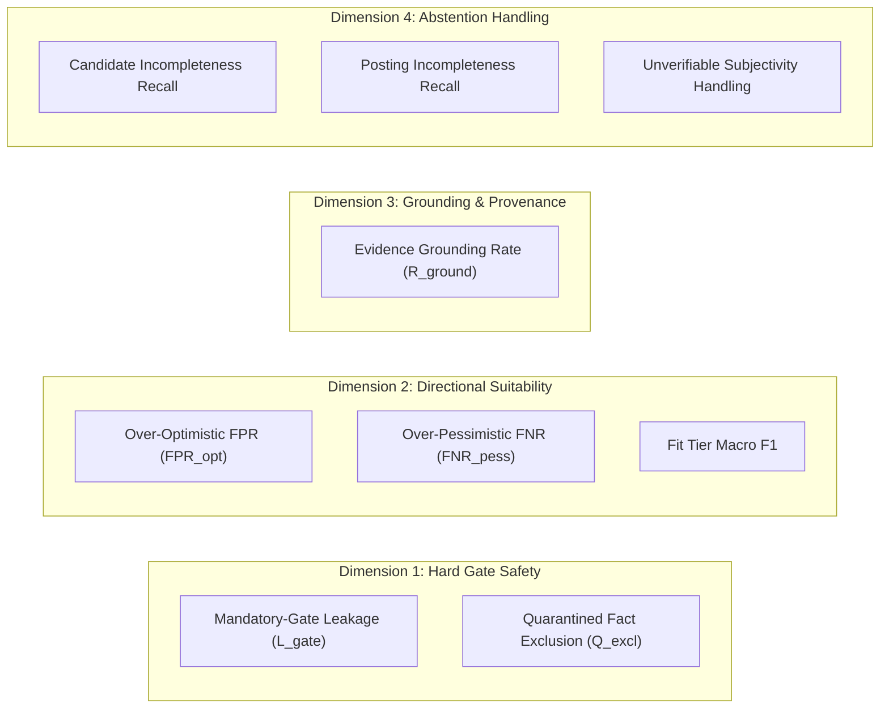
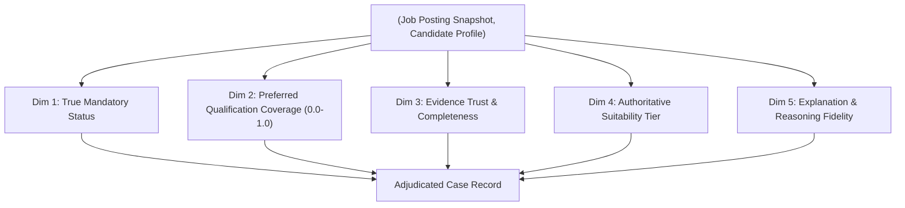
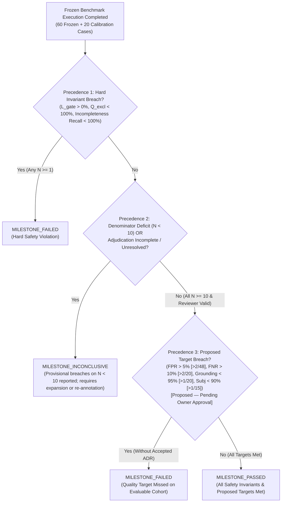
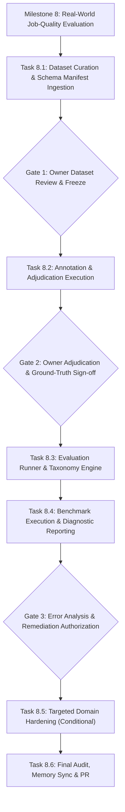

# Hire-Steward — Real-World Job-Quality Evaluation Design

**Revision:** 4.7 (Active Source of Truth; Revisions 1.0–4.6 are Historical)
**Status:** Decisions 1–6 APPROVED; Task 8.1 COMPLETE & VERIFIED; Gate 1 APPROVED BY OWNER (2026-10-31); Revision 4.7 CURRENT; Tasks 8.2–8.6 Strictly NOT_AUTHORIZED; Phase 0 IN_PROGRESS / NOT PASSED (Task 8.2 requires separate owner review & authorization)
**Author:** AI Evaluation Engineer, Software Architect, QA Lead, Adversarial Test Strategist<br>
**Date:** October 31, 2026
**Target Milestone:** Milestone 8 — Real-World Job-Quality Evaluation Benchmark<br>
**Scope Boundary:** Local-First Application Runtime (Zero Live ATS Requests, Zero Web Scraping). Task 8.2 Evaluation Involves Outbound HTTPS Requests to External Model Providers Once Authorized. Synthetically Authored Dataset with Documented Residual PII Collision Risk.

---

## 1. Executive Summary & Design Principles

> [!IMPORTANT]
> **Truth-in-Verification & Four-Layer Architectural Disclosure:**
> 1. **Existing Repository Test Suite (`pytest`):** The 325 passing unit/integration tests in `backend/tests/` validate only existing application code and Milestones 1–7 behavior. Passing these tests does **not** validate the Milestone 8 benchmark design or future evaluation fixtures.
> 2. **Document-Only Static Verification:** Mathematical consistency, table alignment, ID canonicalization, and whitespace integrity are verified via direct Python scanning of this specification document. Note that `git diff --check` only evaluates tracked files with unstaged or staged changes; because this design document is currently untracked, `git diff --check` does not inspect it. Direct document scanning is mandatory.
> 3. **Benchmark-Design Mathematical Validation:** This document establishes the theoretical validity, crossed-clustering structure, and discrete pass/fail boundaries of the 60-case evaluation model prior to authoring any fixtures.
> 4. **Future Runner Validation:** The single-pass evaluation runner (`run_real_world_eval.py`) is a proposed component to be implemented in Task 8.3 and executed in Task 8.4; it does not yet exist in the repository.


Hire-Steward has established a deterministic, explainable offline job search, matching, and application preparation foundation across Milestones 1 through 7, fully merged into `main` (commit `483a729`). In Milestone 7 (commit `a599467`), the system achieved a 100.0% pass rate across 37 frozen synthetic cases and 6 adversarial regression cases with 0.0% hard-gate leakage.

However, as established in ADR-0018, **clean synthetic benchmarks do not prove real-world matching quality**. Synthetic test fixtures are authored with clean section headers, unambiguous terminology, and predictable skill mentions. Real-world job postings, by contrast, are messy, unstructured, conversational, laden with boilerplate, and frequently conflate mandatory prerequisites with aspirational wishlists.

This document establishes the comprehensive specification for **Milestone 8: Real-World Job-Quality Evaluation**. Its objective is to measure how accurately Hire-Steward's deterministic matching engine, requirement extraction heuristics, and evidence-grounded explanations behave on realistic, diverse, and human-adjudicated job postings and candidate profiles, identifying systematic failure modes before any live source integrations are considered.

### Core Invariants:
1. **Local-First Application Runtime & Controlled Model Access:** Application matching and candidate evaluation runtime operate strictly on-device with zero live HTTP/socket requests to job boards, ATS APIs (Lever, Greenhouse, Ashby, Workday), or career pages. Outbound network access is strictly confined to explicitly authorized model-provider HTTPS API calls during Task 8.2 evaluation execution.
2. **Phase 0 Status Preservation:** Phase 0 remains `IN_PROGRESS / NOT PASSED`. All candidate ATS adapters remain disabled, unapproved, and in `NEEDS_REVIEW`.
3. **Synthetically Authored Dataset with Acknowledged Collision Risk:** All evaluation fixtures are synthetically authored without private candidate resumes or personal records. Synthetic authorship significantly reduces privacy exposure, but does not mathematically eliminate accidental collisions with real-world names or phone numbers. Accidental collision risk is explicitly acknowledged, analyzed, and mitigated.
4. **Human Authority Over Labels:** LLM output is never ground truth. Human expert adjudication is authoritative.
5. **Separation of Calibration and Evaluation:** Strict group-based clustering between calibration fixtures and the frozen test set to prevent threshold overfitting.
6. **No Production Code Modifications:** This document defines the evaluation framework design; no matching weights, production schemas, or application endpoints are altered during design.

---

## 2. Evaluation Unit, Data Relationships & Anti-Leakage Partitioning

### 2.1 The Evaluation Unit & Structural Definitions
To prevent terminological ambiguity across dataset accounting, evaluation metrics, and test fixtures, the fundamental units of evaluation are defined as follows:

1. **Evaluation Case:**
   The fundamental measurement and scoring unit, formally defined as an immutable 4-tuple:
   $$\text{Case} = \langle C_{\text{id}}, \ J_{\text{snap}}, \ P_{\text{cand}}, \ E_{\text{context}} \rangle$$
   Where:
   - **$C_{\text{id}}$ (Case Identifier):** A unique, deterministic string formatted as `rw_eval_[0-9]{3}` (e.g., `rw_eval_014`).
   - **$J_{\text{snap}}$ (Job Posting Snapshot):** An immutable posting representation containing employer handle, posting title, raw text description (`description_plain`), workplace type (`remote`, `hybrid`, `onsite`), location, structured lists (if present), and SHA-256 content hash.
   - **$P_{\text{cand}}$ (Candidate Profile Snapshot):** An immutable collection of structured candidate evidence facts (skills, education, employment, projects, certifications, verification states, and byte-span provenance references) linked to an archetype identifier.
   - **$E_{\text{context}}$ (Evaluation Context & Provenance):** Metadata recording posting provenance category, human ground-truth labels across five evaluation dimensions, reviewer notes, and adjudication audit trail.
2. **Posting Fixture ($J_{\text{snap}}$):**
   An immutable representation of an individual job posting snapshot. A single posting fixture is typically evaluated against 2 to 3 candidate profiles (a many-to-many relationship).
3. **Candidate Profile Snapshot ($P_{\text{cand}}$):**
   An immutable snapshot representing a distinct job applicant's verified and unverified facts. A single profile snapshot is evaluated against multiple posting fixtures across the dataset.
4. **Adversarial Probe:**
   A specialized, synthetic attack pair (1 synthetic attack posting $\times$ 1 targeted synthetic probe profile) designed to probe tokenizer/parser exploits (e.g. Unicode homoglyphs, zero-width spaces, token boundary collisions). Adversarial probes are strictly quarantined from evaluation benchmarks and run exclusively in automated CI regression tests.
5. **Case Fixture:**
   The physical on-disk JSON file (e.g., `rw_eval_001.json`) stored under `backend/tests/fixtures/real_matching_eval/` that serializes an evaluation case along with its embedded posting snapshot, candidate profile reference, provenance metadata, and adjudicated ground truth.

### 2.2 Relationship Between Postings and Profiles (Feasibility of Case Counts)
The relationship between postings and candidate profiles is **many-to-many**:
- A single job posting $J_i$ is typically evaluated against 2 to 3 candidate profiles $P_j$ (e.g., evaluating a Senior Go role against a strong Go backend candidate, a junior Python candidate, and a remote-only candidate in an incompatible timezone).
- Across the target **80 total evaluation cases** (20 calibration cases + 60 frozen benchmark cases), the dataset requires **approximately 28 to 32 distinct job postings** evaluated across **20 distinct, independently authored candidate profiles** (8 for calibration, 12 for frozen benchmark):
  - **Calibration Set (20 cases):** Derived from 8 distinct job postings evaluated across 8 distinct calibration candidate profiles ($P_{\text{calib\_01}}$ through $P_{\text{calib\_08}}$).
  - **Frozen Benchmark Set (60 cases):** Derived from 20 to 24 distinct job postings evaluated across 12 distinct frozen candidate profiles ($P_{\text{froz\_01}}$ through $P_{\text{froz\_12}}$).
- This many-to-many design makes manual curation and rigorous cluster isolation completely realistic and manageable for human reviewers, while providing sufficient cases for all safety cohorts to satisfy the minimum reporting/decision threshold ($N \ge 10$).

### 2.3 Dual-Sided Anti-Leakage Partitioning Protocol (Postings & Candidate Profiles)
Randomly splitting cases into calibration and evaluation sets would introduce severe data leakage on both the posting side and the candidate profile side:
1. **Posting-Side Leakage:** If Posting $J_1$ evaluated against Profile $P_1$ is placed in calibration, and the same Posting $J_1$ evaluated against Profile $P_2$ is placed in the frozen benchmark, the parser's handling of $J_1$'s specific formatting is leaked into calibration.
2. **Candidate-Side Leakage:** If the exact same candidate profile $P_1$ (with identical evidence facts, employer names, and byte-spans) is evaluated in both calibration and frozen sets, tuning the matching engine's skill extractor, synonym dictionary, or years-of-experience regex to $P_1$'s specific phrasing during calibration causes memorization and leaks candidate evidence patterns into the frozen benchmark.

To eliminate leakage from both directions, partitioning enforces strict **Dual-Sided Isolation**:

#### A. Six Orthogonal Dimensions & Anti-Leakage Isolation Protocol:

To eliminate data leakage, benchmark memorization, and parser overfitting, the evaluation architecture enforces strict orthogonal disjointness across all six structural dimensions:

1. **Dimension 1 — Candidate Profiles ($P_{\text{calib\_*}}, P_{\text{froz\_*}}$):**
   - *Definition:* The structured candidate evidence dossiers (facts, skills, work histories, education, projects, and byte-spans) evaluated against postings.
   - *Calibration Identifiers ($N = 8$):* `P_calib_01` through `P_calib_08`.
   - *Frozen Identifiers ($N = 12$):* `P_froz_01` through `P_froz_12`.
   - *Anti-Leakage Role:* Guarantees zero candidate fact or byte-span overlap ($\text{Profiles}_{\text{calib}} \cap \text{Profiles}_{\text{froz}} = \emptyset$). Prevents matching heuristics from memorizing specific candidate phrasings or resumes.

2. **Dimension 2 — Job Posting Fixtures ($J_{\text{calib\_*}}, J_{\text{froz\_*}}$):**
   - *Definition:* The immutable job posting snapshots containing role descriptions, qualification requirements, locations, and compensation listings.
   - *Calibration Identifiers ($N = 8$):* `J_calib_01` through `J_calib_08`.
   - *Frozen Identifiers ($N = 24$):* `J_froz_01` through `J_froz_24`.
   - *Anti-Leakage Role:* Guarantees zero posting text overlap ($\text{Postings}_{\text{calib}} \cap \text{Postings}_{\text{froz}} = \emptyset$). Prevents parser or matching engine heuristics from memorizing specific posting texts.

3. **Dimension 3 — Employer Identities / Clusters (`EMP_CALIB_*`, `EMP_FROZ_*`):**
   - *Definition:* The distinct hiring organization or legal employer offering the role.
   - *Calibration Identifiers ($N = 4$):* `EMP_CALIB_01` (`anon_ecommerce_scale`), `EMP_CALIB_02` (`anon_edtech_platform`), `EMP_CALIB_03` (`synth_ai_consultancy`), `EMP_CALIB_04` (`synth_biotech_tools`).
   - *Frozen Identifiers ($N = 8$):*
     - Real / Anonymized: `EMP_FROZ_01` (`anon_fintech_payments`), `EMP_FROZ_02` (`anon_healthtech_ai`), `EMP_FROZ_03` (`anon_enterprise_cloud`), `EMP_FROZ_04` (`anon_devops_saas`).
     - Synthetic Reconstructions: `EMP_FROZ_05` (`synth_early_stage`), `EMP_FROZ_06` (`synth_fin_trading`), `EMP_FROZ_07` (`synth_stub_corp`), `EMP_FROZ_08` (`synth_legacy_dump`).
   - *Anti-Leakage Role:* Guarantees zero employer overlap ($\text{Employers}_{\text{calib}} \cap \text{Employers}_{\text{froz}} = \emptyset$). Prevents matching heuristics, synonym dictionaries, or prompt weights from memorizing company-specific culture keywords, benefits, tech-stack defaults, or phrasing patterns.

4. **Dimension 4 — Real ATS / Source Platforms (`ATS_*` for Real Excerpts):**
   - *Definition:* The Applicant Tracking System or hosting portal software from which real job postings were extracted.
   - *Calibration Identifiers ($N = 2$):* `ATS_SMARTRECRUITERS`, `ATS_ICIMS`.
   - *Frozen Identifiers ($N = 4$):* `ATS_GREENHOUSE`, `ATS_LEVER`, `ATS_WORKDAY`, `ATS_ASHBY`.
   - *Anti-Leakage Role:* Guarantees that ATS-specific DOM wrappers, boilerplate disclosures, standard EEO statements, and layout conventions do not leak parser memorization between calibration and frozen sets.

5. **Dimension 5 — Synthetic Source Pipelines (`PIPE_SYNTH_*` for Synthetic Reconstructions):**
   - *Definition:* The generator architecture, prompt templates, and pipeline parameters used to synthesize job postings.
   - *Calibration Identifiers ($N = 2$):* `PIPE_SYNTH_CALIB_CHAT` (chat transcript extraction pipeline), `PIPE_SYNTH_CALIB_FORUM` (developer forum / community job thread pipeline).
   - *Frozen Identifiers ($N = 4$):*
     - `PIPE_SYNTH_DIRECT`: Direct authoring Markdown pipeline (founder/startup spec).
     - `PIPE_SYNTH_BOARD`: Job board aggregator simulator pipeline (fintech/trading spec).
     - `PIPE_SYNTH_FEED`: API ingested structured-to-text feed pipeline (truncated corporate stubs).
     - `PIPE_SYNTH_DUMP`: Web crawl raw unformatted text dump pipeline (legacy OCR/noisy text).
   - *Anti-Leakage Role:* Guarantees that synthetic generator prompts, seeds, and authoring personas are strictly disjoint between calibration and frozen partitions, preventing prompt-structure leakage.

6. **Dimension 6 — Formatting / Template Clusters (`FMT_CALIB_*`, `FMT_FROZ_*`):**
   - *Definition:* The syntactic structure, markup conventions, and typographical presentation of the posting text.
   - *Calibration Identifiers ($N = 4$):* `FMT_CALIB_01` (`Numbered_Outline`), `FMT_CALIB_02` (`Table_Layout`), `FMT_CALIB_03` (`FAQ_Style`), `FMT_CALIB_04` (`Single_Runon_Block`).
   - *Frozen Identifiers ($N = 8$):*
     - `FMT_FROZ_01` (`Structured_Markdown_Bullets`): Standard Markdown with clean bulleted lists.
     - `FMT_FROZ_02` (`Narrative_Bullets_Combo`): Narrative prose overview followed by bulleted requirements.
     - `FMT_FROZ_03` (`Multi_Section_Nested_Headers`): Multi-section enterprise layout with deeply nested headers.
     - `FMT_FROZ_04` (`Dense_Spec_Sheet`): Semicolon-delimited, compact specification sheet.
     - `FMT_FROZ_05` (`Conversational_Prose`): Conversational prose without bullet lists.
     - `FMT_FROZ_06` (`Acronym_Dense_Heavy_Terms`): High-density technical jargon and specialized acronyms.
     - `FMT_FROZ_07` (`Truncated_Sections`): Incomplete posting stubs with cut-off qualification blocks.
     - `FMT_FROZ_08` (`Unstructured_OCR`): Irregular spacing, missing line breaks, raw crawler text.
   - *Anti-Leakage Role:* Prevents extraction heuristics, section-header regexes, and bullet-point parsers from overfitting to specific layout patterns during calibration.

#### Exhaustive Six-Dimensional Anti-Leakage Isolation & Disjointness Audit Matrix:

| Leakage Dimension | Calibration Partition Identifiers | Frozen Benchmark Partition Identifiers | Set Intersection ($\text{Calib} \cap \text{Frozen}$) | Disjointness Audit Result | Anti-Leakage & Generalization Role |
| :--- | :--- | :--- | :--- | :--- | :--- |
| **1. Candidate Profiles ($P$)** | `P_calib_01` through `P_calib_08` ($N = 8$) | `P_froz_01` through `P_froz_12` ($N = 12$) | $\emptyset$ ($0$ overlapping profiles) | **PASS (Strictly Disjoint)** | Candidate fact quarantine: zero shared candidate evidence facts, employer histories, projects, or byte-spans. |
| **2. Job Posting Fixtures ($J$)** | `J_calib_01` through `J_calib_08` ($N = 8$) | `J_froz_01` through `J_froz_24` ($N = 24$) | $\emptyset$ ($0$ overlapping postings) | **PASS (Strictly Disjoint)** | Posting text quarantine: zero shared job posting descriptions, requirements, or compensation listings. |
| **3. Employer Identities ($E$)** | `EMP_CALIB_01` (`anon_ecommerce_scale`), `EMP_CALIB_02` (`anon_edtech_platform`), `EMP_CALIB_03` (`synth_ai_consultancy`), `EMP_CALIB_04` (`synth_biotech_tools`) ($N = 4$) | `EMP_FROZ_01` (`anon_fintech_payments`), `EMP_FROZ_02` (`anon_healthtech_ai`), `EMP_FROZ_03` (`anon_enterprise_cloud`), `EMP_FROZ_04` (`anon_devops_saas`), `EMP_FROZ_05` (`synth_early_stage`), `EMP_FROZ_06` (`synth_fin_trading`), `EMP_FROZ_07` (`synth_stub_corp`), `EMP_FROZ_08` (`synth_legacy_dump`) ($N = 8$) | $\emptyset$ ($0$ overlapping employers) | **PASS (Strictly Disjoint)** | Organizational quarantine: prevents matching engine from memorizing company-specific culture, benefits, or tech stack defaults. |
| **4. Real ATS / Source Platforms ($S_{\text{real}}$)** | `ATS_SMARTRECRUITERS`, `ATS_ICIMS` ($N = 2$) | `ATS_GREENHOUSE`, `ATS_LEVER`, `ATS_WORKDAY`, `ATS_ASHBY` ($N = 4$) | $\emptyset$ ($0$ overlapping platforms) | **PASS (Strictly Disjoint)** | Platform quarantine: prevents extraction regexes or parser heuristics from memorizing vendor-specific DOM wrappers, boilerplate disclosures, or EEO layouts. |
| **5. Synthetic Source Pipelines ($S_{\text{synth}}$)** | `PIPE_SYNTH_CALIB_CHAT` (chat transcript parser), `PIPE_SYNTH_CALIB_FORUM` (developer forum post parser) ($N = 2$) | `PIPE_SYNTH_DIRECT` (direct markdown founder spec), `PIPE_SYNTH_BOARD` (job board aggregator simulator), `PIPE_SYNTH_FEED` (API ingested truncated stubs), `PIPE_SYNTH_DUMP` (raw OCR / noisy text dump) ($N = 4$) | $\emptyset$ ($0$ overlapping synthetic pipelines) | **PASS (Strictly Disjoint)** | Generator quarantine: ensures prompt structures, generation seeds, and authoring personas are strictly non-overlapping. |
| **6. Formatting Clusters ($F$)** | `FMT_CALIB_01` (`Numbered_Outline`), `FMT_CALIB_02` (`Table_Layout`), `FMT_CALIB_03` (`FAQ_Style`), `FMT_CALIB_04` (`Single_Runon_Block`) ($N = 4$) | `FMT_FROZ_01` (`Structured_Markdown_Bullets`), `FMT_FROZ_02` (`Narrative_Bullets_Combo`), `FMT_FROZ_03` (`Multi_Section_Nested_Headers`), `FMT_FROZ_04` (`Dense_Spec_Sheet`), `FMT_FROZ_05` (`Conversational_Prose`), `FMT_FROZ_06` (`Acronym_Dense_Heavy_Terms`), `FMT_FROZ_07` (`Truncated_Sections`), `FMT_FROZ_08` (`Unstructured_OCR`) ($N = 8$) | $\emptyset$ ($0$ overlapping formats) | **PASS (Strictly Disjoint)** | Layout quarantine: ensures section-header regexes, bullet parsers, and typography extractors generalize across unseen layouts. |

#### Shared Vendor ATS Platform Analysis: Real-World Industry Practice, Risk Analysis & Architectural Mitigation:

1. **Reason for Potential ATS Vendor Commonality in Real-World Ecosystems:**
   In commercial recruitment, thousands of independent employers host their careers pages on a small handful of market-leading ATS vendor platforms (e.g., Greenhouse, Lever, Workday, SmartRecruiters). Consequently, in extended production deployments, candidates will inevitably encounter distinct employers that happen to utilize the same underlying ATS platform software.

2. **Leakage Risk Analysis:**
   If a matching engine or parser overfits its text-cleaning heuristics to standard vendor boilerplates (e.g. "Powered by Greenhouse", standard California privacy notices, or Workday requisition ID footers) during calibration, could this compromise evaluation validity if the same ATS vendor appears in the evaluation benchmark?
   - *Direct Fact Leakage Risk: NONE.* ATS platforms do not author candidate qualifications or job requirements; they only host text authored by independent human recruiters.
   - *Parser Shortcut Risk: LOW TO MODERATE.* If an extraction heuristic learns to strip a specific ATS vendor's disclaimer footer during calibration, it might artificially inflate parser cleanliness on that vendor's postings in evaluation.

3. **Multi-Layer Architectural Mitigation & Proof of Zero Leakage:**
   - **Nominal Benchmark Disjointness:** In this benchmark specification, real ATS platforms are partitioned with **zero overlap** (`ATS_SMARTRECRUITERS` and `ATS_ICIMS` in calibration; `ATS_GREENHOUSE`, `ATS_LEVER`, `ATS_WORKDAY`, `ATS_ASHBY` in frozen benchmark; $\text{Calib} \cap \text{Frozen} = \emptyset$).
   - **Plaintext Abstraction Boundary:** Hire-Steward evaluation cases feed normalized plaintext snapshots (`description_plain`) and extracted qualification lists (`lists_json`) to the matching engine, NOT live HTTP responses or raw HTML DOM trees. Vendor-specific HTML wrappers are stripped during upstream intake before matching evaluation occurs.
   - **Orthogonal Entity Disjointness:** Even in future expansions where an ATS vendor might be shared across partitions, employer identities (`EMP_*`), job postings (`J_*`), candidate profiles (`P_*`), and formatting template clusters (`FMT_*`) remain 100% disjoint. The semantic matching engine evaluates candidate evidence against job requirements, neither of which depends on ATS vendor mechanics.

#### B. Candidate Profile Snapshot Isolation (Candidate-Side Anti-Leakage):
- **Zero Candidate Profile Overlap:**
  $$\text{Profiles}_{\text{calib}} \cap \text{Profiles}_{\text{frozen}} = \emptyset$$
  Candidate profiles evaluated in calibration ($P_{\text{calib\_01}}$ through $P_{\text{calib\_08}}$) and frozen evaluation ($P_{\text{froz\_01}}$ through $P_{\text{froz\_12}}$) must be physically and textually independent snapshots.
- **Archetype Categories vs. Underlying Evidence Facts:**
  - *Permitted Category Overlap:* Both calibration and frozen partitions may include candidate profiles representing similar high-level role archetypes (e.g., "Senior Go Backend", "Junior Python", "Mid-Level Frontend React", "Staff Platform/SRE") to ensure technical domain diversity across partitions.
  - *Strict Evidence Fact Quarantine:* The underlying candidate facts, employer history, project summaries, educational credentials, exact skill formulations, and byte-span offsets must be **independently authored and completely disjoint**. For example, a calibration Go profile ($P_{\text{calib\_01}}$) may cite 5 years Go in payments with CockroachDB, while a frozen Go profile ($P_{\text{froz\_01}}$) cites 6 years Go in streaming data with Kafka and ClickHouse. Tuning heuristics to the specific phrasing in $P_{\text{calib\_01}}$ cannot leak to $P_{\text{froz\_01}}$.
- **Calibration Tuning Firewall:**
  During Task 8.5 (conditional domain hardening), developers and evaluators may inspect and tune matching heuristics only against calibration profiles and calibration error traces. **Frozen candidate profiles, ground-truth labels, and test outcomes are strictly sealed behind an evaluation firewall until benchmark execution**.
- **Generalization Scope Limitation Disclosure:**
  While candidate snapshot isolation prevents direct fact memorization, candidate profiles authored by the evaluation team will naturally share certain authoring conventions. Passing this benchmark establishes candidate generalization across independent profiles within the defined schema taxonomy, but does **not** prove universal generalization over arbitrary real-world resumes with noisy OCR, malformed formatting, or multi-lingual text.

#### C. Partition Governance & Deficit Rules:
1. **Cluster Imbalance & Strata Deficit Protocol:** If cluster-based assignment produces an imbalance in the frozen set (e.g., leaving a deficit of Senior Frontend roles in the benchmark), the team must **curate an additional independent cluster and profile** to fill the target quota, rather than splitting an existing cluster or profile across the boundary.
2. **Metric Boundary Isolation:** Only the frozen benchmark set determines the primary milestone pass/fail results. Calibration results are strictly diagnostic for development and are **never pooled into frozen benchmark pass/fail metrics**.
3. **Separate Adversarial Regression Suite:** The 12-case Adversarial Regression Suite is physically and procedurally quarantined from both calibration and frozen benchmark sets; it serves exclusively as an automated regression blocker in CI.

---

### 2.3.1 Enforceable Candidate Isolation, Control Implementation Taxonomy & Truth-in-Security Governance

To establish clear and honest governance over candidate-side independence, data isolation, and security controls, the framework defines how controls are classified, verified, and audited across three canonical implementation statuses rather than making blanket claims of programmatic enforcement.

#### A. Multi-Tier Candidate Screening & Validation Pipeline:
1. **Tier 1 — Exact Duplicate Detection (Automated Gate — IMPLEMENTED_AND_VERIFIED):**
   - The automated audit suite computes cryptographic SHA-256 hashes for every candidate fact statement, project summary, educational record, and employer name string.
   - Cross-partition hash collisions between $\text{Profiles}_{\text{calib}}$ and $\text{Profiles}_{\text{frozen}}$ are strictly forbidden ($\text{Collision Count} = 0$). Any identical fact statement triggers an immediate automated freeze block.
2. **Tier 2 — Near-Duplicate Detection (Provisional Screening Tripwire — DESIGNED_NOT_IMPLEMENTED):**
   - Fact statements are compared across partitions using character 3-gram Jaccard similarity.
   - *Provisional Screening Threshold ($\text{Jaccard} \le 0.15$):* The 0.15 cutoff serves strictly as a planned automated **screening tripwire requiring empirical calibration on calibration profiles**, not proof of independence. Exact cryptographic hash, character n-gram lexical overlap, and human semantic review function as **three complementary screening mechanisms** operating across lexical, syntactic, and contextual layers. Because common technical qualifications (e.g., standard tool lists such as "Docker, Kubernetes, AWS" or generic phrases like "5 years of experience in distributed systems") can trigger high lexical overlap without true factual duplication, pairs exceeding 0.15 are routed to Tier 3 for semantic adjudication.
3. **Tier 3 — Semantic Overlap & Contextual Adjudication (Procedural Review Protocol — IMPLEMENTED_AND_VERIFIED for Curated Baseline):**
   - When a fact pair exceeds the provisional 0.15 screening threshold, human reviewers examine the surrounding entity context:
     - *Benign False Positives:* Standard industry jargon, canonical library names, and standard degree titles are cleared if employer histories, project deliverables, and architectural contexts are completely disjoint. Cleared false positives must be documented with written justification in the audit log.
     - *Unresolved Overlap & True Leaks:* If candidate facts share substantive project narratives, client engagements, or unique problem formulations across partitions, the candidate profile is classified as **leaked** and must be re-authored or replaced before freeze.
4. **Tier 4 — Shared Source-Material & Generation Audit (Procedural Generation Audit — IMPLEMENTED_AND_VERIFIED for Curated Baseline):**
   - Evaluators audit generator prompts, seed resumes, and biographical templates to verify that calibration and frozen profiles originate from disjoint generation pipelines and independent random seeds.

#### B. Contact Information Validation Taxonomy: Supplied vs. Syntactic vs. Verified:
To eliminate ambiguity in candidate profile completeness, the system explicitly distinguishes three hierarchical levels of contact data validation:
1. **Contact Information Supplied:** A field value is present (non-null string) for email or telephone. It indicates that the user attempted to provide contact coordinates, but provides zero structural guarantee.
2. **Syntactically Valid Contact Information (Profile Completeness Standard):**
   - *Email:* A non-empty string satisfying basic offline structural syntax: contains `@` with a non-empty local prefix and domain containing at least one dot delimiter (`user@domain.tld`), conforming to RFC 2606 / RFC 6761 reserved domains in evaluation fixtures (`.invalid`, `.example`, `example.com`, `example.org`, `example.net`; `test.com` is an active commercial domain and is strictly prohibited as a reserved domain). A basic offline syntax check confirms structural format only; it does **not** prove deliverability, non-routability, active MX records, or remote mailbox existence.
   - *Telephone:* Offline syntactic format check — string matching basic telecom formatting: optional leading `+`, permitted delimiters (hyphens, dots, spaces, parentheses), between 7 and 20 total characters, and at least 7 numeric digits (`sum(c.isdigit() for c in phone) >= 7`). Basic syntactic formatting confirms telecom formatting structure, but does **not** prove ITU-T E.164 allocation, carrier routing, active subscription, or live device reachability. Merely supplying a non-empty string is not equated with syntactic validity. Standard international mobile test strings (e.g., `+91-98765-01001`, exactly 15 Unicode code points) satisfy syntactic validity.
   - *Offline Completeness Boundary:* Syntactic validity is the **exact and only standard required for candidate profile completeness**.
3. **Independently Verified Contact Information (Out of Scope for Offline Matching):**
   - External verification of mailbox existence (via SMTP/MX handshake or confirmation token loop) or telephony reachability (via SMS OTP or carrier HLR lookup).
   - *Strict Local-First Boundary:* Hire-Steward operates strictly offline and local-first. It does **NOT** make external network calls, introduce third-party phone verification services, or ping mail exchangers during profile ingestion or evaluation. Profiles are never penalized or blocked for lacking external third-party reachability verification.

#### C. Control Implementation Status Taxonomy (Three Canonical Statuses):
To eliminate ambiguous claims of security or implementation maturity, every system control, validation script, and security boundary is classified under exactly one of three canonical statuses:
1. **`DESIGNED_NOT_IMPLEMENTED`:** Architectural specifications, data flow designs, future runner mechanisms, and planned verification tests that have been documented in accepted ADRs or design specifications but do not yet exist as executable code in the repository. (Examples: Single-pass runner `run_real_world_eval.py`, automated error taxonomy engine `E01`?`E10`, model assessment JSON serializer, owner reference adjudication web interface, future owner-reference PII verification tests).
2. **`IMPLEMENTED_NOT_VERIFIED`:** Scripts, schema definitions, or application modules written and present in the working tree, but lacking comprehensive automated test suite coverage, formal verification receipts, or owner sign-off.
3. **`IMPLEMENTED_AND_VERIFIED`:** Concrete implementation code and fixtures present in the repository and verified by passing automated test suites with documented evidence. (Examples: Fast unit test suite in `backend/tests/unit/`, Task 8.1 92 evaluation case fixtures in `backend/tests/fixtures/real_matching_eval/cases/`, 5 JSON schemas, SHA-256 `manifest.json` tracking 188 files with self-digest `31f7db7c...` verified by 20 passing unit tests in `test_real_world_eval_dataset.py`, and 345 passing tests in the fast suite).

#### D. Honest Governance Disclosures & Local-First Limitations:
1. **Cryptographic Hashes as Integrity References, Not Proof of Immutability or Identity:**
   - A SHA-256 digest is a point-in-time byte-level integrity verification mechanism. It detects accidental corruption or unrecorded file modifications.
   - A hash is **NOT proof of immutability**: anyone with write access to the filesystem or Git repository can recompute and overwrite both the target file and the manifest.
   - A hash chain without an asymmetric digital signature (GPG/signify) anchored to an external trusted PKI is **NOT proof of author identity or authorization**.
   - An accepted Architecture Decision Record (ADR) on `main` is a governance consensus record, not an asymmetric cryptographic proof.
2. **Local Administrator Bypass & Inherent Local-First Boundaries:**
   - On a local workstation, a local administrator with filesystem permissions can modify fixtures, inspect reference labels, alter manifests, or bypass evaluation scripts at any time.
   - Clean Git tree verification (`git status --porcelain` empty) verifies that no uncommitted code or fixture drift exists; **it does NOT provide OS-level confidentiality, hardware encryption, or access prevention against local administrators.**
   - Blinding integrity in a local-first architecture relies on post-hoc auditability: official benchmark results are valid only if accompanied by an unbroken Git commit history, a clean receipt matching the committed manifest hash, and transparent review.
3. **Tokenization, Pseudonymization & HMAC 64-Bit Bounds:**
   - Evaluating token uniqueness across 92 curated fixture cases confirms absence of duplicate tokens within that specific fixture set; it does **NOT prove asymptotic collision resistance** across larger populations.
   - When HMAC-SHA256 tokens are truncated to 64 bits (16 hexadecimal characters), the token space contains $2^{64} \approx 1.84 \times 10^{19}$ possible states. By the Birthday Problem, the 50% collision probability bound occurs after approximately $2^{32} \approx 4.29 \times 10^9$ evaluations. While sufficient for offline benchmarking, 64-bit truncated tokens do not provide infinite collision safety.
   - Truncated HMAC tokens provide deterministic pseudonymization, not cryptographic secrecy or one-way privacy without secure key management.
4. **Internal Identifier Quarantine:**
   - `source_fixture_id` (e.g. `rw_eval_014`, `rw_calib_002`) and local file paths are strictly restricted to internal owner-side audit records, manifest indexes, and adjudication cross-references.
   - **Internal identifiers must NEVER be included in model-facing evaluation payloads** transmitted to external model providers, preventing models from exploiting naming patterns or sequence cues.

---

### 2.3.2 Comprehensive Compensation Representation Taxonomy & Multi-Component Evaluation

To ensure that candidate compensation preferences and employer compensation offerings are evaluated accurately, compensation is never reduced to a simplistic binary flag or a single scalar figure. Where text evidence supports it, compensation is modeled across seven distinct, structured components:

#### A. Structured Compensation Dimensions:
1. **Amount or Numerical Range:**
   - `amount_min`: Lower financial bound (numeric float/int, e.g. `120000.00`).
   - `amount_max`: Upper financial bound (numeric float/int, e.g. `150000.00`). When a single exact figure is stated, $\text{min} = \text{max}$.
2. **Currency Code:**
   - Standard ISO 4217 three-letter currency code (e.g. `USD`, `EUR`, `GBP`, `INR`, `CAD`). `null` when undisclosed.
3. **Payment Frequency:**
   - Cadence of payment: `ANNUAL`, `MONTHLY`, `HOURLY`, `WEEKLY`, `PROJECT_BASED`, or `UNSPECIFIED`.
4. **Contract Duration & Commitment:**
   - `PERMANENT_INDEFINITE`, `FIXED_TERM_MONTHS` (with explicit integer month count), `CONTRACT_PROJECT`, or `UNSPECIFIED`.
5. **Guarantee Status & Nature of Compensation:**
   - `GUARANTEED_SALARY`: Fixed, contractual cash base compensation.
   - `CONDITIONAL_OR_VARIABLE`: Performance bonuses, sales commissions, profit-sharing, or tips.
   - `MIXED_ARRANGEMENT`: Explicit multi-part compensation structures (e.g., base salary plus commission; base salary plus educational stipend; commission plus equity without guaranteed base salary).
   - `NON_CASH_ONLY`: Roles offering equity, academic credit, housing, or mentorship in place of cash compensation ($0.00 cash).
   - `EXPLICITLY_UNPAID`: Uncompensated labor, unpaid internships, or volunteer work ($0.00 cash, 0 equity).
   - `UNSPECIFIED_OR_VAGUE`: Postings with no compensation information or using vague colloquialisms.
6. **Separation of Equity & Non-Cash Benefits from Cash Compensation:**
   - Equity grants (stock options, RSUs, profit interests) and non-cash benefits (comprehensive medical insurance, 401(k) matching, transit passes, equipment stipends) must be represented in distinct, dedicated schema structures (`equity_offered: bool`, `equity_details: str`, `benefits_list: list[str]`).
   - Equity and benefits must **never be monetized into phantom cash equivalents or added to guaranteed base salary**.
7. **Explicit Zero Financial Compensation Representation:**
   - When a posting or candidate profile explicitly specifies uncompensated work (unpaid internship, pure equity co-founder, volunteer role):
     - `amount_min = 0.00`, `amount_max = 0.00`, `frequency = ANNUAL`, `nature_of_compensation = EXPLICITLY_UNPAID` (or `NON_CASH_ONLY`).
     - This explicit zero state is represented cleanly without contradictory non-zero flags or phantom salary estimations.

#### B. Handling Vague Phrases & Prohibition of Phantom Salary:
- Job postings frequently contain vague, non-committal compensation phrases such as "competitive salary", "salary commensurate with experience (DOE)", "negotiable", "industry standard", or "market rate".
- **Strict Prohibition of Phantom Salary:** The matching engine and evaluation heuristics are strictly forbidden from inferring, estimating, or predicting numeric salary amounts for vague phrases based on job titles, geographical averages, or industry benchmarks.
- Vague compensation phrases must be classified as `UNSPECIFIED_OR_VAGUE` with numeric amounts set to `null` and currency set to `null`.
- In candidate matching, `UNSPECIFIED_OR_VAGUE` compensation defaults to an unevidenced constraint state (`UNKNOWN`). It remains informational and **non-blocking** to the candidate's review.

#### C. Evaluation Constraint Gating & Compensation Policy:
1. **Independent Unpaid Role Gate:** Roles classified as `EXPLICITLY_UNPAID` or `NON_CASH_ONLY` (in the absence of documented statutory exemptions) fail the non-negotiable compensation gate ($L_{\text{gate}}$), triggering an automatic fail-closed evaluation status (`BLOCKED_OR_CONTRADICTED`).
2. **Compensation Floor Verification:** When a candidate configures a minimum annual compensation floor (e.g. $100,000 USD/year), the floor is evaluated **strictly against confirmed guaranteed cash compensation** (`GUARANTEED_SALARY` or guaranteed base of `MIXED_ARRANGEMENT`). Variable commissions, conditional bonuses, and equity cannot satisfy the floor unless guaranteed.
3. **Commission-Only & Variable Roles:** Roles offering variable compensation without guaranteed base cash (e.g. commission-only sales) cannot satisfy a candidate's guaranteed salary floor, but are distinguished from unpaid labor in error reporting (`E03`).

---

### 2.3.3 Evidence Offsets, Coordinate Mapping & Normalization Invariants (DESIGNED_NOT_IMPLEMENTED)

To guarantee that evidence citations, highlighted text spans, and audit trails remain precise and verifiable across processing layers, evidence offset handling adheres to strict mathematical coordinate standards. This entire coordinate mapping subsystem is classified as `DESIGNED_NOT_IMPLEMENTED` pending implementation in Task 8.2 and Task 8.3:

#### A. Unicode Scalar Code Point Standard:
- All character offsets in Hire-Steward are strictly defined in **Python Unicode scalar code points** (`text[start:end]`), where each Unicode character (including emoji, mathematical symbols, and accented characters) corresponds to exactly one integer index.
- Offsets are **NOT** measured in UTF-8 byte spans or UTF-16 surrogate pairs. This eliminates cross-platform indexing discrepancies between Python, SQLite, PostgreSQL, and JSON parsers.

#### B. Text Normalization Pipeline & Canonical Source Space:
To establish unambiguous coordinates, all input text undergoes a deterministic two-stage normalization pipeline before coordinate calculation:
1. **Line-Ending Normalization:** Windows CRLF (`\r\n`, length 2) sequences are converted to POSIX LF (`\n`, length 1).
2. **Unicode Canonical Composition (NFC):** Text is normalized using Unicode Canonical Composition (NFC). The destructive compatibility decomposition form (NFKC) is **strictly prohibited**, as NFKC decomposes and irreversibly alters typographic symbols, fractions, superscripts, ligatures, and mathematical notation.
3. **Execution Order Invariant:** Canonical source offsets are established **strictly AFTER text normalization**. The normalized string is the definitive baseline for all source coordinate references.

#### C. Source Coordinates vs. Payload Coordinates:
Because evaluation involves serializing, blinding, and redacting case text for external model inspection, the framework maintains an explicit distinction between two coordinate spaces:
1. **Source Coordinates ($C_{\text{source}} = \langle \text{start}_{\text{source}}, \text{end}_{\text{source}} \rangle$):** Denotes the exact character interval in the post-normalized canonical posting description (`description_plain`) or candidate resume dossier stored in the internal fixture.
2. **Payload Coordinates ($C_{\text{payload}} = \langle \text{start}_{\text{payload}}, \text{end}_{\text{payload}} \rangle$):** Denotes the character interval in the blinded, redacted JSON payload transmitted to external models.

#### D. Redaction Boundary Behavior & Monotonic Coordinate Mapping:
- **Redaction Replacement Deltas:** Replacing an entity (e.g., candidate name "Priya Sharma" [12 chars] with "Candidate C01" [13 chars], or telephone `+91-98765-01001` [15 chars] with `[REDACTED_PHONE]` [16 chars]) introduces localized positive or negative length deltas.
- **Handling Adjacent & Overlapping Redactions:**
  - *Adjacent Redactions:* Adjacent redacted entities produce concatenated markers without intervening whitespace.
  - *Overlapping Redactions:* Overlapping entity spans must be merged into a single encompassing span before marker replacement to prevent corrupted, nested, or conflicting marker insertions.
- **Monotonic Interval Map ($M$):** The serializer generates an immutable, piecewise monotonic interval projection map:
  $$M: [a_{\text{payload}}, b_{\text{payload}}] \to [a_{\text{source}}, b_{\text{source}}]$$
  Tracking cumulative normalization and redaction offsets, projecting model-cited payload coordinates back to source text spans for owner verification.

#### E. Atomic Redaction Markers & Partial-Marker Fail-Closed Rejection:
- Redaction markers (e.g. `[REDACTED_PHONE]`, `[REDACTED_EMAIL]`, `Candidate C01`) are atomic semantic tokens.
- **Fail-Closed Partial Marker Rule:** If an external model output cites an evidence span that partially overlaps or bisects a redaction marker (e.g., citing `REDACTED_PH` or `didate C01`), the citation is classified as corrupted. The evaluation runner rejects the citation (`E09` / `AMBIGUOUS_UNVERIFIABLE`), preventing malformed span alignment from passing evaluation.

#### F. Lossy Redaction & Non-Reversibility Disclosure:
- Redaction is strictly **lossy and one-way**.
- **Non-Reversibility Disclaimer:** Monotonicity of the interval map $M$ allows projecting payload coordinates back to source character boundaries in the presence of the original source text, but **monotonicity alone does NOT guarantee reversibility or unambiguous attribution across adjacent markers**. The tokenized payload alone cannot be cryptographically reversed or used to reconstruct redacted personal data.

---

### 2.3.4 PII Sourcing Governance, Synthetic Authorship vs. Collision Risk, & Detection Boundaries

To maintain rigorous data privacy and truthful legal disclosures, the sourcing policy and PII management framework adhere to strict boundaries:

#### A. Sourcing Distinction: Synthetic Authorship vs. Absence of Real-World PII:
Synthetically authoring text (generating fictitious names, emails, and job descriptions) does **not** mathematically prove the complete absence of real-world PII. The framework explicitly distinguishes six orthogonal layers:
1. **Synthetic Authorship:** Test fixtures are authored by project engineers and generative prompts, never collected by scraping live job boards or private candidate resumes.
2. **Accidental Collision Risk:** The unavoidable statistical reality that a fictitious name (e.g. "Arun Kumar", "Sarah Jenkins") or telephone digit sequence accidentally coincides with a real living person or active telephone number in the real world.
3. **Automated Detection:** Regular expression, NER, and heuristic pattern scanners designed to identify standard email, telephone, URL, and national identification formats.
4. **Owner / Reference-Based Detection:** Automated checks comparing case text against internal owner identity registries and known fixture entity manifests.
5. **Manual Review:** Rigorous human review conducted during Gate 1 curation across all 92 case fixtures.
6. **Residual Risk:** The acknowledged residual possibility that novel, unstructured, or colloquial personal identifiers remain undetected by finite pattern rules.

#### B. Non-Routable Reserved Email Domains via RFC 2606 & RFC 6761:
- All candidate and recruiter email addresses in evaluation fixtures strictly use IETF/IANA reserved top-level domains (`.invalid`, `.example`) and reserved second-level domains (`example.com`, `example.org`, `example.net`) established under RFC 2606 and RFC 6761.
- `test.com` is an active commercial domain owned by a third party and is strictly PROHIBITED from being treated as a reserved or non-routable domain.
- While RFC 2606 / RFC 6761 reserved domains prevent inadvertent global routing to real-world mailboxes, basic syntactic validation of email addresses confirms format only; it does not prove deliverability or non-routability.

#### C. Telephone Numbers & Telecom Allocation Boundaries:
- Unlike Internet domain names, there is **no international RFC equivalent providing guaranteed non-routable telephone number ranges worldwide**.
- Standard telecom ranges (such as North American 555 numbers) do not apply to European, Indian, or Asian dial plans.
- Automated telephone validation confirms syntactic telecom formatting (e.g., `+91-98765-01001`, exactly 15 Unicode code points), but does **not prove carrier non-allocation or disconnection**. All telephone numbers in fixtures are fictitious dummy strings.

#### D. Scanner Detection Limitations:
1. **Name Dictionaries:** Finite name dictionaries exhibit systematic blind spots for multi-cultural, regional, transliterated, or compound names.
2. **International Dial Plans:** Regexes tuned to North American NANP patterns fail on international formats (e.g. UK mobile prefixes, Indian 10-digit mobile series, European trunk codes).
3. **Postal Codes:** Retaining realistic 5-digit or 6-digit postal codes to evaluate location matching creates unavoidable geographical correlations with real locations.
4. **Numeric Pattern Collisions:** Long numeric sequences (requisition numbers, annual salary figures, date stamps) can trigger false-positive alerts against national ID patterns.

#### E. Status of Future Reference-Based PII Tests:
Any future test suites comparing model outputs or candidate dossiers against external PII registries or owner reference databases are formally classified as `DESIGNED_NOT_IMPLEMENTED`. They represent planned future quality checks, not verified baseline capabilities.

---

### 2.4 Partition-Feasibility Model & Consolidated Allocation Breakdown (Task 8.1 Curated & Verified Baseline)

> [!NOTE]
> **Task 8.1 Curation Status: Curated & Verified Baseline:**
> The allocation breakdown below represents the concrete, curated evaluation dataset established and verified in Task 8.1 under Gate 1 approval. The dataset comprises **92 total evaluation fixtures** (60 frozen benchmark cases, 20 calibration cases, and 12 adversarial regression probes) across 41 candidate profiles, 48 job postings, 12 employer identities, and 12 formatting clusters. All posting-cluster and candidate-profile isolation constraints are cryptographically tracked in `backend/tests/fixtures/real_matching_eval/manifest.json` with self-digest `31f7db7c69cc3d6f7a8ccb25e57e7361dbb0dca4d6f03f6fae185803fc293840` (tracking 188 files, verified by 20 passing unit tests in `test_real_world_eval_dataset.py`).

#### Mathematical Integrity of Counting Units:
The dataset satisfies the structural equation:
$$\text{Total Case Fixtures (92)} = \text{Calibration Cases (20)} + \text{Frozen Benchmark Cases (60)} + \text{Adversarial Probes (12)}$$
Where each Case Fixture on disk (`rw_eval_*.json` or `rw_adv_*.json`) serializes one complete evaluation case.

#### Consolidated Multi-Dimensional Allocation Matrix:

| Evaluation Partition | Evaluation Cases | Unique Profiles ($P$) | Unique Postings ($J$) | Employers ($E$) | ATS / Pipelines ($S$) | Formatting Clusters ($F$) | Adversarial Probes | Total Fixtures |
| :--- | :--- | :--- | :--- | :--- | :--- | :--- | :--- | :--- |
| **Calibration Set** | **20** | 8 (`P_calib_01..08`) | 8 | 4 (`EMP_CALIB_01..04`) | 4 (2 ATS, 2 Synth) | 4 (`FMT_CALIB_01..04`) | 0 | **20** |
| **Frozen Benchmark Set** | **60** | 12 (`P_froz_01..12`) | 24 | 8 (`EMP_FROZ_01..08`) | 8 (4 ATS, 4 Synth) | 8 (`FMT_FROZ_01..08`) | 0 | **60** |
| **Adversarial Regression Suite** | **0** (Quarantined) | 12 (`P_adv_01..12`) | 12 attack postings | Quarantined | Quarantined | Quarantined | **12** | **12** |
| **Total Curated Fixtures** | **80 Evaluation Cases** | **32 Profiles** | **36 Postings** | **12 Employers** | **12 Platforms/Pipes** | **12 Formats** | **12 Probes** | **92 Fixtures** |

#### Key Feasibility Mechanics:
1. **Enforcing Zero Posting Overlap Across Partitions:**
   - Real clusters: If an employer (e.g., `anon-fintech-core`) or source template layout appears in `EMP_CALIB_01`, **zero postings from that employer or template may enter `EMP_FROZ_01 through EMP_FROZ_04 and FMT_FROZ_01 through FMT_FROZ_04`**.
   - Synthetic clusters: If a specific authoring layout and persona (e.g., "Conversational Startup narrative without bullets") is used for `PIPE_SYNTH_DIRECT`, **that authoring template is barred from all frozen benchmark clusters**.
2. **Enforcing Zero Candidate Profile Overlap Across Partitions:**
   - All 8 calibration profiles ($P_{\text{calib\_01}}$ through $P_{\text{calib\_08}}$) and all 12 frozen profiles ($P_{\text{froz\_01}}$ through $P_{\text{froz\_12}}$) have unique candidate IDs and independently authored fact sets.
   - Even if both partitions include a "Senior Backend Go" category, the calibration profile uses distinct employer histories, project descriptions, and evidence byte-spans from the frozen benchmark profile. No candidate evidence text is shared across partitions.
3. **Adversarial Suite Quarantine:**
   - The 12 adversarial regression cases are completely excluded from both calibration and frozen benchmark runs. They exist exclusively in `backend/tests/fixtures/real_matching_eval/adversarial/` and are executed by a standalone CI test suite to catch specific parser/tokenizer exploits (e.g. Unicode homoglyphs, invisible zero-width spaces, boundary-free token injection).

---

### 2.5 Case-to-Entity Dependency Model & Crossed Clustering Structure (Hypothetical Specification)

> [!IMPORTANT]
> **Hypothetical Allocation Specification Only:**
> The table below specifies an explicit case-to-entity dependency model for the 60-case frozen evaluation set. No actual candidate fixtures or job postings have been curated or frozen prior to owner authorization of Task 8.1.
>
> This dependency model formally documents entity reuse, cluster nesting, crossed random effects, and the distinction between independent entity coverage and deterministic regression repetitions.

#### Candidate Profile Archetype & Fact Registry ($N = 12$ Unique Profiles):

| Candidate Profile ID | Role Archetype | Primary Tech Stack & Core Competencies | Seniority & Experience | Role in Benchmark |
| :--- | :--- | :--- | :--- | :--- |
| `P_froz_01` | Senior Backend Go Engineer | Go, Distributed Systems, CockroachDB, Kafka, gRPC | Senior (6 yrs) | Tech stack core match (`CAT_SF`), stretch (`CAT_PF`), and gate cases (`CAT_BR`). |
| `P_froz_02` | Staff Nurse / Registered Nurse | Critical Care, Patient Assessment, IV Cannulation, BLS/ACLS | Senior (6 yrs) | Operative State Nursing Council registration under Indian Nursing Council Act 1947 framework (`CAT_BR`). |
| `P_froz_03` | Full-Stack TypeScript Engineer | React, TypeScript, Node.js, GraphQL, PostgreSQL | Senior (5 yrs) | Full-stack match (`CAT_SF`) and credential gate check (`CAT_BR`). |
| `P_froz_04` | Senior Data Engineer | Apache Spark, Kafka, Python, Databricks, ClickHouse | Senior (6 yrs) | Big data pipeline match (`CAT_SF`), stretch (`CAT_PF`), unpaid gate check (`CAT_BR`). |
| `P_froz_05` | Machine Learning Engineer | PyTorch, LLM Fine-Tuning, Python, Ray, Transformers | Mid-Senior (4 yrs) | ML engineer match (`CAT_SF`) and security clearance check (`CAT_BR`). |
| `P_froz_06` | Mid Python Backend Engineer | Python, FastAPI, Docker, PostgreSQL, REST APIs | Mid-Level (3 yrs) | Stretch candidate (`CAT_PF`), weak fit (`CAT_WF`), citizenship check (`CAT_BR`). |
| `P_froz_07` | Lead Mobile Engineer | Swift, iOS, Kotlin, Mobile Architecture, CI/CD | Lead (7 yrs) | Startup match (`CAT_SF`), stretch (`CAT_PF`), weak fit (`CAT_WF`), FDA check (`CAT_BR`). |
| `P_froz_08` | Cloud Security Engineer | Cloud IAM, SOC2, DevSecOps, Penetration Testing | Senior (5 yrs) | Enterprise SecOps match (`CAT_SF`), stretch (`CAT_PF`), location check (`CAT_BR`). |
| `P_froz_09` | QA Automation Engineer | Cypress, Playwright, Python, Test Automation | Senior (5 yrs) | Principal QA match (`CAT_SF`), weak fit (`CAT_WF`), commission check (`CAT_BR`). |
| `P_froz_10` | Senior Frontend Engineer | React, CSS Grid, Design Systems, TypeScript, WCAG | Senior (6 yrs) | Design systems match (`CAT_SF`), weak fit (`CAT_WF`), license check (`CAT_BR`). |
| `P_froz_11` | Junior Web Developer | HTML, CSS, JavaScript, Basic React, Git | Junior (1 yr) | Stretch candidate (`CAT_PF`) and substantive inadequacy (`CAT_WF`). |
| `P_froz_12` | Empty Profile Archetype | Zero candidate evidence facts (0 skills, 0 history) | N/A (Empty) | Deterministic fail-closed regression repetition (`CAT_II_CAND`). |

#### Job Posting Fixture Entity Registry ($N = 24$ Unique Postings):

| Posting ID | Posting Title / Role Spec | Employer ID | ATS / Synthetic Pipeline ID | Formatting Cluster ID | Sourcing Provenance & Technical Description |
| :--- | :--- | :--- | :--- | :--- | :--- |
| `J_froz_01` | Staff Backend Infrastructure Engineer | `EMP_FROZ_01` | `ATS_GREENHOUSE` | `FMT_FROZ_01` | High-throughput distributed Go backend systems in fintech payments. |
| `J_froz_02` | SRE Platform Engineer | `EMP_FROZ_01` | `ATS_GREENHOUSE` | `FMT_FROZ_01` | Multi-cluster Kubernetes and cloud platform reliability engineering. |
| `J_froz_03` | Junior Backend Engineer (Tokyo) | `EMP_FROZ_01` | `ATS_GREENHOUSE` | `FMT_FROZ_01` | On-site Tokyo workplace policy; employer policy of no visa sponsorship under Japan ISA guidelines. |
| `J_froz_04` | Staff Nurse (Inpatient / ICU) | `EMP_FROZ_02` | `ATS_LEVER` | `FMT_FROZ_02` | Inpatient ICU role requiring active State Nursing Council registration under operative Indian statutory nursing framework. |
| `J_froz_05` | Full-Stack TypeScript Engineer | `EMP_FROZ_02` | `ATS_LEVER` | `FMT_FROZ_02` | React and Node.js full-stack development with unpaid equity-only gate variant. |
| `J_froz_06` | Senior Data Engineer | `EMP_FROZ_02` | `ATS_LEVER` | `FMT_FROZ_02` | Spark, Kafka, and streaming data pipelines with purely objective requirements. |
| `J_froz_07` | Cloud SecOps Lead | `EMP_FROZ_03` | `ATS_WORKDAY` | `FMT_FROZ_03` | Enterprise cloud security, IAM, and active US Government TS/SCI clearance. |
| `J_froz_08` | Enterprise Data Architect | `EMP_FROZ_03` | `ATS_WORKDAY` | `FMT_FROZ_03` | Multi-cloud data warehouse architecture requiring US citizenship for defense contracts. |
| `J_froz_09` | QA Automation Principal | `EMP_FROZ_03` | `ATS_WORKDAY` | `FMT_FROZ_03` | Automated testing frameworks requiring mandatory 10+ yrs medical device FDA audit experience. |
| `J_froz_10` | Senior Infrastructure Go Engineer | `EMP_FROZ_04` | `ATS_ASHBY` | `FMT_FROZ_04` | High-throughput Go systems requiring 100% on-site London presence. |
| `J_froz_11` | Senior Frontend Design Systems | `EMP_FROZ_04` | `ATS_ASHBY` | `FMT_FROZ_04` | Design systems, WCAG 2.1 accessibility, React UI with purely objective requirements. |
| `J_froz_12` | Lead Platform Engineer | `EMP_FROZ_04` | `ATS_ASHBY` | `FMT_FROZ_04` | Cloud platform architecture, developer experience, and internal tooling. |
| `J_froz_13` | Early-Stage Startup Backend Generalist | `EMP_FROZ_05` | `PIPE_SYNTH_DIRECT` | `FMT_FROZ_05` | Conversational markdown spec with unverified zero-base commission compensation. |
| `J_froz_14` | Full-Stack AI Tinkerer | `EMP_FROZ_05` | `PIPE_SYNTH_DIRECT` | `FMT_FROZ_05` | Scrappy fast-shipping full-stack engineer in early-stage AI startup. |
| `J_froz_15` | Mobile Product Engineer | `EMP_FROZ_05` | `PIPE_SYNTH_DIRECT` | `FMT_FROZ_05` | Cross-platform React Native and mobile product development. |
| `J_froz_16` | Low-Latency Systems Engineer (C++/Go) | `EMP_FROZ_06` | `PIPE_SYNTH_BOARD` | `FMT_FROZ_06` | Microsecond execution trading engine requiring FINRA Series 7 regulatory license. |
| `J_froz_17` | Quantitative Market Data Pipeline | `EMP_FROZ_06` | `PIPE_SYNTH_BOARD` | `FMT_FROZ_06` | High-volume quantitative order book and market data processing. |
| `J_froz_18` | Equity Derivatives Trading Terminal Operator | `EMP_FROZ_06` | `PIPE_SYNTH_BOARD` | `FMT_FROZ_06` | Equity derivatives approved user role requiring NISM Series VIII under SEBI circular CIR/MRD/DP/26/2012. |
| `J_froz_19` | Truncated Backend Stub | `EMP_FROZ_07` | `PIPE_SYNTH_FEED` | `FMT_FROZ_07` | Cut-off qualification section in feed export lacking job requirements. |
| `J_froz_20` | Missing Requirements Stub | `EMP_FROZ_07` | `PIPE_SYNTH_FEED` | `FMT_FROZ_07` | Truncated posting completely missing qualifications and role expectations. |
| `J_froz_21` | Header-Only Posting Stub | `EMP_FROZ_07` | `PIPE_SYNTH_FEED` | `FMT_FROZ_07` | Title-only corporate stub lacking description body and prerequisites. |
| `J_froz_22` | Scanned Spec OCR Text Blob | `EMP_FROZ_08` | `PIPE_SYNTH_DUMP` | `FMT_FROZ_08` | Raw unformatted OCR text with missing line breaks and irregular syntax. |
| `J_froz_23` | Raw Plaintext Dump | `EMP_FROZ_08` | `PIPE_SYNTH_DUMP` | `FMT_FROZ_08` | Unstructured text dump lacking identifiable qualification headers. |
| `J_froz_24` | Boilerplate Company History Dump | `EMP_FROZ_08` | `PIPE_SYNTH_DUMP` | `FMT_FROZ_08` | Corporate PR history dump lacking all role specifications and qualifications. |

#### Full 60-Case Frozen Evaluation Allocation Matrix (7 Required Columns):

| Case ID | Ground-truth Category | Candidate Profile ID | Posting ID | Employer ID | ATS/Synthetic Pipeline ID | Formatting Cluster ID |
| :--- | :--- | :--- | :--- | :--- | :--- | :--- |
| `rw_froz_001` | `CAT_SF` | `P_froz_01` | `J_froz_01` | `EMP_FROZ_01` | `ATS_GREENHOUSE` | `FMT_FROZ_01` |
| `rw_froz_002` | `CAT_SF` | `P_froz_02` | `J_froz_02` | `EMP_FROZ_01` | `ATS_GREENHOUSE` | `FMT_FROZ_01` |
| `rw_froz_003` | `CAT_SF` | `P_froz_03` | `J_froz_05` | `EMP_FROZ_02` | `ATS_LEVER` | `FMT_FROZ_02` |
| `rw_froz_004` | `CAT_SF` | `P_froz_04` | `J_froz_06` | `EMP_FROZ_02` | `ATS_LEVER` | `FMT_FROZ_02` |
| `rw_froz_005` | `CAT_SF` | `P_froz_05` | `J_froz_04` | `EMP_FROZ_02` | `ATS_LEVER` | `FMT_FROZ_02` |
| `rw_froz_006` | `CAT_SF` | `P_froz_08` | `J_froz_07` | `EMP_FROZ_03` | `ATS_WORKDAY` | `FMT_FROZ_03` |
| `rw_froz_007` | `CAT_SF` | `P_froz_09` | `J_froz_09` | `EMP_FROZ_03` | `ATS_WORKDAY` | `FMT_FROZ_03` |
| `rw_froz_008` | `CAT_SF` | `P_froz_01` | `J_froz_10` | `EMP_FROZ_04` | `ATS_ASHBY` | `FMT_FROZ_04` |
| `rw_froz_009` | `CAT_SF` | `P_froz_10` | `J_froz_11` | `EMP_FROZ_04` | `ATS_ASHBY` | `FMT_FROZ_04` |
| `rw_froz_010` | `CAT_SF` | `P_froz_02` | `J_froz_12` | `EMP_FROZ_04` | `ATS_ASHBY` | `FMT_FROZ_04` |
| `rw_froz_011` | `CAT_SF` | `P_froz_07` | `J_froz_13` | `EMP_FROZ_05` | `PIPE_SYNTH_DIRECT` | `FMT_FROZ_05` |
| `rw_froz_012` | `CAT_SF` | `P_froz_03` | `J_froz_14` | `EMP_FROZ_05` | `PIPE_SYNTH_DIRECT` | `FMT_FROZ_05` |
| `rw_froz_013` | `CAT_PF` | `P_froz_06` | `J_froz_01` | `EMP_FROZ_01` | `ATS_GREENHOUSE` | `FMT_FROZ_01` |
| `rw_froz_014` | `CAT_PF` | `P_froz_04` | `J_froz_08` | `EMP_FROZ_03` | `ATS_WORKDAY` | `FMT_FROZ_03` |
| `rw_froz_015` | `CAT_PF` | `P_froz_03` | `J_froz_11` | `EMP_FROZ_04` | `ATS_ASHBY` | `FMT_FROZ_04` |
| `rw_froz_016` | `CAT_PF` | `P_froz_07` | `J_froz_15` | `EMP_FROZ_05` | `PIPE_SYNTH_DIRECT` | `FMT_FROZ_05` |
| `rw_froz_017` | `CAT_PF` | `P_froz_01` | `J_froz_16` | `EMP_FROZ_06` | `PIPE_SYNTH_BOARD` | `FMT_FROZ_06` |
| `rw_froz_018` | `CAT_PF` | `P_froz_04` | `J_froz_17` | `EMP_FROZ_06` | `PIPE_SYNTH_BOARD` | `FMT_FROZ_06` |
| `rw_froz_019` | `CAT_PF` | `P_froz_08` | `J_froz_18` | `EMP_FROZ_06` | `PIPE_SYNTH_BOARD` | `FMT_FROZ_06` |
| `rw_froz_020` | `CAT_PF` | `P_froz_11` | `J_froz_14` | `EMP_FROZ_05` | `PIPE_SYNTH_DIRECT` | `FMT_FROZ_05` |
| `rw_froz_021` | `CAT_WF` | `P_froz_11` | `J_froz_01` | `EMP_FROZ_01` | `ATS_GREENHOUSE` | `FMT_FROZ_01` |
| `rw_froz_022` | `CAT_WF` | `P_froz_10` | `J_froz_02` | `EMP_FROZ_01` | `ATS_GREENHOUSE` | `FMT_FROZ_01` |
| `rw_froz_023` | `CAT_WF` | `P_froz_06` | `J_froz_04` | `EMP_FROZ_02` | `ATS_LEVER` | `FMT_FROZ_02` |
| `rw_froz_024` | `CAT_WF` | `P_froz_07` | `J_froz_06` | `EMP_FROZ_02` | `ATS_LEVER` | `FMT_FROZ_02` |
| `rw_froz_025` | `CAT_WF` | `P_froz_11` | `J_froz_07` | `EMP_FROZ_03` | `ATS_WORKDAY` | `FMT_FROZ_03` |
| `rw_froz_026` | `CAT_WF` | `P_froz_09` | `J_froz_10` | `EMP_FROZ_04` | `ATS_ASHBY` | `FMT_FROZ_04` |
| `rw_froz_027` | `CAT_WF` | `P_froz_06` | `J_froz_12` | `EMP_FROZ_04` | `ATS_ASHBY` | `FMT_FROZ_04` |
| `rw_froz_028` | `CAT_WF` | `P_froz_10` | `J_froz_16` | `EMP_FROZ_06` | `PIPE_SYNTH_BOARD` | `FMT_FROZ_06` |
| `rw_froz_029` | `CAT_WF` | `P_froz_11` | `J_froz_17` | `EMP_FROZ_06` | `PIPE_SYNTH_BOARD` | `FMT_FROZ_06` |
| `rw_froz_030` | `CAT_WF` | `P_froz_07` | `J_froz_18` | `EMP_FROZ_06` | `PIPE_SYNTH_BOARD` | `FMT_FROZ_06` |
| `rw_froz_031` | `CAT_BR` | `P_froz_01` | `J_froz_03` | `EMP_FROZ_01` | `ATS_GREENHOUSE` | `FMT_FROZ_01` |
| `rw_froz_032` | `CAT_BR` | `P_froz_02` | `J_froz_03` | `EMP_FROZ_01` | `ATS_GREENHOUSE` | `FMT_FROZ_01` |
| `rw_froz_033` | `CAT_BR` | `P_froz_03` | `J_froz_04` | `EMP_FROZ_02` | `ATS_LEVER` | `FMT_FROZ_02` |
| `rw_froz_034` | `CAT_BR` | `P_froz_04` | `J_froz_05` | `EMP_FROZ_02` | `ATS_LEVER` | `FMT_FROZ_02` |
| `rw_froz_035` | `CAT_BR` | `P_froz_05` | `J_froz_07` | `EMP_FROZ_03` | `ATS_WORKDAY` | `FMT_FROZ_03` |
| `rw_froz_036` | `CAT_BR` | `P_froz_06` | `J_froz_08` | `EMP_FROZ_03` | `ATS_WORKDAY` | `FMT_FROZ_03` |
| `rw_froz_037` | `CAT_BR` | `P_froz_07` | `J_froz_09` | `EMP_FROZ_03` | `ATS_WORKDAY` | `FMT_FROZ_03` |
| `rw_froz_038` | `CAT_BR` | `P_froz_08` | `J_froz_10` | `EMP_FROZ_04` | `ATS_ASHBY` | `FMT_FROZ_04` |
| `rw_froz_039` | `CAT_BR` | `P_froz_09` | `J_froz_13` | `EMP_FROZ_05` | `PIPE_SYNTH_DIRECT` | `FMT_FROZ_05` |
| `rw_froz_040` | `CAT_BR` | `P_froz_10` | `J_froz_16` | `EMP_FROZ_06` | `PIPE_SYNTH_BOARD` | `FMT_FROZ_06` |
| `rw_froz_041` | `CAT_II_CAND` | `P_froz_12` | `J_froz_01` | `EMP_FROZ_01` | `ATS_GREENHOUSE` | `FMT_FROZ_01` |
| `rw_froz_042` | `CAT_II_CAND` | `P_froz_12` | `J_froz_02` | `EMP_FROZ_01` | `ATS_GREENHOUSE` | `FMT_FROZ_01` |
| `rw_froz_043` | `CAT_II_CAND` | `P_froz_12` | `J_froz_04` | `EMP_FROZ_02` | `ATS_LEVER` | `FMT_FROZ_02` |
| `rw_froz_044` | `CAT_II_CAND` | `P_froz_12` | `J_froz_05` | `EMP_FROZ_02` | `ATS_LEVER` | `FMT_FROZ_02` |
| `rw_froz_045` | `CAT_II_CAND` | `P_froz_12` | `J_froz_07` | `EMP_FROZ_03` | `ATS_WORKDAY` | `FMT_FROZ_03` |
| `rw_froz_046` | `CAT_II_CAND` | `P_froz_12` | `J_froz_08` | `EMP_FROZ_03` | `ATS_WORKDAY` | `FMT_FROZ_03` |
| `rw_froz_047` | `CAT_II_CAND` | `P_froz_12` | `J_froz_10` | `EMP_FROZ_04` | `ATS_ASHBY` | `FMT_FROZ_04` |
| `rw_froz_048` | `CAT_II_CAND` | `P_froz_12` | `J_froz_11` | `EMP_FROZ_04` | `ATS_ASHBY` | `FMT_FROZ_04` |
| `rw_froz_049` | `CAT_II_CAND` | `P_froz_12` | `J_froz_13` | `EMP_FROZ_05` | `PIPE_SYNTH_DIRECT` | `FMT_FROZ_05` |
| `rw_froz_050` | `CAT_II_CAND` | `P_froz_12` | `J_froz_16` | `EMP_FROZ_06` | `PIPE_SYNTH_BOARD` | `FMT_FROZ_06` |
| `rw_froz_051` | `CAT_II_POST` | `P_froz_01` | `J_froz_19` | `EMP_FROZ_07` | `PIPE_SYNTH_FEED` | `FMT_FROZ_07` |
| `rw_froz_052` | `CAT_II_POST` | `P_froz_02` | `J_froz_19` | `EMP_FROZ_07` | `PIPE_SYNTH_FEED` | `FMT_FROZ_07` |
| `rw_froz_053` | `CAT_II_POST` | `P_froz_03` | `J_froz_20` | `EMP_FROZ_07` | `PIPE_SYNTH_FEED` | `FMT_FROZ_07` |
| `rw_froz_054` | `CAT_II_POST` | `P_froz_04` | `J_froz_20` | `EMP_FROZ_07` | `PIPE_SYNTH_FEED` | `FMT_FROZ_07` |
| `rw_froz_055` | `CAT_II_POST` | `P_froz_05` | `J_froz_21` | `EMP_FROZ_07` | `PIPE_SYNTH_FEED` | `FMT_FROZ_07` |
| `rw_froz_056` | `CAT_II_POST` | `P_froz_06` | `J_froz_21` | `EMP_FROZ_07` | `PIPE_SYNTH_FEED` | `FMT_FROZ_07` |
| `rw_froz_057` | `CAT_II_POST` | `P_froz_07` | `J_froz_22` | `EMP_FROZ_08` | `PIPE_SYNTH_DUMP` | `FMT_FROZ_08` |
| `rw_froz_058` | `CAT_II_POST` | `P_froz_08` | `J_froz_22` | `EMP_FROZ_08` | `PIPE_SYNTH_DUMP` | `FMT_FROZ_08` |
| `rw_froz_059` | `CAT_II_POST` | `P_froz_09` | `J_froz_23` | `EMP_FROZ_08` | `PIPE_SYNTH_DUMP` | `FMT_FROZ_08` |
| `rw_froz_060` | `CAT_II_POST` | `P_froz_10` | `J_froz_24` | `EMP_FROZ_08` | `PIPE_SYNTH_DUMP` | `FMT_FROZ_08` |

#### Statistical Analysis of Entity Dependencies & Crossed Clustering:

1. **Reused Entities Across Evaluation Cases:**
   - **Candidate Profiles ($P = 12$):** Complete candidate profiles (`P_froz_01` to `P_froz_11`) are evaluated across 3 to 6 distinct job postings each (e.g., `P_froz_01` appears in 6 cases: 2 strong fits, 1 stretch potential fit, 1 blocked case, and 2 posting-incomplete cases). The empty profile archetype (`P_froz_12`) is evaluated across 10 distinct job postings in the candidate-incompleteness cohort.
   - **Job Postings ($J = 24$):** Evaluated postings appear across 1 to 4 evaluation cases each (average 2.5 cases per posting). Complete postings (`J_froz_01` to `J_froz_18`) are paired with multiple distinct candidates across fit tiers; truncated/unstructured postings (`J_froz_19` to `J_froz_24`) are paired with distinct complete candidate profiles.
   - **Explanation of Category vs. Overall Unique Counts:** Category-level unique posting counts sum to **55** ($12 + 8 + 10 + 9 + 10 + 6 = 55$) while the overall unique posting count is **24**. This occurs because individual posting fixtures are evaluated under multiple distinct candidate profiles to test varying fit boundaries (e.g., `J_froz_01` is evaluated with `P_froz_01` for `CAT_SF`, with `P_froz_06` for `CAT_PF`, with `P_froz_11` for `CAT_WF`, and with `P_froz_12` for `CAT_II_CAND`). Reusing postings across candidate profiles reflects real-world candidate applicant pools and enables crossed random effects evaluation.

2. **Statistically Dependent Observations:**
   - Observations in this benchmark are **not statistically independent**:
     - *Candidate-Induced Correlation:* Any two cases sharing the same candidate profile ($P_j$) share the candidate's exact wording, skill phrasing, and evidence representation. A parser bug or semantic misunderstanding of a specific candidate fact will propagate across all cases utilizing $P_j$.
     - *Posting-Induced Correlation:* Any two cases sharing the same job posting ($J_i$) share identical requirement extraction outputs, compensation ranges, and location constraints.
     - *Employer/Platform Correlation:* Postings within the same employer (`EMP_FROZ_01..08`) and platform share common formatting conventions (e.g., Workday nested headers or Ashby layout schemas).

3. **Independent Sampling Units:**
   - The **8 frozen evaluation employers** (`EMP_FROZ_01` through `EMP_FROZ_08`) and **8 formatting clusters** (`FMT_FROZ_01` through `FMT_FROZ_08`) represent the primary independent macro-sampling units. Sourcing and authoring pipelines between clusters are strictly disjoint.

4. **Nested vs. Crossed Clustering Structure:**
   - Job postings ($J$) are **hierarchically nested** within Employer Clusters ($E$), Source Platforms / Synthetic Pipelines ($S$), and Formatting Clusters ($F$) (each posting belongs to exactly one employer, platform, and format).
   - Candidate profiles ($P$), however, are **crossed across job postings and clusters**: candidate profile `P_froz_01` is evaluated against postings in Greenhouse (`ATS_GREENHOUSE`, `FMT_FROZ_01`), Ashby (`ATS_ASHBY`, `FMT_FROZ_04`), Synthetic Direct (`PIPE_SYNTH_DIRECT`, `FMT_FROZ_05`), and Synthetic Job Boards (`PIPE_SYNTH_BOARD`, `FMT_FROZ_06`).
   - Consequently, the evaluation benchmark forms a **crossed two-way random effects structure** ($\text{Candidate} \times \text{Posting}$, with Postings nested within Employers and Formatting Clusters).

5. **Observation Clustering & Effective Sample Size Statistical Guardrails:**
   - **Repeated Entities Across Observations:** The 48 evaluation cases contributing to the $FPR_{\text{opt}}$ denominator and the 20 cases contributing to the $FNR_{\text{pess}}$ denominator are generated by pairing a finite pool of 12 candidate profiles across 24 job postings. Consequently, observations reuse candidate and posting entities.
   - **No Assumption of Statistical Independence:** Observations are **not statistically independent Bernoulli trials**. Candidate-induced correlation (shared evidence wording, byte spans, and credentials) and posting-induced correlation (shared requirement text, compensation, and formatting) create mutual dependencies among cases.
   - **Correlation Structure Not Measured Pre-Execution:** The actual intra-candidate and intra-posting correlation coefficients have not been empirically measured prior to benchmark execution. Therefore, **a numerical effective sample size ($N_{\text{eff}}$) is not currently established**, and claiming a specific numerical effective sample size as an established mathematical result is strictly avoided.
   - **No Invented Correlation Values:** We do not hypothesize or invent arbitrary correlation values or speculative confidence intervals. Binomial Wilson score intervals are reported strictly as an unadjusted descriptive baseline for observed sample outcomes, with clustering limitations transparently disclosed.
   - **Regression Evaluation vs. Population-Level Claims:** Frozen benchmark acceptance metrics function as **controlled regression evaluation benchmarks and operational noise filters**, NOT asymptotic population proofs of universal production defect rates under arbitrary distribution shifts.

#### Hard Safety Cohort Coverage, Independence & Generalization Limits:

To prevent overclaiming statistical confidence on safety properties, the allocation explicitly distinguishes between independent entity coverage and deterministic regression repetitions:

| Hard Safety Cohort | Raw Cases ($N_{\text{raw}}$) | Unique Profiles ($N_{\text{profile}}$) | Unique Postings ($N_{\text{posting}}$) | Source Dimensions | Exactly What the Allocation Establishes | Exactly What the Allocation Does NOT Establish |
| :--- | :--- | :--- | :--- | :--- | :--- | :--- |
| **Mandatory-Gate Leakage ($L_{\text{gate}}$)** | **10** | 10 (`P_froz_01..P_froz_10`) | 9 (`J_froz_03, 04, 05, 07, 08, 09, 10, 13, 16`) | Employers `EMP_FROZ_01..06`, Formats `FMT_FROZ_01..06` | Deterministic gate enforcement ($L_{\text{gate}} = 0.0\%$) across 10 distinct candidate-job pairings covering legal, compensation floor, credential, and unpaid-work constraints. | Does not prove zero latent leakage across unrepresented edge cases or novel international visa nuances. |
| **Candidate Incompleteness Recall ($R_{\text{cand\_empty}}$)** | **10** | **1 (`P_froz_12`)** | 10 (`J_froz_01, 02, 04, 05, 07, 08, 10, 11, 13, 16`) | Employers `EMP_FROZ_01..06`, Formats `FMT_FROZ_01..06` | **Deterministic Fail-Closed Regression Repetition:** Verifies that a single empty profile archetype reliably triggers `INSUFFICIENT_DATA` across 10 distinct job posting templates. | **Does NOT establish candidate profile generalization.** It does not test 10 independent candidate profiles, but 10 repetitions of 1 profile against varying job postings. |
| **Posting Incompleteness Recall ($R_{\text{post\_incomplete}}$)** | **10** | 10 (`P_froz_01..P_froz_10`) | **6 (`J_froz_19..J_froz_24`)** | Employers `EMP_FROZ_07, 08`, Formats `FMT_FROZ_07, 08` | **Deterministic Parser Abstention Repetition:** Verifies that 10 distinct qualified candidates are protected from phantom matching when encountering 6 truncated/unstructured posting stubs. | **Does NOT establish broad web scraping/parsing generalization.** It tests 6 truncated stubs across 2 synthetic clusters, not a population-representative distribution of web errors. |

#### Architectural Trade-Off Analysis for Hard-Safety Cohorts:
1. **Approach A (Recommended — Deterministic Regression Repetitions with Strict Generalization Limits):**
   - Retain 10 cases using repeated fixtures (`P_froz_12` across 10 postings; 10 profiles across 6 truncated postings).
   - *Trade-off:* Maintains the reconciled 60-case total and avoids authoring artificial profile variations for a deterministic binary gate (where 0 facts deterministically equals abstention), while explicitly disclosing the lack of candidate-profile or posting-population independence.
2. **Approach B (Expanded Independent Coverage):**
   - Expand to 10 distinct empty/sparse candidate profile variants (e.g. name only, contact only, single corrupted date, etc.) and 10 distinct incomplete posting fixtures across 4+ clusters.
   - *Trade-off:* Increases authoring overhead in Task 8.1 without changing the deterministic pass/fail nature of fail-closed gates.
3. *Recommendation:* Adopt Approach A as the simpler, defensible local-first design for Milestone 8, while documenting Approach B as an optional future expansion. Zero-defect enforcement ($N \ge 1 \implies \text{MILESTONE\_FAILED}$) remains strictly preserved.

#### Consolidated Metric Denominator & Clustering Entity Breakdown:

| Metric Name & Category | Evaluated Cases ($N_{\text{raw}}$) | Unique Candidate Profiles ($N_{\text{profile}}$) | Unique Job Postings ($N_{\text{posting}}$) | Independent Employers & Formats | Target & Discrete Pass Boundary | Clustering & Independence Structure |
| :--- | :--- | :--- | :--- | :--- | :--- | :--- |
| **Mandatory-Gate Leakage ($L_{\text{gate}}$)** [Cat A] | **10** (`CAT_BR`) | 10 (`P_froz_01..P_froz_10`) | 9 (`J_froz_03, 04, 05, 07, 08, 09, 10, 13, 16`) | Employers `EMP_FROZ_01..06`, Formats `FMT_FROZ_01..06` | **0.0%** (0 defects permitted; $\ge 1$ fails) | Crossed profiles $\times$ postings; zero defects mandatory ($L_{\text{gate}} = 0.0\%$). |
| **Candidate Incompleteness Recall ($R_{\text{cand\_empty}}$)** [Cat A] | **10** (`CAT_II_CAND`) | **1 (`P_froz_12`)** | 10 (`J_froz_01, 02, 04, 05, 07, 08, 10, 11, 13, 16`) | Employers `EMP_FROZ_01..06`, Formats `FMT_FROZ_01..06` | **100.0%** (0 false matches; $\ge 1$ fails) | Deterministic regression repetition: 1 empty profile across 10 distinct postings. |
| **Posting Incompleteness Recall ($R_{\text{post\_incomplete}}$)** [Cat A] | **10** (`CAT_II_POST`) | 10 (`P_froz_01..P_froz_10`) | **6 (`J_froz_19..J_froz_24`)** | Employers `EMP_FROZ_07, 08`, Formats `FMT_FROZ_07, 08` | **100.0%** (0 false matches; $\ge 1$ fails) | Deterministic regression repetition: 10 profiles across 6 truncated postings. |
| **Over-Optimistic Tier Promotion Rate ($FPR_{\text{opt}}$)** [Cat B] | **48** (`PF`+`WF`+`BR`+`II`) | 12 (`P_froz_01..P_froz_12`) | 24 (`J_froz_01..J_froz_24`) | 8 Employers (`EMP_FROZ_01..08`), 8 Formats (`FMT_FROZ_01..08`) | **$\le 5.0\%$** (max 2/48 errors; 3 errors fail) | **Crossed two-way clustering ($P \times J$).** Repeated entities; numerical $N_{\text{eff}}$ unmeasured. Unadjusted Wilson CI reported as baseline. |
| **Over-Pessimistic Tier Demotion Rate ($FNR_{\text{pess}}$)** [Cat B] | **20** (`SF`+`PF`) | 11 (`P_froz_01..P_froz_11`) | 17 (`J_froz_01..J_froz_18` except `J_froz_03`) | 6 Employers (`EMP_FROZ_01..06`), 6 Formats (`FMT_FROZ_01..06`) | **$\le 10.0\%$** (max 2/20 errors; 3 errors fail) | **Crossed two-way clustering ($P \times J$).** Repeated entities; numerical $N_{\text{eff}}$ unmeasured. Unadjusted Wilson CI reported as baseline. |
| **Case-Level Grounding Compliance ($R_{\text{ground\_case}}$)** [Cat B] | **20** (`SF`+`PF`) | 11 (`P_froz_01..P_froz_11`) | 17 (`J_froz_01..J_froz_18` except `J_froz_03`) | 6 Employers (`EMP_FROZ_01..06`), 6 Formats (`FMT_FROZ_01..06`) | **$\ge 95.0\%$** (max 1/20 failures; 2 failures fail) | Primary metric: Case-level binary rule (100% citations valid). Target $\ge 95.0\%$. Wilson CI. |
| **Posting-Level Subjectivity Handling ($R_{\text{subj\_post}}$)** [Cat B] | **15** postings | Variable | 15 postings (`J_froz_01..18` except `03, 06, 11`) | 6 Employers (`EMP_FROZ_01..06`), 6 Formats (`FMT_FROZ_01..06`) | **$\ge 90.0\%$** (max 1/15 failures; 2 failures fail) | Primary metric: Posting-level binary rule (100% phrases flagged). Target $\ge 90.0\%$. Wilson CI. |
| **Macro F1 Score** [Cat D] | **60** (Full benchmark) | 12 (`P_froz_01..P_froz_12`) | 24 (`J_froz_01..J_froz_24`) | 8 Employers (`EMP_FROZ_01..08`), 8 Formats (`FMT_FROZ_01..08`) | **Report Only** (Diagnostic baseline) | Multi-tier harmonic mean; evaluated with **case-level bootstrap** (no Wilson CI). |

---

## 3. Operationalized Metrics, Label Mappings & Directional Accuracy

### 3.1 Domain Enums vs. Evaluation Conventions
In [`backend/app/domain/job_matching.py`](file:///c:/projects/Personal/AI-ML/AI-ML/Autonomous-Job-Search-Agent/backend/app/domain/job_matching.py), the domain model computes:
- `FitTier`: `STRONG_MATCH`, `PARTIAL_MATCH`, `WEAK_MATCH`, `BLOCKED_OR_CONTRADICTED`, `INSUFFICIENT_DATA`.
- `submission_eligible`: `True` | `False`.

#### Decoupling Fit Score / Fit Tier from Application Eligibility (Owner Directive):
Under Hire-Steward's approved product philosophy, **`FitTier` and fit score are strictly decoupled from the candidate's right to apply**. The system must never paternalistically lock out or automatically bar a candidate from applying simply because:
- They have fewer years of experience than requested.
- They possess a related or transferable skill rather than the exact listed technology.
- They lack an ordinary employer-desired skill.
- Their fit score is below 75%.
- Their overall fit tier is `PARTIAL_MATCH` or `WEAK_MATCH`.

Hire-Steward provides an objective, transparent, and honest fit assessment, highlighting strengths, gaps, and transferable capabilities. **The human candidate retains final decision authority over whether to apply.**

To maintain absolute structural clarity, the evaluation framework distinguishes five strictly orthogonal dimensions:
1. **Fit Assessment (Suitability Quality):**
   Transparent, objective assessment of alignment between candidate competencies and job criteria (`STRONG_MATCH`, `PARTIAL_MATCH`, `WEAK_MATCH`, `INSUFFICIENT_INFORMATION`). It evaluates skill overlap, experience depth, and responsibility alignment. A candidate can have a strong skills and responsibility match while having a separately disclosed unmet statutory license requirement; the fit score or tier must NOT be distorted or suppressed to hide that constraint.
2. **Mandatory Constraint Assessment (Eligibility Prerequisites):**
   Discrete, non-negotiable prerequisite evaluations evaluated as `PASS`, `FAIL`, `UNKNOWN`, or `NOT_APPLICABLE`:
   - Statutory professional licenses (e.g. State Nursing Council registration, SEBI approved user certification).
   - Legal work authorization / employer non-sponsorship barriers.
   - Configured minimum annual compensation floor (evaluated strictly against confirmed guaranteed cash compensation as defined in Section 2.3.2; variable commission, bonuses, or equity cannot satisfy the base salary floor).
   - Independent exclusion of explicitly-unpaid roles (evaluated under Section 2.3.2; roles with 0 financial compensation without statutory exemption fail closed).
   Undisclosed or vague compensation ("competitive", "DOE", "negotiable") remains non-blocking `UNKNOWN` without phantom salary estimation. Ordinary skills, preferred qualifications, and experience shortfalls must never become hard application blocks.
3. **Candidate Profile Completeness:**
   Verification that the profile contains the required core information:
   - (1) Candidate name (non-empty string),
   - (2) At least one valid contact channel (email OR phone; valid syntax),
   - (3) Education status declaration (which explicitly accommodates candidates declaring that they have no formal education or degree, e.g. `DECLARED_NO_FORMAL_EDUCATION`, `DECLARED_SELF_TAUGHT`, `DECLARED_NONE`, `DECLARED_VERIFIED`, `DECLARED_UNVERIFIED`).
   All other career fields (formal degree, experience, projects, skills, certifications) are **strictly optional**; a candidate with zero experience and zero projects remains a completely valid candidate. Profiles lacking name, contact channel, or education declaration halt before matching into `INSUFFICIENT_DATA`.
4. **Evidence Completeness & Uncertainty:**
   Missing or unverified claims are flagged as `UNKNOWN`, `NOT_EVIDENCED`, or `INSUFFICIENT_INFORMATION`; they are never assumed false or fabricated.
5. **Candidate-Controlled Application Decision:**
   User-agency boundary. The candidate reviews transparent fit assessments and disclosed constraints, and retains sole decision authority over whether to apply.

#### Metric Classification Notice on `E_elig_leak`:
The previously formulated evaluation metric `E_elig_leak` (which enforced `submission_eligible = False` on all non-strong matches) is **SUPERSEDED AND MARKED FOR REDESIGN**. Enforcing non-eligibility on `PARTIAL_MATCH` or `WEAK_MATCH` fundamentally conflicted with user agency. In accordance with repository instructions and owner governance, zero changes are made to production matching logic in `backend/app/domain/job_matching.py` at this time.

To evaluate quality, human reviewers annotate cases using canonical human suitability labels:
- `HumanSuitability`: `STRONG_FIT`, `POTENTIAL_FIT`, `WEAK_FIT`, `BLOCKED_OR_REJECT`, `INSUFFICIENT_INFORMATION`.

#### Formal Ordering of Suitability Tiers & Output Lattices:
To avoid conflating multi-tier ordinal matching with conventional binary classification, the evaluation framework establishes two formally ordered lattices:

1. **Human Ground-Truth Suitability Lattice ($\succ$):**
   $$\text{STRONG\_FIT} \succ \text{POTENTIAL\_FIT} \succ \text{WEAK\_FIT} \succ \text{BLOCKED\_OR\_REJECT}$$
   - *Abstention State:* `INSUFFICIENT_INFORMATION` is an unrankable, non-comparable state representing absence of evidence (neither qualified nor disqualified).
2. **System FitTier Output Lattice ($\succ$):**
   $$\text{STRONG\_MATCH} \succ \text{PARTIAL\_MATCH} \succ \text{WEAK\_MATCH} \succ \text{BLOCKED\_OR\_CONTRADICTED}$$
   - *Abstention State:* `INSUFFICIENT_DATA` is an unrankable, fail-closed state representing system refusal to match due to unevidenced or unparseable inputs.

#### Operational Directional Classifications:
1. **Over-Promotion (Ordinal False Positive: $FPR_{\text{opt}}$):**
   Occurs whenever the system assigns an output tier that is **strictly more optimistic** than justified by human ground truth ($\text{Rank}(\text{System}) > \text{Rank}(\text{Human})$), or predicts an active match tier (`STRONG_MATCH` or `PARTIAL_MATCH`) when ground truth is `INSUFFICIENT_INFORMATION`.
2. **Under-Promotion / Demotion (Ordinal False Negative: $FNR_{\text{pess}}$):**
   Occurs whenever the system demotes a viable candidate into a lower tier than justified ($\text{Rank}(\text{System}) < \text{Rank}(\text{Human})$ on viable candidates), or falsely abstains (`INSUFFICIENT_DATA`) on a qualified candidate.
3. **Equal-Tier Treatment (Exact Match):**
   Whenever the predicted system tier matches the human ground truth tier (`STRONG_FIT` $\to$ `STRONG_MATCH`, `POTENTIAL_FIT` $\to$ `PARTIAL_MATCH`, `WEAK_FIT` $\to$ `WEAK_MATCH`, `BLOCKED_OR_REJECT` $\to$ `BLOCKED_OR_CONTRADICTED`, `INSUFFICIENT_INFORMATION` $\to$ `INSUFFICIENT_DATA`), the prediction is classified as a **Correct Classification** ($0$ error). Equal-tier predictions never contribute to the numerator of $FPR_{\text{opt}}$ or $FNR_{\text{pess}}$.
4. **Treatment of Insufficient-Information Predictions:**
   - Ground truth `INSUFFICIENT_INFORMATION` + system `INSUFFICIENT_DATA` $\implies$ **Correct Fail-Closed Abstention** (pass).
   - Premature system abstention (`INSUFFICIENT_DATA`) on viable candidate (`STRONG_FIT` or `POTENTIAL_FIT`) $\implies$ **Erroneous Demotion / False Negative** (counted in $FNR_{\text{pess}}$ numerator).
   - Safe system abstention (`INSUFFICIENT_DATA`) on non-viable candidate (`WEAK_FIT` or `BLOCKED_OR_REJECT`) $\implies$ **Safe Fail-Closed Demotion** (not counted in $FPR_{\text{opt}}$ numerator).
   - Speculative system match (`STRONG_MATCH` or `PARTIAL_MATCH`) on `INSUFFICIENT_INFORMATION` $\implies$ **Critical Hallucination / Over-Promotion** (counted in $FPR_{\text{opt}}$ numerator).

5. **Decoupled Application Eligibility Policy & Reclassification of $E_{\text{elig\_leak}}$ (SUPERSEDED / MARKED FOR REDESIGN):**
   Under Hire-Steward's approved product philosophy, **the candidate retains sole decision authority over whether to submit an application**. A candidate must never be locked out or barred from applying due to:
   - Fewer years of experience than requested.
   - Equivalent, related, or transferable skills.
   - Ordinary employer-desired skill gaps.
   - Fit score below 75%.
   - Overall fit tier not being `STRONG_MATCH`.

   Hire-Steward provides an honest fit assessment, transparent gap disclosures, and transferability analysis. The previous evaluation metric **$E_{\text{elig\_leak}}$ (which treated any submission on a non-strong case as an eligibility breach) is officially SUPERSEDED AND MARKED FOR REDESIGN**.
   
   *Genuine Hard Constraints Preserved:*
   Non-negotiable mandatory gates (statutory professional licenses, legal work authorization / employer non-sponsorship barriers, configured minimum compensation floors, and independent exclusion of explicitly-unpaid roles) remain enforced by the matching engine as `BLOCKED_OR_CONTRADICTED`. Undisclosed salary is non-blocking (`UNKNOWN`).

   #### Comprehensive Fail-Closed Behavior Across All Engine Output Conditions (Normative Contract for Task 8.3 Runner):
   When matching heuristics encounter unexpected execution states, missing fields, or malformed payloads, the evaluation harness MUST strictly enforce the following fail-closed contract upon implementation in Task 8.3:

   | Engine Output Condition | System State & Field Values | Operational Fail-Closed Execution Requirement | Outcome Precedence & Governance Rule |
   | :--- | :--- | :--- | :--- |
   | **1. Missing Eligibility / FitTier Field** | `FitTier` or eligibility field omitted | Evaluation runner forces safe non-submission (`submission_eligible = False`). | **Schema Contract Breach (`E09`)**; fails closed (`MILESTONE_INCONCLUSIVE`). |
   | **2. Null Field Invariant** | `FitTier = null` or `submission_eligible = null` | Evaluation runner forces safe non-submission (`submission_eligible = False`). | **Null Type Breach (`E09`)**; fails closed (`MILESTONE_INCONCLUSIVE`). |
   | **3. Invalid Field Type** | Field is string, int, or invalid object | Evaluation runner rejects payload via Pydantic schema validation. | **Type Safety Breach (`E09`)**; fails closed (`MILESTONE_INCONCLUSIVE`). |
   | **4. Malformed / Unparseable JSON** | Truncated response, JSON syntax error | Evaluation runner records parse exceptions; never treats crash as valid abstention. | **Engine Execution Crash (`E09`)**; fails closed (`MILESTONE_INCONCLUSIVE`). |
   | **5. Unhandled Exception / Timeout** | Python runtime exception, timeout | Evaluation runner records execution crash; zero submissions authorized. | **Runtime Exception Defect (`E09`)**; fails closed (`MILESTONE_INCONCLUSIVE`). |

6. **Updated Four-Dimensional Correctness Taxonomy:**
   To eliminate conflation, the evaluation framework formally separates evaluation into four orthogonal dimensions:
   - **Dimension 1: Ordinal Tier Correctness:** Evaluates whether `FitTier` matches ground truth or is directionally sound ($	ext{STRONG\_MATCH} \succ 	ext{PARTIAL\_MATCH} \succ 	ext{WEAK\_MATCH} \succ 	ext{BLOCKED\_OR\_CONTRADICTED}$, with `INSUFFICIENT\_DATA`). Governed by proposed targets $FPR_{	ext{opt}}$, $FNR_{	ext{pess}}$, and Macro F1 (requiring calibration data and owner approval). Fit assessment evaluates competency match and is NOT demoted merely because a separate constraint failed.
   - **Dimension 2: Mandatory-Gate Satisfaction & Dispatch Correctness:** Evaluates whether non-negotiable negative constraints (statutory licenses, location/residency barriers, compensation floor, explicitly unpaid roles) are correctly evaluated. Measured by Hard Safety Invariant Metric 1: $L_{	ext{gate}} = 0.0\%$ ($N = 10$, zero defects permitted). Assesses whether a failed constraint is incorrectly evaluated as satisfied (`PASS`) or whether an automated dispatch is incorrectly authorized.
   - **Dimension 3: Candidate Required-Profile Completeness:** Evaluates whether candidate profiles lacking required core info (missing name, missing all contact channels, or unstated education status) are halted before matching. Measured by Hard Safety Invariant Metric 4A: $R_{	ext{cand\_req}} = 100.0\%$ ($N = 10$, zero defects permitted; formal degree, experience, projects, skills, and certifications are optional; career starters with 0 experience/projects are valid).
   - **Dimension 4: Zero Unsupported Factual Claims:** Evaluates whether matched requirements or system claims fabricate candidate facts, job prerequisites, credentials, or invalid citations. Measured by Hard Safety Invariant Metric 6: $F_{	ext{unsupported}} = 0.0\%$ (zero tolerance; zero defects permitted across all cases).

#### Operational, Non-Overlapping Label Definitions:
To ensure high reviewer consistency, the boundaries between labels are strictly operationalized:
1. **`STRONG_FIT` (Target: `STRONG_MATCH`):**
   Candidate demonstrably satisfies 100% of non-negotiable mandatory qualifications and has confirmed evidence for core requirements. Recommended for interview.
2. **`POTENTIAL_FIT` (Target: `PARTIAL_MATCH`):**
   Candidate meets fundamental core qualifications but has non-fatal gaps (e.g. meets technical requirements but is short 1 year of preferred experience, or lacks a secondary tool). Viable stretch candidate requiring human recruiter review.
3. **`WEAK_FIT` (Target: `WEAK_MATCH`):**
   Candidate's evidence profile is complete and evaluable, but demonstrates **substantive qualification inadequacy** (e.g. candidate has 1 of 6 required core skills, or has exclusively junior data science experience for a senior systems programming role), **in the absence of any confirmed mandatory prerequisite failure, non-negotiable constraint violation, or legal contradiction**. The candidate is simply not viable for the role.
4. **`BLOCKED_OR_REJECT` (Target: `BLOCKED_OR_CONTRADICTED`):**
   Candidate fails at least one **confirmed, non-negotiable mandatory gate** (e.g. strictly fails a mandatory legal prerequisite, violates an explicit location/workplace constraint, confirmed compensation floor exceeds posting ceiling, or position is unpaid).
5. **`INSUFFICIENT_INFORMATION` (Target: `INSUFFICIENT_DATA`):**
   Input data (either candidate evidence facts or posting description) is **so sparse, truncated, or unevidenced** that a human reviewer cannot determine whether qualifications are met or whether hard disqualifiers exist (e.g., candidate profile contains 0 facts; posting contains only marketing fluff without any extractable requirements; or key terms are completely unevidenced).

> [!IMPORTANT]
> **Reviewer Ambiguity & Escalation Path:**
> These definitions are proposed evaluation conventions, not claims about current engine capabilities. If available text does not permit an unambiguous classification (e.g., whether a conversational requirement is mandatory or aspirational):
> - Reviewers are **strictly forbidden from guessing or forcing a label**.
> - The reviewer must mark `is_ambiguous = True`, record the conflicting text span, and log the issue in `adjudication_notes`.
> - **Option D Escalation (Approved Protocol):** The case is flagged as requiring owner review. Models record evidence citations and uncertainty flags. If textual evidence cannot definitively resolve the ambiguity, the owner assigns `INSUFFICIENT_DATA` or records an explicit rationale. (Superseded Path A/B dual-human escalation rules are historical).

---

### 3.2 The 5 × 5 Human Ground Truth to System Outcome Decision Matrix

The table below exhaustively defines how every combination of human ground-truth label and system prediction is classified across directional accuracy metrics, error tagging, and safety invariants:

| Human Ground-Truth Label | System `FitTier` Prediction | System `submission_eligible` | Metric Classification | Diagnostic Error Code | Explanation & Invariant Status |
| :--- | :--- | :--- | :--- | :--- | :--- |
| **`STRONG_FIT`** | `STRONG_MATCH` | `True` | **Correct Match** | None | Exact match; eligible for application. |
| **`STRONG_FIT`** | `PARTIAL_MATCH` | `False` | **Over-Pessimistic Error ($FNR_{\text{pess}}$)** | `E05` / `E08` | Unwarranted demotion of qualified candidate. |
| **`STRONG_FIT`** | `WEAK_MATCH` | `False` | **Over-Pessimistic Error ($FNR_{\text{pess}}$)** | `E05` / `E06` | Severe under-match of qualified candidate. |
| **`STRONG_FIT`** | `BLOCKED_OR_CONTRADICTED` | `False` | **Over-Pessimistic Error ($FNR_{\text{pess}}$)** | `E07` | False rejection / phantom contradiction. |
| **`STRONG_FIT`** | `INSUFFICIENT_DATA` | `False` | **Over-Pessimistic Error ($FNR_{\text{pess}}$)** | `E09` | Erroneous abstention on qualified candidate. |
| **`POTENTIAL_FIT`** | `STRONG_MATCH` | `True` | **Over-Optimistic Error ($FPR_{\text{opt}}$)** | `E04` / `E08` | Over-promoted stretch candidate without review. |
| **`POTENTIAL_FIT`** | `PARTIAL_MATCH` | `False` | **Correct Classification** | None | Correctly flagged for human review. |
| **`POTENTIAL_FIT`** | `WEAK_MATCH` | `False` | **Over-Pessimistic Error ($FNR_{\text{pess}}$)** | `E05` / `E06` | Unwarranted demotion of stretch candidate. |
| **`POTENTIAL_FIT`** | `BLOCKED_OR_CONTRADICTED` | `False` | **Over-Pessimistic Error ($FNR_{\text{pess}}$)** | `E07` | False rejection of stretch candidate. |
| **`POTENTIAL_FIT`** | `INSUFFICIENT_DATA` | `False` | **Over-Pessimistic Error ($FNR_{\text{pess}}$)** | `E09` | Erroneous abstention on stretch candidate. |
| **`WEAK_FIT`** | `STRONG_MATCH` | `True` | **Critical False Positive ($FPR_{\text{opt}}$)** | `E04` | Severe over-promotion of unqualified candidate. |
| **`WEAK_FIT`** | `PARTIAL_MATCH` | `False` | **Over-Optimistic Error ($FPR_{\text{opt}}$)** | `E04` | Promoted weak candidate to potential match. |
| **`WEAK_FIT`** | `WEAK_MATCH` | `False` | **Correct Classification** | None | Accurately recognized substantive inadequacy. |
| **`WEAK_FIT`** | `BLOCKED_OR_CONTRADICTED` | `False` | **Tier Conflation Error** | `E07` | Misclassified missing skill as hard gate; safe. |
| **`WEAK_FIT`** | `INSUFFICIENT_DATA` | `False` | **Abstention on Weak Data** | `E09` | Non-submitting; unnecessary abstention. |
| **`BLOCKED_OR_REJECT`**| `STRONG_MATCH` | `True` | **Mandatory Gate Leakage ($L_{\text{gate}}$) & $FPR_{\text{opt}}$** | `E01` / `E03` | **CRITICAL SAFETY VIOLATION (Hard Blocker)**. |
| **`BLOCKED_OR_REJECT`**| `PARTIAL_MATCH` | `False` | **Over-Optimistic Error ($FPR_{\text{opt}}$)** | `E01` | Failed to detect hard gate; treated as stretch. |
| **`BLOCKED_OR_REJECT`**| `WEAK_MATCH` | `False` | **Over-Optimistic Error ($FPR_{\text{opt}}$)** | `E01` | Treated hard contradiction as merely weak. |
| **`BLOCKED_OR_REJECT`**| `BLOCKED_OR_CONTRADICTED` | `False` | **Correct Classification** | None | Accurately blocked non-negotiable failure. |
| **`BLOCKED_OR_REJECT`**| `INSUFFICIENT_DATA` | `False` | **Fail-Closed Misclassification**| `E07` | Abstention instead of block; safe fail-closed. |
| **`INSUFFICIENT_INFORMATION`** | `STRONG_MATCH` | `True` | **Critical Hallucination ($FPR_{\text{opt}}$)** | `E09` / `E10` | **CRITICAL SAFETY VIOLATION (Fail-Closed Broken)**. |
| **`INSUFFICIENT_INFORMATION`** | `PARTIAL_MATCH` | `False` | **Over-Optimistic Speculation ($FPR_{\text{opt}}$)** | `E09` | Speculative match on missing information. |
| **`INSUFFICIENT_INFORMATION`** | `WEAK_MATCH` | `False` | **Speculative Classification** | `E09` | Guessed weak fit instead of abstaining. |
| **`INSUFFICIENT_INFORMATION`** | `BLOCKED_OR_CONTRADICTED` | `False` | **Speculative Rejection** | `E07` | Guessed contradiction without evidence. |
| **`INSUFFICIENT_INFORMATION`** | `INSUFFICIENT_DATA` | `False` | **Correct Abstention** | None | Correctly abstained (Fail-Closed Invariant). |

---

### 3.3 Metric Definitions, Formulas & Worked Examples

#### Single Consolidated Illustrative 60-Case Distribution (Hypothetical Model):
To ensure mathematical consistency across all worked examples and ensure that all required safety cohorts can satisfy the minimum reporting/decision threshold ($N \ge 10$), all calculations in this section use a **single, unified, mutually exclusive 60-case frozen benchmark distribution**.

Every case in the benchmark belongs to **exactly one mutually exclusive category**; no evaluation case is assigned multiple primary ground-truth suitability tiers.

#### Mutually Exclusive Case Distribution & Metric Denominator Mapping Matrix:

| Category Name & Identifier | Cases ($N$) | Overlap Status | Contributes to FPR Denom? | Contributes to FNR Denom? | Contributes to Incompleteness Denom? | Contributes to Gate Leakage Denom? | Contributes to Macro F1? | Operational Description & Subsystem Focus |
| :--- | :--- | :--- | :--- | :--- | :--- | :--- | :--- | :--- |
| **`STRONG_FIT`** (`CAT_SF`) | **12** | Mutually Exclusive | No ($0$) | **Yes (12)** | No ($0$) | No ($0$) | **Yes (12)** | Candidate satisfies 100% of mandatory prerequisites and core skills with confirmed facts. |
| **`POTENTIAL_FIT`** (`CAT_PF`) | **8** | Mutually Exclusive | **Yes (8)** | **Yes (8)** | No ($0$) | No ($0$) | **Yes (8)** | Candidate meets fundamental core qualifications with non-fatal secondary gaps. |
| **`WEAK_FIT`** (`CAT_WF`) | **10** | Mutually Exclusive | **Yes (10)** | No ($0$) | No ($0$) | No ($0$) | **Yes (10)** | Substantive qualification inadequacy with complete data and 0 hard gate violations. |
| **`BLOCKED_OR_REJECT`** (`CAT_BR`) | **10** | Mutually Exclusive | **Yes (10)** | No ($0$) | No ($0$) | **Yes (10)** | **Yes (10)** | Candidate fails explicit mandatory prerequisite, legal constraint, or compensation floor. |
| **`INSUFFICIENT_INFO` (Cohort A: Candidate-Empty)** (`CAT_II_CAND`) | **10** | Mutually Exclusive | **Yes (10)** | No ($0$) | **Yes (10)** ($R_{\text{cand\_empty}}$) | No ($0$) | **Yes (10)** | Complete, structured job posting evaluated against an empty/sparse candidate profile (0 facts). |
| **`INSUFFICIENT_INFO` (Cohort B: Posting-Incomplete)** (`CAT_II_POST`) | **10** | Mutually Exclusive | **Yes (10)** | No ($0$) | **Yes (10)** ($R_{\text{post\_incomplete}}$) | No ($0$) | **Yes (10)** | Complete candidate profile evaluated against an unstructured posting lacking requirement sections (`is_incomplete=True`). |
| **Total Frozen Benchmark** | **60** | **Strict Zero Overlap** | **48 cases** | **20 cases** | **10 + 10 cases** | **10 cases** | **60 cases** | **Complete reconciliation across all denominators.** |

#### Strict Handling of Compound Dual Incompleteness:
Cases involving **compound dual incompleteness** (where both the candidate profile has 0 facts AND the job posting description is incomplete) are **strictly excluded from the primary 60-case frozen benchmark set ($N = 0$)**.
- *Methodological Rationale:* If an engine encounters dual incompleteness, a single fail-closed abstention is diagnostically confounded: it is impossible to determine whether the candidate profile parser or the job posting requirement extractor correctly triggered the abstention.
- *Preservation:* Dual-incomplete test fixtures are isolated into a separate diagnostic stress cohort that does not contribute to frozen benchmark pass/fail denominators.

#### Reconciliation of Denominators:
1. **FPR Denominator ($N = 48$):** All cases where human ground truth is NOT `STRONG_FIT` ($N(\text{POTENTIAL\_FIT}) [8] + N(\text{WEAK\_FIT}) [10] + N(\text{BLOCKED\_OR\_REJECT}) [10] + N(\text{INSUFFICIENT\_INFO Cohort A}) [10] + N(\text{INSUFFICIENT\_INFO Cohort B}) [10] = 8 + 10 + 10 + 10 + 10 = \mathbf{48\text{ cases}}$).
2. **FNR Denominator ($N = 20$):** All cases representing viable, interviewable candidates ($N(\text{STRONG\_FIT}) [12] + N(\text{POTENTIAL\_FIT}) [8] = \mathbf{20\text{ cases}}$).
3. **Candidate Incompleteness Denominator ($N = 10$):** Strictly Cohort A ($N = 10$).
4. **Posting Incompleteness Denominator ($N = 10$):** Strictly Cohort B ($N = 10$).
5. **Mandatory-Gate Leakage Denominator ($N = 10$):** Strictly `BLOCKED_OR_REJECT` ($N = 10$).
6. **Total Benchmark Cases ($N = 60$):** $12 + 8 + 10 + 10 + 10 + 10 = \mathbf{60\text{ cases}}$.

> [!NOTE]
> All counts, numerators, denominators, and percentages below are **hypothetical illustrative models**, not observed benchmark results.
>
> **Zero-Denominator Rule:** If any evaluation cohort or sub-slice has $N = 0$ eligible cases for a metric's denominator, the metric outcome is **`NOT_EVALUABLE`**. It is never treated as 0.0%, 100.0%, or an automatic pass.



#### Metric 1: Mandatory-Gate Satisfaction & Dispatch Leakage Rate ($L_{\text{gate}}$) — [HARD SAFETY INVARIANT — APPROVED]
- **Operational Definition:** Assesses whether a verified mandatory constraint is incorrectly represented as satisfied (`PASS`), or whether an outbound application / automated dispatch is incorrectly authorized despite a failed mandatory constraint (`submission_authorized = True`).
- **Separation of Fit from Mandatory Constraints:**
  Fit assessment (`STRONG_MATCH`, `PARTIAL_MATCH`, `WEAK_MATCH`, `INSUFFICIENT_INFORMATION`) evaluates competency and qualification match. A candidate may have a strong competency match while having a separately disclosed failed statutory constraint. `L_{\text{gate}}` evaluates constraint satisfaction and dispatch authorization; it does **NOT** require the fit tier itself to become non-strong merely because an eligibility constraint failed.
- **Formula:**
  $$L_{\text{gate}} = \frac{N\Big(\text{Cases where a failed mandatory constraint is evaluated as } \text{PASS} \lor \text{automated dispatch is authorized}\Big)}{N\big(\text{Cases with a verified mandatory constraint failure}\big)}$$
- **Denominator:** Exactly all cases where a verified mandatory constraint fails ($N = 10$ in the frozen distribution, satisfying $N \ge 10$):
  - Statutory professional license missing or unverified.
  - Mandatory workplace location / employer non-sponsorship constraint violated.
  - Confirmed candidate compensation floor strictly exceeds posting salary ceiling.
  - Role is confirmed explicitly unpaid (`is_explicitly_unpaid: True`).
- **Numerator:** Any case within that denominator where the system represents the failed constraint as satisfied (`PASS`) or authorizes automated application dispatch (`submission_authorized = True`).
- **Worked Example (Frozen Benchmark):** In the 10 constraint-failure cases ($N = 10$), if the system records zero satisfied breaches and zero automated dispatches:
  $$L_{\text{gate}} = 0 / 10 = 0.0\% \quad \big(95\%\text{ Wilson CI: } [0.0\%, 27.8\%]\big)$$
  If 1 breach occurs: $L_{\text{gate}} = 1 / 10 = 10.0\%$, triggering an immediate milestone failure.
- **Acceptance Threshold:** **0.0% (Zero tolerance. Hard Blocker. APPROVED, $N = 10$).**
- **Action on Failure:** Immediate halt. Root cause analysis and remediation with dedicated regression tests.

---

#### Metric 2: Over-Optimistic Tier Promotion Rate (Ordinal FPR: $FPR_{\text{opt}}$) — [PROPOSED PILOT TARGET — PENDING OWNER APPROVAL]
- **Operational Definition: Project Operational Over-Promotion Safety Metric:**
  In Hire-Steward, $FPR_{\text{opt}}$ is the **project's operational over-promotion safety metric**. It measures the rate at which the system assigns a more optimistic tier than justified by human ground truth across the ordered suitability lattice (e.g., promoting a weak candidate to partial or strong match, or promoting a stretch candidate to strong match).
- **Explicit Statistical Disclosure: Non-Equivalence to Classical Binary Statistical FPR:**
  This metric is **NOT equivalent to conventional binary statistical False Positive Rate (FPR)**:
  1. *Composite Multi-Class Non-Strong Lattice vs. Uniform Binary Negatives:* In classical binary statistics, $FPR = \frac{FP}{FP + TN}$ assumes a single, homogeneous negative population evaluated against a binary decision boundary ($0$ vs $1$). In Hire-Steward, the $N = 48$ denominator is an aggregated composite pool of four distinct non-strong human ground-truth categories: partial fits (`CAT_PF`, $N=8$), weak fits (`CAT_WF`, $N=10$), hard-blocked cases (`CAT_BR`, $N=10$), and unevidenced/incomplete cases (`CAT_II_CAND` $N=10$, `CAT_II_POST` $N=10$).
  2. *Ordinal Directional Non-Over-Promotion:* It measures directional over-promotion across an ordered suitability lattice ($\text{STRONG\_FIT} \succ \text{POTENTIAL\_FIT} \succ \text{WEAK\_FIT} \succ \text{BLOCKED\_OR\_REJECT}$, with `INSUFFICIENT_INFORMATION` as fail-closed abstention). An error occurs only when the system assigns a tier strictly more optimistic than justified by human ground truth.
  3. *Crossed Candidate/Posting Dependencies & Unmeasured Effective Sample Size:* The 48 cases are not independent Bernoulli trials. They are constructed by pairing 12 candidate profiles across 24 job postings in a crossed random-effects structure ($P \times J$). Because intra-candidate and intra-posting correlation structures have not been empirically measured prior to execution, a numerical effective sample size ($N_{\text{eff}}$) is not currently established. Claiming a specific numerical effective sample size as an established result is avoided; unadjusted Wilson intervals are reported as a descriptive baseline with clustering limitations transparently disclosed.
  4. *Role as an Engineering Safety Guardrail:* Consequently, $FPR_{\text{opt}} \le 5.0\%$ operates as an engineering guardrail and regression tripwire against unwarranted candidate elevation, not an asymptotic population parameter.
- **Formula:**
  $$FPR_{\text{opt}} = \frac{N(\text{Over-Optimistic Tier Promotions})}{N(\text{Cases Where System Could Over-Promote})}$$
- **Denominator ($N = 48$):** All evaluation cases where human ground truth is NOT already `STRONG_FIT`:
  $$\text{Denominator}(FPR_{\text{opt}}) = N(\text{GroundTruth} \in \{\text{POTENTIAL\_FIT}, \text{WEAK\_FIT}, \text{BLOCKED\_OR\_REJECT}, \text{INSUFFICIENT\_INFORMATION}\})$$
  In the hypothetical distribution: $8\ (\text{PF}) + 10\ (\text{WF}) + 10\ (\text{BR}) + 10\ (\text{II\_CAND}) + 10\ (\text{II\_POST}) = \mathbf{48\text{ cases}}$ ($N \ge 10$).
- **Unambiguous Error Event Definitions Across Ground-Truth Categories:**
  1. **Partial Fit (`CAT_PF`, $N = 8$ cases):**
     - *True Ground Truth:* Viable stretch candidate requiring human review.
     - *Correct System Behavior:* `PARTIAL_MATCH` (or lower/abstain).
     - *FPR Error Event:* System assigns `STRONG_MATCH` (or marks `submission_eligible = True`). This over-promotes a stretch candidate to fully qualified status.
  2. **Weak Fit (`CAT_WF`, $N = 10$ cases):**
     - *True Ground Truth:* Substantive qualification gaps; not recommended.
     - *Correct System Behavior:* `WEAK_MATCH` (or lower).
     - *FPR Error Event:* System assigns `STRONG_MATCH` or `PARTIAL_MATCH`. Promoting a weak applicant into any interviewable tier is an over-promotion.
  3. **Blocked / Rejected (`CAT_BR`, $N = 10$ cases):**
     - *True Ground Truth:* Explicit mandatory gate breach (compensation, legal authorization, credential, unpaid role).
     - *Correct System Behavior:* `BLOCKED_OR_CONTRADICTED` with `submission_eligible = False`.
     - *FPR Error Event:* System assigns `STRONG_MATCH`, `PARTIAL_MATCH`, or `WEAK_MATCH`. Failing to enforce a mandatory block is an ordinal false positive.
     - *Distinction from Metric 1 ($L_{\text{gate}}$):* Metric 1 specifically measures active leakage into application submission (`submission_eligible = True` or `STRONG_MATCH`). In the ordinal classification lattice (Metric 2), assigning *any* active fit tier (`STRONG_MATCH`, `PARTIAL_MATCH`, `WEAK_MATCH`) above `BLOCKED_OR_CONTRADICTED` constitutes an ordinal false positive.
  4. **Insufficient-Information Cases (`CAT_II_CAND` $N = 10$, `CAT_II_POST` $N = 10$, Total 20 cases):**
     - *True Ground Truth:* Candidate profile is unpopulated (`CAT_II_CAND`) or job posting text is truncated/corrupt (`CAT_II_POST`).
     - *Correct System Behavior:* Fail closed by emitting deliberate abstention (`INSUFFICIENT_DATA` or unprocessable error).
     - *FPR Error Event:* System assigns an active suitability tier (`STRONG_MATCH`, `PARTIAL_MATCH`, or `WEAK_MATCH`) rather than abstaining. Fabricating a match on missing or corrupt input is a severe false positive.
     - *Distinction from Metric 4:* Metric 4 measures abstention recall ($R_{\text{cand\_empty}} = 100\%$, $R_{\text{post\_incomplete}} = 100\%$) as hard safety invariants. In the operational FPR metric ($N = 48$), non-abstention is counted as an over-promotion error. Conversely, when the system correctly abstains (`INSUFFICIENT_DATA`), it is counted as a true negative for promotion (correct non-promotion).
- **Equal-Tier Treatment:** Exact matches (`POTENTIAL_FIT` $\to$ `PARTIAL_MATCH`, `WEAK_FIT` $\to$ `WEAK_MATCH`, etc.) are correct classifications with $0$ error.
- **Handling of System `INSUFFICIENT_DATA`:**
  - If ground truth is `INSUFFICIENT_INFORMATION` and the system outputs `INSUFFICIENT_DATA`, this is **deliberate, correct fail-closed abstention** (counted as a true negative, $0$ error).
  - If ground truth is `POTENTIAL_FIT`, `WEAK_FIT`, or `BLOCKED_OR_REJECT` and the system outputs `INSUFFICIENT_DATA`, it is **never counted in the FPR numerator** (abstaining is never an over-promotion).
- **Worked Example (Hypothetical):** Across the 48 denominator cases, the system erroneously over-promotes 1 weak fit case to partial match:
  $$FPR_{\text{opt}} = 1 / 48 = 2.08\% \ (\approx 2.1\%) \quad \big(95\%\text{ Wilson CI: } [0.4\%, 10.9\%]\big)$$
- **Acceptance Threshold & Discrete Pass/Fail Boundary:**
  - **Acceptance Target:** **$\le 5.0\%$ (PROPOSED — PENDING OWNER APPROVAL, $N = 48$, max 2/48 errors; 3 errors fail).**
  - **Discrete Integer Boundary ($N = 48$):**
    - $0 / 48 = 0.00\% \le 5.0\%$ $\implies$ **PASSED**
    - $1 / 48 = 2.08\% \le 5.0\%$ $\implies$ **PASSED**
    - $2 / 48 = 4.17\% \le 5.0\%$ $\implies$ **PASSED (Maximum 2 errors permitted)**
    - $3 / 48 = 6.25\% > 5.0\%$ $\implies$ **FAILED (Three errors fail the threshold)**
- **Action on Failure:** Investigate keyword token boundary collisions (e.g. matching general prose words as technical skills).

---

#### Metric 3: Over-Pessimistic Tier Demotion Rate (Ordinal FNR: $FNR_{\text{pess}}$) — [PROPOSED PILOT TARGET — PENDING OWNER APPROVAL]
- **Definition:** The rate at which the system demotes a qualified candidate below their true potential, falsely rejects them, or prematurely abstains despite sufficient evidence across the ordered suitability lattice.
- **Formula:**
  $$FNR_{\text{pess}} = \frac{N(\text{Over-Pessimistic Demotions \& False Abstentions})}{N(\text{Cases Where Candidate is Viable / Qualified})}$$
- **Denominator ($N = 20$):** All cases where human ground truth represents a qualified candidate:
  $$\text{Denominator}(FNR_{\text{pess}}) = N(\text{GroundTruth} \in \{\text{STRONG\_FIT}, \text{POTENTIAL\_FIT}\})$$
  In the hypothetical distribution: $12\ (\text{SF}) + 8\ (\text{PF}) = \mathbf{20\text{ cases}}$ ($N \ge 10$).
- **Unambiguous Error Event Definitions Across Ground-Truth Categories:**
  1. **Strong Fit (`CAT_SF`, $N = 12$ cases):**
     - *True Ground Truth:* Exemplary, fully qualified candidate match.
     - *Correct System Behavior:* `STRONG_MATCH`.
     - *FNR Error Event:*
       - *Demotion:* System assigns `PARTIAL_MATCH` or `WEAK_MATCH` (depriving a strong applicant of top-tier matching).
       - *False Rejection:* System assigns `BLOCKED_OR_CONTRADICTED` due to false-positive gate trigger.
       - *False Abstention:* System outputs `INSUFFICIENT_DATA` despite complete profile and posting data.
  2. **Partial Fit (`CAT_PF`, $N = 8$ cases):**
     - *True Ground Truth:* Viable stretch candidate who should be surfaced for user consideration.
     - *Correct System Behavior:* `PARTIAL_MATCH`.
     - *FNR Error Event:*
       - *Demotion:* System assigns `WEAK_MATCH`.
       - *False Rejection:* System assigns `BLOCKED_OR_CONTRADICTED`.
       - *False Abstention:* System outputs `INSUFFICIENT_DATA` despite complete profile and posting data.
     - *Important Boundary:* Assigning `STRONG_MATCH` to a `CAT_PF` case is an **over-promotion error (tracked in FPR)**, NOT an FNR error. An under-promotion occurs strictly when the assigned tier is *lower* than ground truth (`WEAK_MATCH`, `BLOCKED`, or false abstention).
- **Equal-Tier Treatment:** Exact matches (`STRONG_FIT` $\to$ `STRONG_MATCH`, `POTENTIAL_FIT` $\to$ `PARTIAL_MATCH`) are correct classifications with $0$ error.
- **Distinction Between Deliberate Abstention and False Abstention:**
  - On `CAT_II_CAND` and `CAT_II_POST`, abstention is *deliberate, correct fail-closed behavior* (true negative for promotion).
  - On `CAT_SF` and `CAT_PF`, input data is fully verified and complete. An abstention here is a *false abstention* (a failure of the parser or matching engine to extract evident qualifications), directly counted in the FNR numerator.
  - No event is counted in both directions: an error is either an over-promotion (FPR) or an under-promotion / false abstention (FNR), never both.
- **Worked Example (Hypothetical):** Across the 20 denominator cases (12 strong + 8 potential), the system demotes 1 strong fit candidate to partial match due to an unhandled technical synonym:
  $$FNR_{\text{pess}} = 1 / 20 = 5.0\% \quad \big(95\%\text{ Wilson CI: } [0.9\%, 23.6\%]\big)$$
- **Acceptance Threshold & Discrete Pass/Fail Boundary:**
  - **Acceptance Target:** **$\le 10.0\%$ (PROPOSED — PENDING OWNER APPROVAL, $N = 20$, max 2/20 errors; 3 errors fail).**
  - **Discrete Integer Boundary ($N = 20$):**
    - $0 / 20 = 0.00\% \le 10.0\%$ $\implies$ **PASSED**
    - $1 / 20 = 5.00\% \le 10.0\%$ $\implies$ **PASSED**
    - $2 / 20 = 10.00\% \le 10.0\%$ $\implies$ **PASSED (Maximum 2 errors permitted)**
    - $3 / 20 = 15.00\% > 10.0\%$ $\implies$ **FAILED (Three errors fail the threshold)**
- **Action on Failure:** Inspect synonym dictionary and years-of-experience extraction regex.

---

#### Metric 4: Insufficient-Information Separation & Recall — [HARD SAFETY INVARIANTS & PROPOSED TARGET — PENDING OWNER APPROVAL]
To avoid collapsing distinct failure modes into a single bucket, insufficient information is split into three tracked sub-metrics, each satisfying the minimum sample coverage rule ($N \ge 10$):

1. **Candidate Required-Profile Completeness Gate ($R_{\text{cand\_req}}$) [HARD SAFETY INVARIANT — APPROVED]:**
   - *Operational Definition:* Rate at which candidate profiles missing any of the three required core fields (candidate name, at least one syntactically valid contact channel, or declared education status) are halted before ordinary matching.
   - *Required Core Information Only (Strictly 3 Elements):*
     1. Candidate name (non-empty string).
     2. At least one syntactically valid contact channel (email with `@` and domain dot, or offline syntactically valid phone matching basic telecom formatting: optional leading `+`, permitted delimiters `- .()`, length 7–20, and at least 7 numeric digits).
     3. Declared education status (explicitly accommodates candidates declaring no formal education or degree).
   - *Strictly Optional Fields:* Experience, projects, skills, certifications, and formal degrees are strictly optional; career starters with zero experience, zero projects, and zero skills remain completely valid candidates and are permitted to proceed to ordinary matching.
   - *Career-Starter Matching-Path Verification:* Verified via dedicated test (`test_career_starter_enters_ordinary_matching_without_blocking_by_optional_fields`) that a valid candidate profile with declared education status (including self-taught or declared no formal education), valid name, valid contact, and empty experience (`[]`), empty projects (`[]`), empty skills (`[]`), and empty certifications (`[]`) enters ordinary matching (`assess_job_match`) without being blocked, halted, or rejected by optional-field completeness checks. The matching engine evaluates candidate evidence deterministically into `INSUFFICIENT_DATA` or `WEAK_MATCH`, cataloging gaps rather than halting execution at the intake boundary.
   - *Denominator:* Incomplete candidate profiles missing required core fields ($N = 10$, `P_froz_inc_01`..`10`).
   - *Requirement:* System must halt before ordinary matching and emit `INSUFFICIENT_DATA` (or schema validation rejection) with zero dispatches authorized.
   - *Formula:*
     $$R_{\text{cand\_req}} = \frac{N(\text{Incomplete Required Profiles Correctly Halted with Abstention})}{N(\text{Evaluated Incomplete Required Profiles})} = 100.0\%$$
   - *Target:* **Strictly 100.0% (Zero tolerance, $N = 10$). Any breach at $N \ge 1$ triggers immediate failure.**

2. **Posting Incompleteness Recall ($R_{\text{post\_incomplete}}$) [HARD SAFETY INVARIANT]:**
   - *Denominator:* Job postings lacking identifiable requirement sections or lists (`is_incomplete = True`) ($N = 10$ in hypothetical distribution, satisfying $N \ge 10$).
   - *Requirement:* System must output `INSUFFICIENT_DATA` with `LOW` confidence and `submission_eligible = False`.
   - *Worked Example (Hypothetical):* System correctly abstains on all 10 incomplete postings: $R_{\text{post\_incomplete}} = 10/10 = 100.0\%$.
   - *Target:* **100.0% (HARD SAFETY INVARIANT — PROPOSED, PENDING OWNER APPROVAL, $N = 10$). Any breach at $N \ge 1$ triggers immediate failure.**
3. **Unverifiable Subjectivity Handling Rate ($R_{\text{subj\_flag}}$) [PROPOSED PILOT TARGET — PENDING OWNER APPROVAL]:**
   - *Definition:* The rate at which the system identifies unevidenced subjective/behavioral phrases and downgrades confidence instead of fabricating matches.
   - *Denominator:* Requirements containing exclusively subjective or behavioral phrases ("rockstar", "growth mindset", "great attitude") across evaluated postings. In the 20–24 frozen job postings, a designated cohort of at least 15 subjective requirements is embedded (hypothetically $N = 15$, satisfying $N \ge 10$).
   - *Numerator:* Subjective requirements correctly flagged with `is_subjective = True`, status `INSUFFICIENT_EVIDENCE`, and downgraded confidence (`MEDIUM` or `LOW`).
   - *Requirement:* System must flag them as `is_subjective = True`, set evaluation status to `INSUFFICIENT_EVIDENCE`, and downgrade confidence to `MEDIUM`.
   - *Worked Example (Hypothetical):* Across 15 subjective requirements, the system correctly flags 14:
     $$R_{\text{subj\_flag}} = 14 / 15 = 93.3\% \quad \big(95\%\text{ Wilson CI: } [70.2\%, 98.8\%]\big)$$
   - *Target:* **$\ge 90.0\%$ (PROPOSED — PENDING OWNER APPROVAL, $N = 15$).**
- **Action on Failure:** Refine `extract_requirements_from_snapshot()` completeness check to prevent guessing on unevidenced inputs.

---

#### Metric 5: Quarantined Fact Exclusion Rate ($Q_{\text{excl}}$) — [HARD SAFETY INVARIANT — PROPOSED, PENDING OWNER APPROVAL]

To eliminate ambiguity across fact-level, profile-level, and case-level accounting, this evaluation framework formally establishes a **single primary measurement unit** supported by an informational secondary exposure metric:

1. **Primary Measurement Unit: Distinct Quarantined Fact Entity ($N = 15$ Unique Facts):**
   - *What Constitutes One Quarantined Fact:* A discrete, structured candidate evidence fact record embedded within a candidate profile snapshot whose lifecycle state is marked as either `REJECTED` (e.g., an unverified or discredited skill claim, retracted employer reference, or unconfirmed degree) or `SUPERSEDED` (e.g., an expired certification or outdated work authorization replaced by a newer fact record). Under domain policy (ADR-0009 and ADR-0011), quarantined facts are strictly forbidden from participating in match scoring, skill extraction, or eligibility authorization.
   - *Deterministic Fact Identifiers:* Each quarantined fact is assigned an immutable, canonical identifier structured as `FACT_Q_{candidate_id}_{fact_index}` (e.g., `FACT_Q_P01_01`, `FACT_Q_P01_02`, ..., `FACT_Q_P11_02`).
   - *Exhaustive Distribution Across Candidate Profiles:* Exactly **15 unique quarantined facts** are embedded across the 11 non-empty candidate profiles (`P_froz_01` through `P_froz_11`):
     - `P_froz_01` (Sr Backend Go): `FACT_Q_P01_01` (SUPERSEDED Go 1.12 Certification), `FACT_Q_P01_02` (REJECTED Expired AWS SysOps Cert) [2 facts]
     - `P_froz_02` (Staff Infra SRE): `FACT_Q_P02_01` (SUPERSEDED GCP Professional Cloud Architect 2019) [1 fact]
     - `P_froz_03` (Full-Stack TS): `FACT_Q_P03_01` (REJECTED Angular Expert claim), `FACT_Q_P03_02` (SUPERSEDED Node v12 certification) [2 facts]
     - `P_froz_04` (Sr Data Eng): `FACT_Q_P04_01` (REJECTED Hadoop Administrator cert) [1 fact]
     - `P_froz_05` (ML Engineer): `FACT_Q_P05_01` (SUPERSEDED TensorFlow 1.x Developer cert) [1 fact]
     - `P_froz_06` (Mid Python Backend): `FACT_Q_P06_01` (REJECTED Django Lead Architect claim) [1 fact]
     - `P_froz_07` (Lead Mobile): `FACT_Q_P07_01` (SUPERSEDED Objective-C Specialist), `FACT_Q_P07_02` (REJECTED Flutter Lead claim) [2 facts]
     - `P_froz_08` (Security Eng): `FACT_Q_P08_01` (SUPERSEDED CISSP Expired Renewal) [1 fact]
     - `P_froz_09` (QA Automation): `FACT_Q_P09_01` (REJECTED Selenium 2.0 cert) [1 fact]
     - `P_froz_10` (Sr Frontend): `FACT_Q_P10_01` (SUPERSEDED AngularJS Specialist) [1 fact]
     - `P_froz_11` (Jr Web Dev): `FACT_Q_P11_01` (REJECTED Full-Stack Architect claim), `FACT_Q_P11_02` (REJECTED AWS Solutions Architect Professional claim) [2 facts]
     - `P_froz_12` (Empty Profile): Contains 0 facts (unpopulated dossier archetype).
     - *Total Unique Quarantined Facts:* $2 + 1 + 2 + 1 + 1 + 1 + 2 + 1 + 1 + 1 + 2 = \mathbf{15\text{ facts}}$ ($N \ge 10$).

   #### Reproducible Per-Profile Exposure & Secondary Denominator Proof:
   The secondary measurement unit evaluates each discrete pairing between an evaluation case and an embedded quarantined fact. The calculation is strictly verified from the actual 60-row allocation matrix:

   $$\text{Profile Exposure} = (\text{Quarantined Fact Count}) \times (\text{Case Count for Profile})$$

   | Candidate Profile ID | Role Archetype | Distinct Quarantined Facts | Evaluation Case Count | Evaluated Case IDs | Case-Fact Exposures |
   | :--- | :--- | :--- | :--- | :--- | :--- |
   | `P_froz_01` | Sr Backend Go Engineer | 2 facts (`FACT_Q_P01_01, 02`) | 5 cases | `rw_froz_001, 008, 017, 031, 051` | $2 \times 5 = \mathbf{10}$ |
   | `P_froz_02` | Staff Infrastructure SRE | 1 fact (`FACT_Q_P02_01`) | 4 cases | `rw_froz_002, 010, 032, 052` | $1 \times 4 = \mathbf{4}$ |
   | `P_froz_03` | Full-Stack TS Engineer | 2 facts (`FACT_Q_P03_01, 02`) | 5 cases | `rw_froz_003, 012, 015, 033, 053` | $2 \times 5 = \mathbf{10}$ |
   | `P_froz_04` | Sr Data Engineer | 1 fact (`FACT_Q_P04_01`) | 5 cases | `rw_froz_004, 014, 018, 034, 054` | $1 \times 5 = \mathbf{5}$ |
   | `P_froz_05` | Machine Learning Engineer | 1 fact (`FACT_Q_P05_01`) | 3 cases | `rw_froz_005, 035, 055` | $1 \times 3 = \mathbf{3}$ |
   | `P_froz_06` | Mid Python Backend | 1 fact (`FACT_Q_P06_01`) | 5 cases | `rw_froz_013, 023, 027, 036, 056` | $1 \times 5 = \mathbf{5}$ |
   | `P_froz_07` | Lead Mobile Engineer | 2 facts (`FACT_Q_P07_01, 02`) | 6 cases | `rw_froz_011, 016, 024, 030, 037, 057` | $2 \times 6 = \mathbf{12}$ |
   | `P_froz_08` | Cloud Security Engineer | 1 fact (`FACT_Q_P08_01`) | 4 cases | `rw_froz_006, 019, 038, 058` | $1 \times 4 = \mathbf{4}$ |
   | `P_froz_09` | QA Automation Engineer | 1 fact (`FACT_Q_P09_01`) | 4 cases | `rw_froz_007, 026, 039, 059` | $1 \times 4 = \mathbf{4}$ |
   | `P_froz_10` | Sr Frontend Engineer | 1 fact (`FACT_Q_P10_01`) | 5 cases | `rw_froz_009, 022, 028, 040, 060` | $1 \times 5 = \mathbf{5}$ |
   | `P_froz_11` | Junior Web Developer | 2 facts (`FACT_Q_P11_01, 02`) | 4 cases | `rw_froz_020, 021, 025, 029` | $2 \times 4 = \mathbf{8}$ |
   | `P_froz_12` | Empty Profile Archetype | 0 facts (Unpopulated) | 10 cases | `rw_froz_041..050` | $0 \times 10 = \mathbf{0}$ |
   | **Total Benchmark** | **12 Profiles** | **15 Quarantined Facts** | **60 Cases** | **All 60 Frozen Cases** | **70 Case-Fact Exposures** |

   - **Explanation of Discrepancy & Denominator Correction (68 $\to$ 70):**
     Earlier working drafts cited 68 exposures based on an approximate assumption that `P_froz_07` participated in 5 cases ($2 \times 5 = 10$). In the actual, audited 60-row allocation matrix (Section 2.5), `P_froz_07` participates in **6 cases** (`rw_froz_011` [CAT_SF], `rw_froz_016` [CAT_PF], `rw_froz_024` [CAT_WF], `rw_froz_030` [CAT_WF], `rw_froz_037` [CAT_BR], and `rw_froz_057` [CAT_II_POST]). Because `P_froz_07` embeds 2 quarantined facts, its actual exposure count is $2 \times 6 = 12$, producing a mathematically verified secondary denominator of **exactly 70 case-fact exposures** ($10 + 4 + 10 + 5 + 3 + 5 + 12 + 4 + 4 + 5 + 8 + 0 = 70$).

   - *How Repeated Exposure is Counted (Primary Unit Rule):*
     In the primary metric, each unique quarantined fact entity is evaluated **once** across all cases in which its parent profile participates. If a quarantined fact (e.g. `FACT_Q_P01_01`) is leaked into match reasoning in *even one* of the cases using `P_froz_01`, that fact entity is classified as **leaked ($Defect = 1$)**. Multiple leakages of the same fact across multiple cases do not inflate the denominator or numerator of the primary metric; it represents 1 failed fact entity.
   - *Primary Formula:*
     $$Q_{\text{excl}} = \frac{N(\text{Distinct Quarantined Fact Entities with ZERO Leakage Across All Cases})}{N(\text{Total Distinct Quarantined Fact Entities in Benchmark Profiles})} = \frac{15 - N_{\text{leaked\_facts}}}{15}$$
   - *Primary Denominator ($N = 15$):* Exactly the 15 distinct quarantined facts embedded in `P_froz_01..11` ($N = 15$, satisfying $N \ge 10$).
   - *Primary Numerator:* Quarantined facts successfully excluded across 100% of evaluation cases ($15 - 0 = 15$).
   - *Worked Example (Hypothetical):* Across 15 evaluated quarantined facts, 0 are utilized in match reasoning across all cases:
     $$Q_{\text{excl}} = 15 / 15 = 100.0\% \quad \big(95\%\text{ Wilson CI: } [79.6\%, 100.0\%]\big)$$
     If even 1 quarantined fact leaks in any case: $Q_{\text{excl}} = 14 / 15 = 93.3\%$, triggering an immediate milestone failure.
   - *Acceptance Threshold:* **Strictly 100.0% ($0$ defects permitted. HARD SAFETY INVARIANT — PROPOSED, PENDING OWNER APPROVAL, $N = 15$ unique facts).**
   - *Action on Failure:* Immediate halt. Audit evidence store retrieval filter in `candidate_service.py` to ensure quarantined records are stripped before matching.

2. **Secondary Metric: Case-Fact Exposure Exclusion Rate ($Q_{\text{excl\_exp}}$) [Informational Baseline]:**
   - *Definition:* Measures exclusion at the granular observation level of each individual case-to-fact pairing.
   - *Formula:*
     $$Q_{\text{excl\_exp}} = \frac{\sum_{\text{case}=1}^{50} N(\text{Quarantined Facts Excluded in Case})}{\sum_{\text{case}=1}^{50} N(\text{Quarantined Facts Present in Candidate Profile for Case})}$$
   - *Verified Denominator ($N_{\text{exp}} = 70$):* Exactly 70 case-fact exposures across the 50 cases evaluating `P_froz_01..11`.
   - *Reporting Rule:* Reported purely as an informational secondary diagnostic to assess exposure depth. It does **NOT** substitute for or weaken the primary 15-fact zero-tolerance metric.

---

#### Metric 6: Zero Unsupported Factual Claims ($F_{\text{unsupported}}$) — [HARD ZERO-TOLERANCE INVARIANT — APPROVED]
- **Operational Definition:** Zero fabricated or unsupported factual claims permitted across the evaluation cohort.
  Replaces the former diagnostic target $R_{\text{ground\_case}} \ge 95.0\%$.
- **Zero-Tolerance Invariant Formula:**
  $$F_{\text{unsupported}} = \frac{N(\text{Cases with Any Unsupported Fact, Fabricated Skill, or Invalid Citation})}{N(\text{Total Evaluated Cases})} = 0.0\%$$
- **Scope of Factual Grounding (Zero Defect Policy):**
  1. *Candidate Facts:* The system must never fabricate candidate skills, years of experience, credentials, or employer history not evidenced in candidate facts.
  2. *Job Facts:* The system must never invent employer requirements, statutory mandates, or benefits not stated in the job posting.
  3. *Qualification Claims:* Any match or gap claim must cite verified evidence with valid byte-span provenance.
  4. *Missing Evidence Handling:* Whenever evidence is absent, incomplete, or ambiguous, the system MUST return `UNKNOWN`, `NOT_EVIDENCED`, or `INSUFFICIENT_INFORMATION`. It must NEVER invent facts or assume claims to complete a match.
- **Acceptance Threshold:** **Strictly 0.0% (Zero defects tolerated across all cases, $N = 60$). Any single unsupported claim fails the benchmark.**
- **Diagnostic Companion Metric: Evidence Grounding Coverage ($R_{\text{ground\_cov}}$):**
  - Measures the proportion of verifiable requirement claims that cite confirmed candidate facts with valid byte-span provenance.
  - Reported purely as an informational diagnostic quality indicator; distinct from the zero-tolerance correctness invariant $F_{\text{unsupported}}$.

---

#### Metric 7: Unverifiable Subjectivity Handling ($R_{\text{subj}}$) — [PROPOSED PILOT TARGET — PENDING OWNER APPROVAL]
- **Operational Structure:** Evaluated via a mandatory **Primary Posting-Level Metric** supported by an informational **Secondary Phrase-Level Metric**:

1. **Primary Metric: Posting-Level Subjectivity Handling Rate ($R_{\text{subj\_post}}$):**
   - *Binary Compliance Rule:* A job posting containing subjective/behavioral phrases passes subjectivity handling ($Posting\_Pass = 1$) if and only if **100% of the subjective phrases in that posting are correctly detected, flagged (`is_subjective = True`), assigned status `INSUFFICIENT_EVIDENCE`, and assigned downgraded confidence (`MEDIUM` or `LOW`)**.
   - *Treatment of Missed Phrases:* If a posting contains multiple subjective phrases and the system misses even **ONE phrase** (or fabricates a match on a subjective phrase), the **entire posting fails ($Posting\_Pass = 0$)**.
   - *Formula:*
     $$R_{\text{subj\_post}} = \frac{N(\text{Postings with 100\% Correctly Flagged Subjective Phrases})}{N(\text{Total Evaluated Postings with Subjective Requirements})}$$
   - *Validated Denominator ($N = 15$ Unique Postings):* The subjectivity cohort consists of **exactly 15 unique job posting fixtures** drawn from viable cases (`J_froz_01..18` except `J_froz_03`, `J_froz_06`, `J_froz_11`). Each posting is evaluated **exactly once**; repeated pairing with multiple candidate profiles does **not** inflate the denominator.
   - *Exhaustive Registry of the 15 Subjectivity Postings & Phrases:*
     1. `J_froz_01` (Staff Backend Go): *"strong ownership mentality"*, *"fast-paced fintech culture"*
     2. `J_froz_02` (SRE Platform): *"thrives under pressure during live outages"*, *"calm problem solver"*
     3. `J_froz_04` (Senior ML Engineer): *"exceptional intellectual curiosity"*, *"creative researcher mindset"*
     4. `J_froz_05` (Full-Stack TS): *"user-first empathetic mindset"*, *"collaborative team player"*
     5. `J_froz_07` (Cloud SecOps Lead): *"evangelizes a security-first culture"*, *"persuasive communicator"*
     6. `J_froz_08` (Enterprise Data Architect): *"visionary technical leadership"*, *"navigates executive ambiguity"*
     7. `J_froz_09` (QA Automation Principal): *"obsessive attention to edge-case detail"*, *"relentless quality champion"*
     8. `J_froz_10` (Sr Infrastructure Go): *"proactive self-starter"*, *"autonomous executor"*
     9. `J_froz_12` (Lead Platform Eng): *"grit and resilience in legacy migration"*, *"humble technical mentor"*
     10. `J_froz_13` (Startup Backend): *"wearer of many hats"*, *"comfortable with constant startup pivots"*
     11. `J_froz_14` (AI Full-Stack Tinkerer): *"scrappy builder"*, *"bias for fast shipping over perfection"*
     12. `J_froz_15` (Mobile Product Engineer): *"strong product intuition"*, *"delights users with micro-interactions"*
     13. `J_froz_16` (Low-Latency C++/Go): *"uncompromising focus on microsecond performance"*, *"thrives in competitive high-stakes trading"*
     14. `J_froz_17` (Quantitative Data Pipeline): *"dogged persistence in debugging data anomalies"*, *"rigorous analytical mindset"*
     15. `J_froz_18` (Crypto SecOps): *"paranoid mindset towards key management"*, *"unflinching integrity"*
   - *Exclusion Rationale for Remaining Postings:*
     - `J_froz_06` (Data Engineer): Excluded because it consists purely of objective technical requirements (Spark, Kafka, SQL, Python) with zero subjective soft skills.
     - `J_froz_11` (Sr Frontend Design): Excluded because it consists purely of objective frontend requirements (React, TypeScript, CSS Grid, WCAG 2.1) with zero subjective soft skills.
     - `J_froz_03`: Excluded as a hard-blocked fixture (`CAT_BR`).
     - `J_froz_19..J_froz_24`: Excluded as truncated/corrupt stubs (`CAT_II_POST`).
   - *Worked Example (Hypothetical):* Across the 15 postings containing subjective requirements, 14 postings achieve 100% correct flagging of all subjective phrases, while 1 posting misses 1 of 2 subjective phrases:
     $$R_{\text{subj\_post}} = 14 / 15 = 93.3\% \quad \big(95\%\text{ Wilson CI: } [70.2\%, 98.8\%]\big)$$
   - *Acceptance Threshold & Discrete Pass/Fail Boundary:*
     - **Acceptance Target:** **$\ge 90.0\%$ (PROPOSED — PENDING OWNER APPROVAL, $N = 15$ unique postings, max 1/15 posting failure; 2 failures fail).**
     - **Discrete Integer Boundary ($N = 15$):**
       - $15 / 15 = 100.0\% \ge 90.0\%$ $\implies$ **PASSED**
       - $14 / 15 = 93.33\% \ge 90.0\%$ $\implies$ **PASSED (Maximum 1 posting failure permitted)**
       - $13 / 15 = 86.67\% < 90.0\%$ $\implies$ **FAILED (Two posting failures fail the threshold)**
   - *Feasibility Disclosure on Binary Posting-Level Scoring:* Under a strict binary posting-level rule on $N = 15$ postings, achieving $\ge 90.0\%$ requires at least 14 of 15 postings to exhibit 100% correct flagging ($14/15 = 93.3\%$). At most **1 posting failure across the entire benchmark cohort is tolerated**; if 2 postings contain missed flags ($13/15 = 86.7\%$), the metric fails the acceptance threshold ($< 90.0\%$).

2. **Secondary Metric: Phrase-Level Subjectivity Handling Rate ($R_{\text{subj\_phrase}}$):**
   - *Formula:*
     $$R_{\text{subj\_phrase}} = \frac{\sum \text{Correctly Flagged Subjective Phrases}}{\sum \text{Total Subjective Phrases Across All Postings}}$$
   - *Denominator:* Total subjective phrases across all 15 postings ($N \approx 30$ phrases across 15 postings).
   - *Clustered Estimator:* Multiple phrases within the same posting share authoring tone and formatting. The phrase-level rate is reported with **posting-level clustered non-parametric bootstrap (1,000 iterations)**. Naive unclustered Wilson intervals are strictly barred.

---

## 4. Threshold Classifications & Small-Sample Uncertainty Protocol

### 4.1 Categorization of Thresholds & Metric Operational Status

#### Metric Operational Status Taxonomy:
To ensure mathematical integrity across variable sample sizes, every evaluated metric slice is classified into one of four operational states:
1. **`NOT_EVALUABLE`:** Denominator is strictly zero ($N = 0$). No eligible cases exist. The metric cannot be computed and is **never treated as passed**.
2. **`INSUFFICIENTLY_SUPPORTED`:** Denominator is non-zero but below the minimum reporting/decision threshold ($1 \le N < 10$). The sample size is too small to prevent single-case volatility from dominating results. The metric is reported with its Wilson CI but **cannot be claimed as an established quality result**, triggering milestone `INCONCLUSIVE`.
3. **`EVALUABLE_PASSED`:** Denominator satisfies the minimum threshold ($N \ge 10$) and the calculated metric meets the acceptance threshold.
4. **`EVALUABLE_FAILED`:** Calculated metric breaches the acceptance threshold. (For Hard Safety Invariants, **a single violation at any $N \ge 1$ triggers immediate milestone failure** regardless of sample size).

#### Operational Distinction for Hard Safety Invariants vs. Provisional Targets:
To preserve zero-tolerance safety without drawing overconfident conclusions from tiny samples, evaluation outcomes for Hard Safety Invariants follow an explicit 3-part operational distinction:
1. **Hard Safety Violation:** Any breach observed at any sample size ($N \ge 1$, e.g., $L_{\text{gate}} > 0.0\%$, $Q_{\text{excl}} < 100.0\%$, or Incompleteness Recall $< 100.0\%$) triggers immediate, non-negotiable **`MILESTONE_FAILED`**. A safety breach is never excused by sample size limitations.
2. **Sufficiently Supported Safety Result:** Zero violations observed ($0$ defects) AND the denominator satisfies the minimum reporting/decision threshold ($N \ge 10$) $\rightarrow$ **`EVALUABLE_PASSED`** under the proposed evaluation protocol (pending owner approval).
3. **Insufficient Coverage:** Zero violations observed ($0$ defects) BUT the denominator is below the minimum threshold ($1 \le N < 10$) $\rightarrow$ **`INSUFFICIENTLY_SUPPORTED`**. While no active breach was observed, the sample size is insufficient to authoritatively establish gate integrity, and the benchmark is classified as **`MILESTONE_INCONCLUSIVE`** unless dataset expansion brings $N \ge 10$.

> [!WARNING]
> **Minimum Reporting/Decision Threshold ($N_{\text{min}} = 10$):**
> An evaluation cohort of $N \ge 10$ serves strictly as an **operational noise filter** to guard against trivial single-case percentage swings. It does **NOT establish formal statistical power**. Claims of statistical power require formal power calculations under verified variance parameters, which are unavailable prior to Task 8.4 execution.

#### Categorized Metric Acceptance Classification:
To ensure technical rigor and avoid conflating distinct evaluation functions, all evaluation metrics are strictly partitioned into **four distinct operational categories**:
- **Category 1: Approved Hard Safety Invariants (Zero Tolerance):** Non-negotiable safety and data-integrity properties that must execute with zero defects. A single violation at any sample size ($N \ge 1$) triggers immediate `MILESTONE_FAILED`.
- **Category 2: Approved Diagnostic Targets:** Informational quality and coverage measurements evaluated against operational noise filter thresholds ($N \ge 10$) to guide engineering refinement.
- **Category 3: Superseded Metrics (Marked for Redesign):** Previously formulated metrics that have been officially superseded and removed from gating.
- **Category 4: Proposed Metrics Requiring Further Owner Approval (Post-Calibration Formulation):** Heuristic and ordinal quality metrics whose formulations and thresholds await post-calibration review and explicit owner approval.

#### Four-Category Metric Classification Table:

| Metric Category | Metric Name & Symbol | Operational Definition | Target / Threshold | Operational Status & Outcome Governance Rule |
| :--- | :--- | :--- | :--- | :--- |
| **1. Approved Hard Invariant** | **Mandatory-Gate Satisfaction & Dispatch ($L_{\text{gate}}$)** | Rate at which failed mandatory constraints (statutory license, location, comp floor, unpaid work) are evaluated as satisfied (`PASS`) or authorized for dispatch. | **Strictly 0.0%** ($0$ defects tolerated, $N = 10$). | **Zero tolerance**. Violation at any $N \ge 1 \implies$ `MILESTONE_FAILED`. |
| **1. Approved Hard Invariant** | **Candidate Required-Profile Completeness ($R_{\text{cand\_req}}$)** | Rate at which candidate profiles missing the three required core fields (name, syntactically valid contact channel, education declaration) are halted before matching. Experience, projects, skills, certifications, and formal degrees are strictly optional. | **Strictly 100.0%** ($0$ incomplete required profiles admitted, $N = 10$). | **Zero tolerance**. Violation at any $N \ge 1 \implies$ `MILESTONE_FAILED`. |
| **1. Approved Hard Invariant** | **Quarantined Fact Exclusion ($Q_{\text{excl}}$)** | Rate at which unreviewed or quarantined candidate facts are excluded from matching. | **Strictly 100.0%** ($0$ leaked facts across 70 exposures, $N = 15$). | **Zero tolerance**. Leaked fact at any $N \ge 1 \implies$ `MILESTONE_FAILED`. |
| **1. Approved Hard Invariant** | **Zero Unsupported Factual Claims ($F_{\text{unsupported}}$)** | Rate of fabricated facts, invented requirements, unsupported qualifications, or invalid citations. | **Strictly 0.0%** ($0$ unsupported claims across all cases, $N = 60$). | **Zero tolerance**. Single hallucination or invalid citation at any $N \ge 1 \implies$ `MILESTONE_FAILED`. |
| **2. Approved Diagnostic Target** | **Evidence Grounding Coverage ($R_{\text{ground\_cov}}$)** | Proportion of verifiable requirement claims citing confirmed facts with valid byte spans. | **Diagnostic Indicator** (Informational; no gating threshold). | Measures evidence citation coverage depth. Secondary reporting with case-clustered bootstrap. |
| **2. Approved Diagnostic Target** | **Posting-Level Subjectivity Handling ($R_{\text{subj\_post}}$)** | Primary Metric: Rate at which postings have 100% of subjective phrases correctly flagged. | **$\ge 90.0\%$** (At most 1 posting failure across $N \approx 15$). | Diagnostic quality indicator. Secondary phrase rate reported with posting-clustered bootstrap. |
| **2. Approved Diagnostic Target** | **Proposed 75% Strong-Fit Diagnostic Indicator** | Calibration benchmark for strong-fit alignment under multi-model independent assessment with owner adjudication. | **Diagnostic Benchmark** (Informational; NOT an eligibility gate). | Developed by solo developer; no recruiter panel recruited. Does not authorize automated dispatch. Calibration awaits empirical baseline. |
| **3. Superseded Metric** | **Submission Eligibility Invariant ($E_{\text{elig\_leak}}$)** | Former metric enforcing `submission_eligible = False` on all non-strong matches. | **SUPERSEDED / REDESIGNED** (Removed as gate). | FitTier is decoupled from application eligibility; user agency is restored. |
| **3. Superseded Metric** | **Binary Case-Level Grounding ($R_{\text{ground\_case}}$)** | Former $\ge 95.0\%$ binary case-level grounding compliance target. | **SUPERSEDED** (Replaced by $F_{\text{unsupported}}$). | Replaced by hard zero-tolerance invariant ($F_{\text{unsupported}} = 0.0\%$) and separated from coverage. |
| **4. Proposed (Pending Approval)** | **Over-Optimistic Tier Promotion ($FPR_{\text{opt}}$)** | Rate at which composite non-strong cases are assigned a more optimistic tier across the lattice. | **Pending Owner Approval** (Proposed $\le 5.0\%$, $N = 48$). | Requires calibration data to distinguish statutory breach from credit for transferable skills. |
| **4. Proposed (Pending Approval)** | **Over-Pessimistic Tier Demotion ($FNR_{\text{pess}}$)** | Rate at which viable candidates are demoted or prematurely abstained upon. | **Pending Owner Approval** (Proposed $\le 10.0\%$, $N = 20$). | Requires calibration data to treat experience shortfalls as partial fit rather than rejection. |
| **4. Proposed (Pending Approval)** | **Posting Incompleteness Handling ($R_{\text{post\_incomplete}}$)** | Handling of truncated/incomplete postings with available partial information. | **Pending Owner Approval** (Proposed cautious assessment). | Revised from binary rejection to cautious assessment disclosing coverage limitations. |
| **4. Proposed (Pending Approval)** | **Skill Equivalence Recognition ($R_{\text{equiv}}$)** | Rate of correctly recognizing transferable or equivalent skills. | **Pending Formulation** (Post-calibration). | Proposed new metric awaiting post-calibration formulation and owner approval. |
| **4. Proposed (Pending Approval)** | **Experience Shortfall Nuance ($S_{\text{exp\_nuance}}$)** | Rate of treating experience shortfalls as partial fit rather than disqualification. | **Pending Formulation** (Post-calibration). | Proposed new metric awaiting post-calibration formulation and owner approval. |
| **4. Proposed (Pending Approval)** | **Score Coverage Disclosure Accuracy ($A_{\text{cov}}$)** | Accuracy of disclosed evidence coverage on incomplete postings. | **Pending Formulation** (Post-calibration). | Proposed new metric awaiting post-calibration formulation and owner approval. |

---

### 4.2 Small-Sample Protocol, Exact Wilson Scoring & Reporting Zero Defects
In small-sample cohorts, observing zero defects does not prove zero risk. All benchmark reports must explicitly distinguish between **observed benchmark results** and **statistical latent limits**:

#### Standard Wilson Score Interval Convention:
All proportion intervals in this milestone specification use the **standard two-sided 95% Wilson Score Interval without continuity correction** ($z = 1.95996 \approx 1.96$):
$$\hat{p} = \frac{x}{n}, \quad \tilde{n} = n + z^2, \quad \tilde{p} = \frac{x + \frac{1}{2} z^2}{\tilde{n}}, \quad \text{Margin} = \frac{z}{\tilde{n}} \sqrt{\frac{x(n - x)}{n} + \frac{z^2}{4}}$$
$$\text{CI}_{95\%} = \left[ \max\left(0, \tilde{p} - \text{Margin}\right), \ \min\left(1, \tilde{p} + \text{Margin}\right) \right]$$

#### Zero-Defect Derivation for $x = 0$:
When zero defects are observed ($x = 0$), $\hat{p} = 0$, $\tilde{p} = \frac{z^2 / 2}{n + z^2}$, and $\text{Margin} = \frac{z^2 / 2}{n + z^2}$. The interval bounds simplify to:
$$\text{Lower Bound} = 0.0\%, \quad \text{Upper Bound} = \frac{z^2}{n + z^2} = \frac{1.96^2}{10 + 1.96^2} = \frac{3.8416}{13.8416} \approx 0.27754 \implies \mathbf{27.8\%}$$

#### Verified Wilson Reference Values:
- Zero Defects on $N=10$ ($0/10$): $[0.0\%, 27.8\%]$ (correcting earlier variant text of 28.3%).
- Perfect Recall on $N=10$ ($10/10$): $[72.2\%, 100.0\%]$.
- Over-Optimistic Error on $N=48$ ($1/48$): $[0.4\%, 10.9\%]$.
- Over-Pessimistic Error on $N=20$ ($1/20$): $[0.9\%, 23.6\%]$.
- Zero Leaks on Quarantined Facts ($0/15$): $[0.0\%, 20.4\%]$.
- Perfect Exclusion on $N=15$ ($15/15$): $[79.6\%, 100.0\%]$.
- Posting-Level Subjectivity on $N=15$ ($14/15$): $[70.2\%, 98.8\%]$.
- Case-Level Grounding Compliance on $N=20$ ($19/20$): $[76.4\%, 99.1\%]$.

#### Mandatory Zero-Defect Disclosure Rule:
In the hypothetical 60-case frozen distribution, if $0$ violations are observed across $N = 10$ blocked cases, the report must state:
$$\text{Observed Leakage: } 0/10 \ (0.0\%) \quad \big(95\%\text{ Wilson CI: } [0.0\%, 27.8\%]\big)$$
*Mandatory Text Disclosure:* "Zero gate leakage was observed on the 10 evaluated blocked cases. However, due to sample size bounds ($N=10$), the 95% confidence interval admits up to 27.8% latent risk under real-world distribution shifts. This verifies deterministic gate enforcement against specified test fixtures, but does not mathematically prove 0.0% latent defect rates in production."

---

### 4.3 Statistical Methodology, Clustered Dependencies & Uncertainty Estimation (Audit 3)
To ensure mathematical and statistical validity, evaluation reporting must account for observation hierarchy, clustering, and appropriate uncertainty estimators across all metric types:

#### Observation Units, Clustering Dependencies & Estimators Matrix:

| Metric Name | Primary Observation Unit | Denominator Unit | Clustering Structure | Uncertainty Estimation Methodology | Sample Size Limitations & Interpretation Guardrails |
| :--- | :--- | :--- | :--- | :--- | :--- |
| **Mandatory-Gate Leakage ($L_{\text{gate}}$)** | Evaluation Case | Blocked Cases ($N = 10$) | Nested within 6 source clusters (10 cases across 10 profiles and 7 postings) | Two-sided 95% Wilson Score Interval for zero defects: $[0.0\%, 27.8\%]$. | $N=10$ is an operational noise filter, not population proof. Zero observed defects demonstrates deterministic rule compliance, but admits up to 27.8% latent risk. |
| **Submission Eligibility Invariant ($E_{\text{elig\_leak}}$)** | Evaluation Case | Non-Strong Cases ($N = 48$) | Crossed Two-Way Clustering ($P \times J$) | Binomial 95% Wilson Score Interval for zero defects: $[0.0\%, 7.4\%]$. | Hard safety invariant. Any non-strong case outputting `submission_eligible = True` fails the milestone, independent of FitTier correctness. |
| **Quarantined Fact Exclusion ($Q_{\text{excl}}$)** | Distinct Quarantined Fact Entity | Distinct Quarantined Facts ($N = 15$) | Embedded across 11 candidate profiles; evaluated across 50 cases (70 case-fact exposures) | Exact fact-level ratio with profile-clustered bootstrap. Secondary metric: 70 case-fact exposures. | Embedded facts test evidence store filtering. A single leakage of any quarantined fact in any case triggers milestone failure. |
| **Candidate Incompleteness Recall ($R_{\text{cand\_empty}}$)** | Evaluation Case | Empty Profile Cases ($N = 10$) | Profile reused across 10 distinct postings in 6 clusters | Binomial 95% Wilson Score Interval for 100% recall ($10/10$): $[72.2\%, 100.0\%]$. | Tests fail-closed abstention on missing candidate data; zero non-abstentions allowed. |
| **Posting Incompleteness Recall ($R_{\text{post\_incomplete}}$)** | Evaluation Case | Incomplete Posting Cases ($N = 10$) | 10 distinct profiles across 6 truncated postings in 2 clusters | Binomial 95% Wilson Score Interval for 100% recall ($10/10$): $[72.2\%, 100.0\%]$. | Tests fail-closed abstention on unparseable job postings; zero non-abstentions allowed. |
| **Over-Optimistic Tier Promotion Rate ($FPR_{\text{opt}}$)** | Evaluation Case | Non-Strong Cases ($N = 48$) | **Crossed Two-Way Clustering ($P \times J$, nested in 8 clusters).** Reuses 12 profiles and 24 postings. | Binomial 95% Wilson Score Interval on case outcomes: e.g. $1/48 \implies [0.4\%, 10.9\%]$. | **Cases are NOT independent Bernoulli trials.** Operational over-promotion safety metric across composite non-strong lattice. Repeated entities; numerical $N_{\text{eff}}$ is unmeasured. Unadjusted Wilson CI serves as an operational baseline with cluster limitations disclosed. |
| **Over-Pessimistic Tier Demotion Rate ($FNR_{\text{pess}}$)** | Evaluation Case | Viable Cases ($N = 20$) | **Crossed Two-Way Clustering ($P \times J$).** Reuses 11 profiles and 14 postings. | Binomial 95% Wilson Score Interval on case outcomes: e.g. $1/20 \implies [0.9\%, 23.6\%]$. | Repeated candidate and posting entities; actual correlation structure and numerical $N_{\text{eff}}$ are unmeasured. Wilson CI accounts for small-sample width. |
| **Evidence Grounding Rate ($R_{\text{ground}}$)** | Evaluation Case (Primary) / Citation (Secondary) | Viable Cases ($N = 20$) / Citations ($N \approx 100$) | **Clustered within cases:** Multiple citations per case share candidate document spans and layout. | **Cluster-Robust Estimators:**<br>1. *Primary Metric:* Case-Level 100% Grounding Compliance Rate ($N = 20$ cases, target $\ge 95.0\%$, Wilson CI: $[76.4\%, 99.1\%]$).<br>2. *Secondary Metric:* Citation-level pooled rate reported with **case-level clustered non-parametric bootstrap (1,000 iterations)**. Naive unclustered Wilson CIs are strictly barred. | Treating 100 citations as independent Bernoulli trials artificially narrows confidence intervals. Case-level clustering preserves realistic variance. |
| **Unverifiable Subjectivity Handling ($R_{\text{subj}}$)** | Job Posting (Primary) / Phrase (Secondary) | Subjective Postings ($N \approx 12\text{--}15$) / Phrases ($N \approx 15$) | **Clustered within postings:** Phrases in the same posting share authoring style and formatting. | **Cluster-Robust Estimators:**<br>1. *Primary Metric:* Posting-Level 100% Subjectivity Handling Rate ($N \approx 12\text{--}15$ postings, target $\ge 90.0\%$, Wilson CI).<br>2. *Secondary Metric:* Phrase-level rate with **posting-level clustered bootstrap**. | Clustered authoring style requires posting-level aggregation to prevent single-posting formatting quirks from dominating results. |
| **Fit Tier Macro F1** | Evaluation Case | 5 Suitability Tiers ($N = 60$ cases) | Multi-class harmonic mean across tiers | **Case-Level Non-Parametric Bootstrap (1,000 iterations):** Reports empirical 95% bootstrap percentile interval $[F1_{2.5\%}, F1_{97.5\%}]$. **Binomial Wilson score intervals are mathematically invalid for Macro F1 and must NEVER be applied.** | Sub-slice counts per tier ($N = 8\text{--}12$) produce wide variance; reported strictly as diagnostic baseline without pass/fail threshold. |

---

## 5. Annotation Quality, Quality Assurance & Reviewer Protocols

> [!IMPORTANT]
> **Governance Status: Option D Approved by Repository Owner:**
> The annotation protocol has been formally resolved under **Decision 2: Option D (Hybrid with Option C Core: Independent Multi-Model Assessment + Mandatory Owner Adjudication)**. Model consensus is advisory; all 80 evaluation cases (20 calibration + 60 frozen) must be reviewed and adjudicated by the human repository owner. The superseded Path A (Dual-Reviewer Double-Blind Gold Standard) and Path B (Single-Reviewer Test-Retest) proposals and associated human kappa thresholds (Cohen's $\kappa \ge 0.70$, raw agreement $\ge 85\%$) are historical proposals superseded by Decision 2.

### 5.1 Reviewer Instructions & The 5-Dimension Rubric
Reviewers evaluate each case across five standardized dimensions, ensuring definitions match Section 3.1:



1. **Dimension 1: True Mandatory Status:**
   - Reviewer isolates non-negotiable prerequisites from aspirational wishlists.
   - Values: `ALL_MANDATORY_MET`, `CRITICAL_GAP`, `CONTRADICTED_CONSTRAINT`, `AMBIGUOUS_UNVERIFIABLE`.
2. **Dimension 2: Preferred Qualification Coverage:**
   - Decimal score from $0.0$ to $1.0$ representing coverage of true "nice to have" skills.
3. **Dimension 3: Evidence Trust & Completeness:**
   - Values: `EVIDENCE_SUFFICIENT`, `EVIDENCE_SPARSE`, `EVIDENCE_UNTRUSTED_OR_CONTRADICTORY`.
4. **Dimension 4: Authoritative Suitability Tier:**
   - Canonical tier matching Section 3.1: `STRONG_FIT`, `POTENTIAL_FIT`, `WEAK_FIT`, `BLOCKED_OR_REJECT`, `INSUFFICIENT_INFORMATION`.
   - *Operational Rules:*
     - `WEAK_FIT` must only be assigned when evidence is sufficient but qualifications are substantively inadequate, with zero hard gate failures.
     - `BLOCKED_OR_REJECT` must only be assigned when an explicit mandatory prerequisite or contradiction has failed.
     - `INSUFFICIENT_INFORMATION` must only be assigned when input data is too incomplete to make a determination.
     - If text is ambiguous, reviewer must flag `is_ambiguous = True` and escalate rather than guessing.
5. **Dimension 5: Explanation & Reasoning Fidelity:**
   - Qualitative review verifying that the system explanation cites valid facts, avoids hallucination, and avoids misleading optimism.

---

### 5.2 Independent Multi-Model Assessment + Mandatory Owner Adjudication (Option D Approved Protocol)

Following explicit owner confirmation in Decision 2, the evaluation annotation and adjudication protocol is operationalized under **Independent Multi-Model Assessment + Mandatory Owner Adjudication** (Option D: Hybrid with Option C Core):

#### Operational Multi-Model Annotation Workflow (9-Step Sequence):
1. **Owner Calibration Reference Decisions:** The repository owner independently inspects original, unblinded source evidence and records authoritative human reference decisions for all 20 calibration cases first.
2. **Double-Blind Calibration Inference:** Multiple commercial frontier AI models independently assess blinded, redacted calibration payloads. Pinned model snapshots cited in earlier revisions (such as OpenAI `gpt-4o-mini-2024-07-18` and Anthropic `claude-3-5-haiku-20241022`) serve strictly as **historical illustrative examples and are NOT approved for upcoming execution**. Actual provider selection, specific pinned immutable snapshots, and inference budget approval remain a separate owner decision prior to any Task 8.2 authorization. Dynamic model family aliases (e.g., `gpt-4o-mini`, `claude-3-5-haiku`) are prohibited during execution because providers may silently update underlying weights; only immutable pinned snapshot identifiers approved by the owner may be used. Models never see Hire-Steward system predictions, curator interpretations, or peer model outputs.
3. **Calibration Diagnostic Comparison:** Evaluators compare model outputs against owner calibration reference decisions to identify systematic prompt ambiguities, schema gaps, or diagnostic failure modes.
4. **Calibration Prompt Refinement:** Prompts and parsing heuristics are refined strictly using calibration cases. No frozen benchmark case text may be inspected or used during prompt tuning.
5. **Cryptographic Freeze Gate:** Freeze prompt templates, schemas, serializers, provider configurations, temperature settings, and pinned model snapshot versions. No prompt or code changes are permitted after this gate.
6. **Double-Blind Frozen Benchmark Inference:** Run both frozen models independently on the 60 blinded, redacted frozen benchmark cases.
7. **Authoritative Owner Frozen Adjudication:** The repository owner independently inspects original source evidence and records authoritative reference decisions for all 60 frozen benchmark cases. Every single evaluation case is human-adjudicated; model outputs are never auto-admitted as ground truth.
8. **Diagnostic Agreement & Benchmark Comparison:** Compare frozen model assessments against owner frozen reference decisions to evaluate model accuracy, measure model-to-owner concordance, and produce diagnostic reports. Concordance is strictly diagnostic; model agreement does not establish ground truth.
9. **Strict Artifact Segregation:** Preserve model assessments and owner reference labels in physically and structurally segregated files under `backend/tests/fixtures/real_matching_eval/`:
   - Owner Reference Labels: `ground_truth/calibration_ground_truth.json` and `ground_truth/frozen_ground_truth.json`.
   - Model Advisory Assessments: `model_assessments/calibration_model_assessments.json` and `model_assessments/frozen_model_assessments.json`.
   - Model assessments and human owner reference labels remain separate immutable artifacts; model consensus is advisory and never overwrites or determines ground truth.

#### Provider Response Metadata Structure (Distinct Four-Field Traceability):
To prevent conflation of provider metadata with HTTP transport envelopes, every external model assessment record must capture four distinct identifier fields:
1. **Provider Model Identifier (`provider_model_id`):** The exact immutable model snapshot string returned in the API response JSON payload (e.g., `response.model == "gpt-4o-mini-2024-07-18"` or `"claude-3-5-haiku-20241022"`, cited here strictly as illustrative schema examples), confirming the exact backend checkpoint that executed inference. Dynamic aliases that do not pin immutable weights are strictly prohibited.
2. **Provider Resource Identifier (`provider_response_id`):** The unique message or completion identifier returned in the API response JSON payload (e.g., `response.id == "chatcmpl-ABC123xyz"` or `"msg_01XYZ789"`), enabling audit lookup with provider logs.
3. **HTTP Request Identifier (`http_request_id`):** The gateway trace ID returned in the HTTP response headers (e.g., `x-request-id` for OpenAI/Anthropic or `request-id`), uniquely identifying the transport transaction through provider infrastructure. HTTP headers are distinct from response body fields and must not be conflated.
4. **Local Evaluation Run Identifier (`local_run_id`):** The timestamped execution identifier generated locally by Hire-Steward's evaluation runner (e.g., `run_20261031_143000_rw`), linking the assessment to an unbroken local Git commit and manifest execution receipt.

#### Key Architectural Invariants:
- **Blinding Integrity:** Models never see Hire-Steward system predictions, curator interpretations, or one another's outputs.
- **Mandatory Human Authority:** The repository owner personally inspects evidence and assigns 100% of ground-truth reference labels across all 80 evaluation cases (20 calibration + 60 frozen).
- **Evidence Traceability:** Every assessment links candidate evidence IDs to job text references.
- **Supervision & Kappa Threshold Removal:** Historical Path A/B human inter-rater metrics (Cohen's $\kappa \ge 0.70$, raw agreement $\ge 85.0\%$) are superseded and non-binding. Concordance between models is evaluated as a diagnostic tool, not an acceptance barrier.

---

### 5.3 Cohen's Kappa ($\kappa$) and the Prevalence Paradox Safeguard (Historical / Informational Only)

> [!NOTE]
> **Historical Governance Status:** Under approved Decision 2 Option D, classical human inter-rater metrics (Cohen's $\kappa \ge 0.70$, raw agreement $\ge 85\%$) are explicitly **superseded and non-binding** for AI model comparisons. AI model consensus is strictly advisory; the repository owner independently adjudicates all 80 evaluation cases. This section is retained for historical methodological documentation explaining why raw kappa thresholds are flawed in imbalanced cohorts (the prevalence paradox).

In imbalanced datasets (e.g., where 70% of cases are unsuitable), high raw agreement (e.g., 90%) can paradoxically produce a very low Cohen's $\kappa$ (e.g. $0.35$). Therefore:
- Cohen's Kappa will **never be used as a standalone pass/fail gate**.
- All annotation reports must present:
  1. Raw Percentage Agreement ($\frac{N_{\text{agree}}}{N_{\text{total}}}$),
  2. Full $5 \times 5$ Confusion / Contingency Table across reviewers,
  3. Marginal Label Distributions,
  4. Cohen's Kappa ($\kappa$) with its standard error.

---

## 6. Sourcing Policy, Provenance Taxonomy & Manifest Integrity

### 6.1 Sourcing Policy: Public Availability is NOT Redistribution Permission
- **Core Policy:** The fact that a job description is publicly visible on a career site **does NOT grant permission to republish, redistribute, or store full-text copies in public repositories**.
- **Crucial Legal Restriction & Authorization Gate:** Neither factuality, absence of PII, nor anonymization by themselves establish legal authorization to store, reproduce, or redistribute third-party text in a software repository. **The hypothetical provenance quota of 46 `ANONYMIZED_FACTUAL_EXCERPT` cases represents an unverified planning target and does NOT authorize collection, reproduction, or repository storage of third-party text.** No third-party job description or excerpt may be stored in repository fixtures until an applicable legal reuse basis has been documented, reviewed, and approved for that specific source by the repository owner.
- **Mandatory Synthetic Default:** If legal permission or clear entitlement cannot be documented and approved for any candidate source, **synthetic reconstructions (`SYNTHETIC_RECONSTRUCTION`) remain the mandatory default** for those cases.

#### Proposed Sourcing Categories (Pending Owner Approval):
1. **`SYNTHETIC_RECONSTRUCTION`:** Realistic job postings authored to mirror real-world structural challenges, conversational prose, and messy lists without copying copyrightable creative prose.
2. **`ANONYMIZED_FACTUAL_EXCERPT`:** Brief, factual qualification statements extracted from public postings with all company names, internal requisition IDs, recruiter names, and identifying links completely scrubbed under documented and approved factual reuse guidelines.
3. **`USER_SUPPLIED_MANUAL`:** Postings entered directly by the user via the `POST /api/v1/jobs/intake` endpoint for private evaluation.

---

### 6.2 Mathematical Integrity of Dataset Partitions
The evaluation dataset is partitioned into three strictly segregated sets totaling **92 cases** (80 evaluation cases across calibration and frozen sets, plus 12 adversarial regression cases):

$$\text{Total Curated Fixtures (92)} = \text{Calibration Set (20)} + \text{Frozen Benchmark Set (60)} + \text{Adversarial Regression Set (12)}$$

#### Exact Manifest Provenance Breakdown:
- `ANONYMIZED_FACTUAL_EXCERPT`: 46 cases (12 calibration, 34 frozen benchmark)
- `SYNTHETIC_RECONSTRUCTION`: 34 cases (8 calibration, 26 frozen benchmark)
- `ADVERSARIAL_SYNTHETIC_FIXTURE`: 12 cases (12 adversarial regression suite)
- **Sum:** $46 + 34 + 12 = 92$ cases total.

---

### 6.3 Illustrative Manifest & Case Schemas (Placeholders Only)

> [!NOTE]
> All records, UUIDs, timestamps, and SHA-256 strings in this section are **illustrative placeholders** for schema definition. No dataset has been collected, reviewed, or hashed prior to owner authorization of Task 8.1.
>
> Third-party text storage is strictly blocked until documented source and permission reviews are completed.

#### Manifest Schema (`dataset_manifest.json`):
The manifest contains only partition counts, cryptographic file digests, and file paths. It **does NOT expose plaintext ground-truth labels, suitability tiers, or third-party text excerpts**:
```json
{
  "$schema": "https://json-schema.org/draft/2020-12/schema",
  "manifest_version": "1.0.0",
  "dataset_version": "1.0.0-rw-eval-draft",
  "created_at": "PLACEHOLDER_TIMESTAMP_ON_FREEZE",
  "git_commit_sha": "a517dd4f9dd0e3add7d1b6adbf5797af0dbf4b3e",
  "provenance_summary": {
    "anonymized_factual_excerpts": 46,
    "synthetic_reconstructions": 34,
    "adversarial_synthetic_fixtures": 12,
    "total_fixtures": 92
  },
  "dataset_partitions": {
    "calibration_cases": 20,
    "frozen_benchmark_cases": 60,
    "adversarial_regression_cases": 12
  },
  "fixture_checksums": {
    "cases/frozen/rw_froz_001.json": "PLACEHOLDER_SHA256_FROZ_001",
    "cases/frozen/rw_froz_002.json": "PLACEHOLDER_SHA256_FROZ_002",
    "ground_truth/frozen_ground_truth.json": "PLACEHOLDER_SHA256_GROUND_TRUTH_SEALED"
  },
  "manifest_sha256": "PLACEHOLDER_SHA256_COMPUTED_AT_FREEZE"
}
```

#### Unlabeled Input Case Schema (`cases/frozen/rw_froz_001.json`):
Stored under `backend/tests/fixtures/real_matching_eval/cases/frozen/`. Contains strictly unlabeled matching inputs with **zero ground-truth labels**:
```json
{
  "case_id": "rw_froz_001",
  "partition": "FROZEN_BENCHMARK",
  "employer_id": "EMP_FROZ_01",
  "source_platform": "ATS_GREENHOUSE",
  "formatting_cluster_id": "FMT_FROZ_01",
  "provenance": {
    "type": "ANONYMIZED_FACTUAL_EXCERPT",
    "source_domain": "fintech_payments",
    "original_date_observed": "2026-10-15",
    "legal_reuse_basis": "PENDING_DOCUMENTED_REVIEW_AND_APPROVAL",
    "legal_review_status": "UNVERIFIED_PENDING_OWNER_CLEARANCE",
    "anonymized": true,
    "pii_scrubbed": true
  },
  "job_posting": {
    "posting_id": "J_froz_01",
    "title": "Staff Backend Infrastructure Engineer",
    "employer_handle": "E1_fintech_payments",
    "workplace_type": "hybrid",
    "location": "Bengaluru, India",
    "content_sha256": "PLACEHOLDER_SHA256_POSTING_CONTENT",
    "description_plain": "About the role:\nWe are seeking a Staff Backend Engineer...",
    "lists_json": [
      {
        "title": "Basic Qualifications",
        "items": [
          "5+ years of experience with Go in production",
          "Deep understanding of distributed consensus and PostgreSQL",
          "Must be able to work hybrid 2 days/week in our Bengaluru office"
        ]
      }
    ]
  },
  "candidate_profile_id": "P_froz_01"
}
```

#### Physically Separated Sealed Ground-Truth Schema (`ground_truth/frozen_ground_truth.json`):
Stored under `backend/tests/fixtures/real_matching_eval/ground_truth/`. Physically separated from input fixtures and loaded exclusively by the future benchmark runner during Task 8.4:
```json
{
  "$schema": "https://json-schema.org/draft/2020-12/schema",
  "ground_truth_version": "1.0.0-frozen-sealed",
  "frozen_at": "PLACEHOLDER_TIMESTAMP_ON_FREEZE",
  "adjudication_sign_off": "INDEPENDENT_EVALUATOR_SIGN_OFF",
  "ground_truth_records": [
    {
      "case_id": "rw_froz_001",
      "human_suitability": "STRONG_FIT",
      "target_system_tier": "STRONG_MATCH",
      "target_submission_eligible": true,
      "mandatory_status": "ALL_MANDATORY_MET",
      "preferred_coverage": 0.85,
      "evidence_trust": "EVIDENCE_SUFFICIENT",
      "is_ambiguous": false,
      "adjudication_notes": "Candidate exhibits 6 years Go production experience, confirmed PostgreSQL distributed locks, and lives in Bengaluru."
    }
  ]
}
```

---

## 7. Diagnostic Error Taxonomy & Reporting Framework

When a system prediction diverges from human ground truth, it must be categorized into one of ten diagnostic error classes:

| Error Code | Name | Severity | Definition & Diagnostic Indicator |
| :--- | :--- | :--- | :--- |
| **`E01`** | **Mandatory Gate Leakage** | **CRITICAL** | System assigned `STRONG_MATCH` or `submission_eligible=True` when ground truth is `BLOCKED_OR_REJECT`. |
| **`E02`** | **Evidence Trust Breach** | **CRITICAL** | System used `REJECTED`, `SUPERSEDED`, or unverified facts to satisfy a mandatory requirement. |
| **`E03`** | **Compensation Gate Failure**| **CRITICAL** | System failed to flag an unpaid role or allowed unverified salary claims to satisfy a threshold. |
| **`E04`** | **Keyword Overlap False Positive** | **HIGH** | High match score assigned based on company prose keywords when candidate lacks the actual core role skills. |
| **`E05`** | **Semantic Synonym False Negative** | **MEDIUM** | System marked a requirement unevidenced because it looked for literal strings rather than known synonyms (e.g., "Postgres" vs "PostgreSQL"). |
| **`E06`** | **Seniority / Experience Mismatch** | **HIGH** | System matched junior candidate to Senior/Staff role because skill keywords matched while years requirement failed. |
| **`E07`** | **Missing vs Contradicted Conflation** | **MEDIUM** | System reported an unevidenced skill as a contradiction, or treated an explicit conflict as merely missing evidence. |
| **`E08`** | **Wishlist Inflation Overfitting** | **MEDIUM** | System blocked a viable candidate because an aspirational "nice to have" was mistakenly parsed as mandatory. |
| **`E09`** | **Parser / Extraction Failure** | **MEDIUM** | HTML markup, tables, or non-standard bullet characters caused requirements to be dropped or truncated. |
| **`E10`** | **Explanation Hallucination** | **MEDIUM** | Generated match explanation makes claims not substantiated by candidate facts. |

---

## 8. Milestone Decision Framework & Release Exit Criteria

### 8.1 The Milestone Decision Taxonomy & 4-Tier Outcome Precedence Ladder
Upon executing the frozen benchmark, the evaluation outcome must be formally resolved using a **strict 4-tier precedence ladder** to prevent overlapping, ambiguous, or contradictory milestone classifications:



#### Operational Execution State:
- **`COMPLETED AS AN EVALUATION EXERCISE`:**
  - Purely an operational execution milestone; **does NOT imply `MILESTONE_PASSED`**.
  - All 60 frozen benchmark cases and 20 calibration cases executed through the future evaluation runner upon implementation in Task 8.4.
  - Diagnostic report generated with raw counts, 5×5 confusion matrix, Wilson confidence intervals, and 10-class error tagging.

#### Deterministic 4-Tier Outcome Precedence Ladder:
1. **Precedence 1 (Highest Precedence — Hard Safety Invariant Breach $\rightarrow$ `MILESTONE_FAILED`):**
   - **Condition:** Any breach of an Approved Hard Safety Invariant at any observed sample size ($N \ge 1$):
     - Mandatory-Gate Satisfaction & Dispatch Leakage $L_{\text{gate}} > 0.0\%$ ($1+$ case where a failed mandatory constraint is evaluated as satisfied or automated dispatch is authorized)
     - Candidate Required-Profile Completeness $R_{\text{cand\_req}} < 100.0\%$ ($1+$ case where a candidate lacking required name, contact channel, or education declaration enters ordinary matching)
     - Quarantined Fact Leakage $Q_{\text{excl}} < 100.0\%$ ($1+$ leakage of any quarantined fact entity across any case)
     - Unsupported Factual Claim Invariant $F_{\text{unsupported}} > 0.0\%$ ($1+$ fabricated candidate fact, invented job requirement, unsupported qualification claim, or invalid citation)
   - **Outcome:** **`MILESTONE_FAILED`**.
   - **Rule:** Hard safety invariants take absolute precedence over sample size and reviewer consensus. A safety breach is never excused by low sample count; it represents an immediate system defect requiring halt and remediation.

2. **Precedence 2 (Evaluation Validity Failure / Insufficient Evidence $\rightarrow$ `MILESTONE_INCONCLUSIVE`):**
   - **Condition:** No Hard Safety Invariant was breached (Precedence 1 passed), but the evaluation lacks authoritative validity because either:
     a. Any required metric denominator is under-supported ($1 \le N < 10$, `INSUFFICIENTLY_SUPPORTED`), OR
     b. Ground-truth adjudication under Decision 2 (Option D: Independent Multi-Model Assessment + Mandatory Owner Adjudication) is incomplete, unadjudicated, or lacks evidence audit logging.
   - **Outcome:** **`MILESTONE_INCONCLUSIVE`**.
   - **Rule:** Precludes claiming that matching quality is established; requires dataset expansion or complete adjudication before any authoritative pass or fail judgment can be rendered.

3. **Precedence 3 (Statistically Evaluable Quality Target Breach $\rightarrow$ `MILESTONE_FAILED`):**
   - **Condition:** Precedences 1 and 2 do not apply (zero hard invariant violations, all required denominators satisfy $N \ge 10$, and owner adjudication is complete), but one or more Approved/Calibrated Quality Targets are breached on evaluable cohorts:
     - Posting-Level Subjectivity Handling $R_{\text{subj\_post}} < 90.0\%$
     - Post-calibration approved targets ($FPR_{\text{opt}}$, $FNR_{\text{pess}}$) once formalized by owner approval,
     AND no accepted Architecture Decision Record (ADR) justifying and re-calibrating the target has been approved by the repository owner.
   - **Outcome:** **`MILESTONE_FAILED`**.
   - **Rule:** Missing targets on evaluable cohorts cannot be excused by invented post-hoc statistical arguments; code remediation and regression verification are required.

4. **Precedence 4 (Lowest Precedence — Complete Benchmark Satisfaction $\rightarrow$ `MILESTONE_PASSED`):**
   - **Condition:** Precedences 1, 2, and 3 do not apply:
     - All Approved Hard Safety Invariants met ($L_{\text{gate}} = 0.0\%$, $R_{\text{cand\_req}} = 100.0\%$, $Q_{\text{excl}} = 100.0\%$, $F_{\text{unsupported}} = 0.0\%$).
     - All metric denominators satisfy the minimum reporting/decision threshold ($N \ge 10$).
     - Independent multi-model assessment and mandatory owner adjudication verified under Decision 2 Option D.
     - All Approved Diagnostic and Quality Targets achieved.
   - **Outcome:** **`MILESTONE_PASSED`**.
   - **Rule:** The deterministic matching engine is verified against the frozen real-world benchmark suite.

### 8.2 Production Disclaimer & Boundary Preservation
> [!IMPORTANT]
> **Production Accuracy Disclaimer & Phase 0 Invariants:**
> Passing Milestone 8 establishes that the deterministic engine behaves safely and reliably against the adjudicated offline benchmark set. **It does NOT constitute proof of universal production accuracy over unconstrained live web scraping or arbitrary multi-lingual postings.**
>
> Passing this milestone does **NOT** authorize live external source scraping, does **NOT** enable external ATS adapters, and does **NOT** alter Phase 0 status (`IN_PROGRESS / NOT PASSED`). All candidate ATS adapters remain disabled and in `NEEDS_REVIEW`.

---

## 9. Milestone 8 Implementation Roadmap & Gated Task Flow



### Task Specifications & Gated Handoffs:
- **Task 8.1 (Dataset Curation & Schema Manifest Ingestion):**
  - **Prerequisite:** Explicit owner sign-off on this design document.
  - Deliverable: Create `backend/tests/fixtures/real_matching_eval/`, establish manifest schema, and curate the 92 case templates (20 calibration, 60 frozen, 12 adversarial). Verify synthetic authorship, RFC 2606 / RFC 6761 reserved domains, zero third-party text without clearance, and zero network calls during dataset ingestion.
  - Gate 1: Owner reviews case text, approves legal clearance documentation, and verifies cluster-based partitioning.
- **Task 8.2 (Multi-Model Assessment & Owner Adjudication Execution):**
  - **Prerequisite:** Task 8.1 Complete, Gate 1 Approved, and Task 8.2 Execution Plan explicitly authorized by repository owner.
  - Deliverable: Execute the 9-step calibration and frozen benchmark sequence: (1) Owner independently establishes reference decisions for all 20 calibration cases; (2) Dual models independently assess blinded calibration inputs; (3) Compare model outputs against owner calibration decisions; (4) Refine prompts on calibration cases only; (5) Cryptographically freeze prompt, schema, serializer, configuration, and model snapshots; (6) Run dual models on 60 frozen cases; (7) Owner independently establishes reference decisions for all 60 frozen cases; (8) Compare model assessments against owner decisions; (9) Preserve model assessments and owner reference decisions as distinct artifacts. Model consensus never determines reference labels.
  - Gate 2 (Ground-Truth & Adjudication Verification Sign-off): Formal verification gate prior to Task 8.3 runner construction. Verifies that: (a) 100% of calibration (20) and frozen (60) cases have authoritative owner reference labels; (b) Model assessments are preserved separately from owner reference labels; (c) Prompts were frozen before frozen benchmark execution; (d) Zero unresolved or failed model outputs are promoted to reference labels; and (e) Manifest self-digest is verified and formally signed off by the repository owner.
- **Task 8.3 (Evaluation Runner & Taxonomy Engine):**
  - Deliverable: Extend `backend/app/evaluation/` with real-world dataset runner and automated 10-class error tagging.
- **Task 8.4 (Benchmark Execution & Diagnostic Reporting):**
  - Deliverable: Execute 60-case frozen benchmark. Publish diagnostic report to `docs/reports/` with raw counts, contingency tables, and Wilson intervals.
  - Gate 3: Error analysis presented to owner. Matching logic is **not modified** without owner review of diagnostic failures.
- **Task 8.5 (Targeted Domain Hardening — Conditional):**
  - Deliverable: If approved by owner, resolve identified parsing or synonym gaps in `job_matching.py`. Verify that existing Milestone 7 tests continue to pass 100% regression-free.
- **Task 8.6 (Final Audit & Documentation Sync):**
  - Deliverable: Run full 349+ test suite, update `docs/memory.md` and `docs/phases.md`, and open integration PR to `main`.

---

## 10. Owner Decision & Approval Checklist (Resolved Baseline)

The repository owner has formally reviewed, resolved, and signed off on all **six governance decisions** established below.

> [!IMPORTANT]
> **Owner Governance Status & Boundary Invariants:**
> 1. **Decisions 1–6 Formally Approved:** The repository owner has confirmed and approved Decisions 1 through 6.
> 2. **Task 8.1 Complete & Verified; Gate 1 Approved:** Task 8.1 dataset curation, schema definitions, and manifest generation are complete and verified (92 cases, 188 fixture files, SHA-256 self-digest verified, 20/20 unit tests passing in `test_real_world_eval_dataset.py`). Gate 1 was formally APPROVED on 2026-10-31 (representing owner approval of the synthetic-only dataset and internal sourcing risk policy, not external legal advice or legal certification).
> 3. **Tasks 8.2–8.6 Strictly NOT_AUTHORIZED:** Task 8.2 remains strictly `NOT_AUTHORIZED` pending separate explicit owner review and authorization of its execution plan. Tasks 8.3 through 8.6 remain blocked. Approving Gate 1 does **NOT** authorize Task 8.2 inference or annotation, does **NOT** authorize live external ATS adapters, does **NOT** alter Phase 0 status (`IN_PROGRESS / NOT PASSED`), and does **NOT** grant authorization for Milestone 9 or any production matching logic alterations.

### Explicit Owner Governance Record:

- [x] **Decision 1: Safety Cohort Architecture Selection (Approach A vs. Approach B)**
  - *Confirmed Owner Decision:* **OWNER_APPROVED: Option B (Approach B — Expanded Independent Coverage)**
    - Binding terms: 10 distinct incomplete candidate profiles (`P_froz_inc_01`..`10`), 10 distinct incomplete/truncated job postings (`J_froz_19`..`28`), deterministic regression coverage preserved, distinct incomplete-input vs. malformed-input validation distinguished, candidate incompleteness separated from posting incompleteness. Reported as coverage bounds, not asymptotic population proof.
  - *Governance Status:* **CONFIRMED / APPROVED BY OWNER**

- [x] **Decision 2: Annotation Protocol Path Selection (Option D — Hybrid with Option C Core)**
  - *Confirmed Owner Decision:* **OWNER_APPROVED: Option D with Option C Core (Independent Multi-Model Assessment + Mandatory Owner Adjudication)**
    - Binding protocol:
      1. Multiple AI models independently assess the same evidence without seeing each other's outputs.
      2. Models cannot see Hire-Steward's predictions before completing independent assessments.
      3. Compare results and identify disagreement clusters.
      4. The repository owner acts as authoritative human adjudicator; AI consensus does not automatically establish ground truth.
      5. Final labels must be supported by original candidate and job evidence.
      6. Audit logging records model identity/version, prompt version, inputs, execution date, and raw outputs.
      7. Additional external human review may be incorporated if available, but is not a prerequisite.
      8. Cohen's kappa and human inter-rater agreement thresholds are explicitly removed as mandatory requirements for AI model comparisons.
      9. Task 8.1 remains completely free of AI annotation and human adjudication.
  - *Governance Status:* **CONFIRMED / APPROVED BY OWNER**

- [x] **Decision 3: Evidence-Grounded Matching Philosophy & Rigorous Metric Reclassification**
  - *Confirmed Owner Decision:* **OWNER_APPROVED: Evidence-Grounded Matching Philosophy with Rigorous 4-Way Metric Reclassification**
    - Binding domain distinctions: Candidate profile completeness, job-description completeness, fit assessment, mandatory constraint assessment, ordinary skill gaps, experience shortfalls, equivalent skills, related skills, transferable skills, and unknown/insufficient information must be distinguished. Zero tolerance for fabricated facts and unsupported evidence is preserved.
    - Decoupling Fit Assessment from Mandatory Constraints:
      - Fit assessment (`STRONG_MATCH`, `PARTIAL_MATCH`, `WEAK_MATCH`, `INSUFFICIENT_INFORMATION`) evaluates competency and qualification match.
      - Constraint assessment (`PASS`, `FAIL`, `UNKNOWN`, `NOT_APPLICABLE`) evaluates discrete non-negotiable prerequisites.
      - A candidate can have a strong skills and responsibility match while having a separately disclosed unmet statutory license requirement; the fit score or tier must NOT be distorted to hide that constraint.
      - $L_{\text{gate}}$ evaluates whether a verified mandatory constraint is incorrectly represented as satisfied (`PASS`) or whether an automated dispatch is authorized (`submission_authorized = True`). It does NOT require the fit tier itself to become non-strong.
      - Candidate retains complete decision authority over whether to apply.
    - Candidate Profile Completeness:
      - Only 3 required elements: (1) candidate name, (2) at least one valid contact channel (email or phone), (3) education status declaration (which explicitly accommodates candidates declaring no formal education or degree).
      - Formal degree, experience, projects, skills, and certifications are optional. Career starters with 0 experience and 0 projects remain completely valid candidates.
    - Correction of 75% Benchmark Terminology:
      - Developed by a solo developer; multi-model independent assessment with evidence-grounded owner adjudication.
      - No panel of professional recruiters was recruited or required as a prerequisite.
      - Multi-model agreement does not represent professional recruiter consensus; owner adjudication is not a recruiter panel gold standard.
      - 75% is an informational diagnostic indicator, not an eligibility gate or dispatch trigger. Numerical calibration awaits post-baseline empirical evaluation and owner approval.
    - Formal Four-Category Metric Classification:
      - *1. Approved Hard Invariants (Zero Tolerance):*
        - Mandatory-Gate Satisfaction & Dispatch Leakage ($L_{\text{gate}} = 0.0\%$, $N = 10$): Evaluates whether failed statutory licenses, legal residency/visas, configured compensation floors, or explicitly unpaid roles are represented as satisfied or authorized for dispatch.
        - Candidate Required-Profile Completeness Gate ($R_{\text{cand\_req}} = 100.0\%$, $N = 10$): Incomplete required profiles (missing name, contact channel, or education declaration) cannot enter ordinary matching; career starters with 0 exp, 0 proj, 0 skills remain completely valid.
        - Quarantined Fact Exclusion ($Q_{\text{excl}} = 100.0\%$, $N = 15$ facts across 70 exposures): Zero tolerance for ungrounded or quarantined facts.
        - Zero Unsupported Factual Claims ($F_{\text{unsupported}} = 0.0\%$): Zero fabricated facts, zero invented requirements, zero ungrounded qualification claims. Missing evidence must return `UNKNOWN`, `NOT_EVIDENCED`, or `INSUFFICIENT_INFORMATION`.
      - *2. Approved Diagnostic Targets:*
        - Evidence Grounding Coverage Diagnostic ($R_{\text{ground\_cov}}$): Diagnostic measurement of verified evidence citations.
        - Posting-Level Subjectivity Handling Rate ($R_{\text{subj\_post}} \ge 90.0\%$): Diagnostic quality indicator.
        - Proposed 75% Strong-Fit Diagnostic Indicator: Informational benchmark only; NOT an eligibility gate.
      - *3. Superseded Metrics (Marked for Redesign):*
        - Submission Eligibility Leakage ($E_{\text{elig\_leak}}$): SUPERSEDED and marked for redesign. Decoupled from `FitTier == STRONG_MATCH` to preserve candidate agency.
        - Binary Case-Level Grounding Rate ($R_{\text{ground\_case}} \ge 95.0\%$): SUPERSEDED by hard invariant $F_{\text{unsupported}} = 0.0\%$ and separated from diagnostic coverage.
      - *4. Proposed Metrics Requiring Further Owner Approval (Post-Calibration Formulation):*
        - Over-Optimistic Tier Promotion Rate ($FPR_{\text{opt}}$): Requires calibration data and revised definition to distinguish statutory gate breach from credit for transferable/equivalent skills.
        - Over-Pessimistic Tier Demotion Rate ($FNR_{\text{pess}}$): Requires calibration data and revised definition to treat experience shortfalls as partial fit rather than categorical rejection.
        - Posting Incompleteness Handling ($R_{\text{post\_incomplete}}$): Revised from binary rejection to cautious assessment disclosing coverage limitations.
        - Skill Transferability / Equivalence Recognition Rate ($R_{\text{equiv}}$).
        - Experience Shortfall Nuance Metric ($S_{\text{exp\_nuance}}$).
        - Score Coverage Disclosure Accuracy ($A_{\text{cov}}$).
  - *Governance Status:* **CONFIRMED / APPROVED BY OWNER**

- [x] **Decision 4: Acceptance of Local-First Security & Blinding Limitations**
  - *Confirmed Owner Decision:* **OWNER_APPROVED: Local-First Truth-in-Security Governance Model Accepted**
    - Binding terms: Honest disclosure that physical directory segregation and read-only flags on a single machine do not provide OS-level access control against a local administrator. Blinding integrity is enforced cryptographically via SHA-256 manifest verification, automated pipeline segregation tests, and strict prohibition of inference loader access to `ground_truth/`.
  - *Governance Status:* **CONFIRMED / APPROVED BY OWNER**

- [x] **Decision 5: Sourcing Policy & Synthetic-Only Default Curation Approval**
  - *Confirmed Owner Decision:* **OWNER_APPROVED: Synthetic-Only Default Sourcing Policy Approved**
    - Binding terms: All 92 evaluation cases curated as synthetic reconstructions or adversarial fixtures. RFC 2606 / RFC 6761 reserved email domains strictly enforced (`.invalid`, `.example`, `example.com`, `example.org`, `example.net`; `test.com` is not a reserved domain); telephone numbers use synthetic placeholder dummy strings (not covered by RFC 2606/6761); honest disclosure that automated pattern scanning does not prove the absence of every possible unstructured PII form; multi-industry occupational diversity maintained across 11 professional categories.
  - *Governance Status:* **CONFIRMED / APPROVED BY OWNER**

- [x] **Decision 6: Explicit Authorization of Task 8.1 Initiation ONLY**
  - *Confirmed Owner Decision:* **OWNER_APPROVED / AUTHORIZED: Task 8.1 Initiation ONLY**
    - Binding terms: Task 8.1 dataset curation, schema definition, and manifest ingestion authorized and executed, subject to final owner acceptance. Tasks 8.2 through 8.6 remain **UNAUTHORIZED**. Phase 0 remains `IN_PROGRESS / NOT PASSED`. ATS adapters remain disabled and in `NEEDS_REVIEW`. No live scraping or automated application submissions authorized.
  - *Governance Status:* **TASK 8.1 IMPLEMENTED & VERIFIED**; **GATE 1 APPROVED**

- [x] **Milestone 8 Gate 1: Owner Curation Review & Synthetic Sourcing Policy Approval**
  - *Confirmed Owner Decision:* **GATE 1 — APPROVED (2026-10-31)**
  - *Owner Approval Scope:* Formal approval of Milestone 8 Task 8.1's curated synthetic evaluation dataset and documented evaluation methodology. Gate 1 represents owner approval of the synthetic-only dataset and internal sourcing risk policy; it does NOT represent external legal advice, legal certification, or formal legal review. Authorizes acceptance of Task 8.1 and completion of Gate 1 ONLY.
  - *Binding Approval Boundaries:*
    1. **Synthetic-Only Dataset:** The approved dataset remains synthetic-only. No third-party job-posting text, real candidate PII, or external data collection is authorized.
    2. **Binding Behavioral Invariants:** The documented candidate completeness (name, valid contact channel, education status declaration; experience/projects optional), evidence-grounding, uncertainty, and zero-fabrication requirements remain binding. The dataset covers 11 occupational categories as an evaluation design requirement; this coverage does NOT prove occupational neutrality, which remains an empirical evaluation requirement to be measured, not an established result.
    3. **No Claim of Real-World Accuracy:** Benchmark results must NOT be presented as proof of real-world matching accuracy.
    4. **Disclosure of Known Limitations:** All known limitations, including the absence of hosted CI validation for uncommitted Task 8.1 changes and deselected PostgreSQL integration tests locally, must remain documented.
    5. **Working Tree Preservation:** Existing uncommitted work is strictly preserved; zero staging, zero commits, zero pushes, zero resets, zero stashes, zero deletions.
  - *Task 8.2 Governance Status:* **Task 8.2 (including multi-model inference, annotation, adjudication, and ground-truth labeling) remains strictly NOT_AUTHORIZED** until the repository owner explicitly reviews and approves its execution plan.
  - *Tasks 8.3–8.6 Governance Status:* Strictly **NOT_AUTHORIZED**.
  - *Governance Status:* **GATE 1 APPROVED; TASK 8.1 ACCEPTED; TASKS 8.2–8.6 REMAIN NOT_AUTHORIZED**
